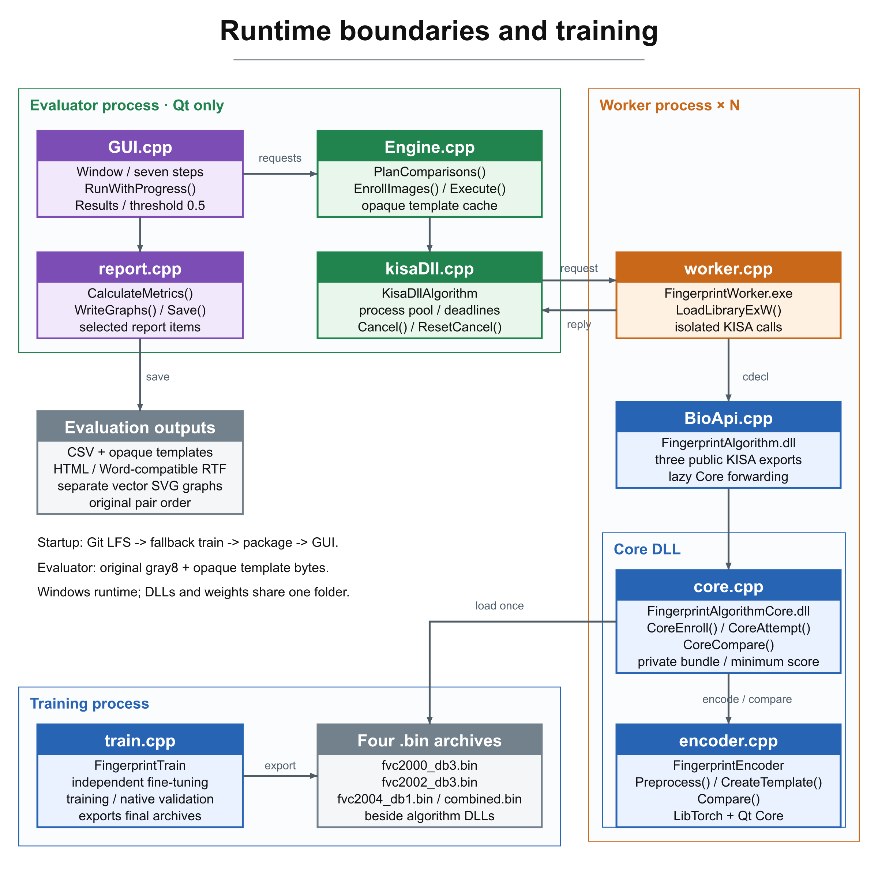
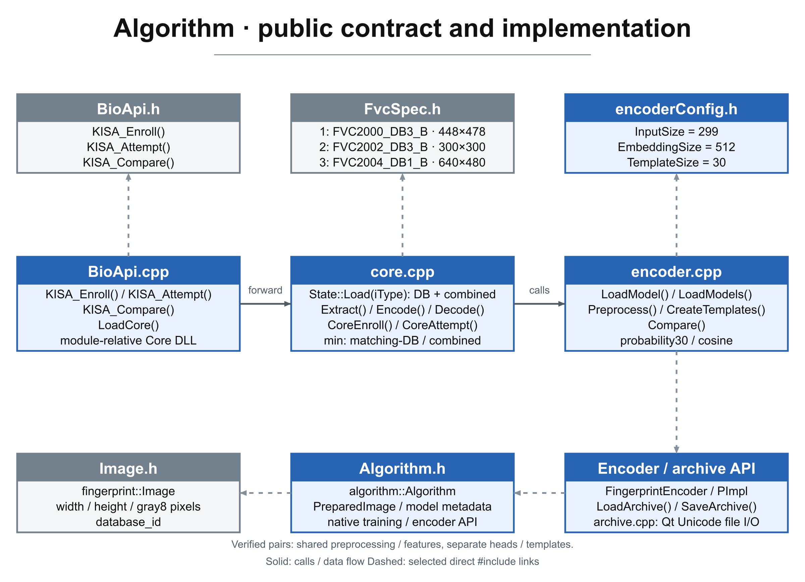
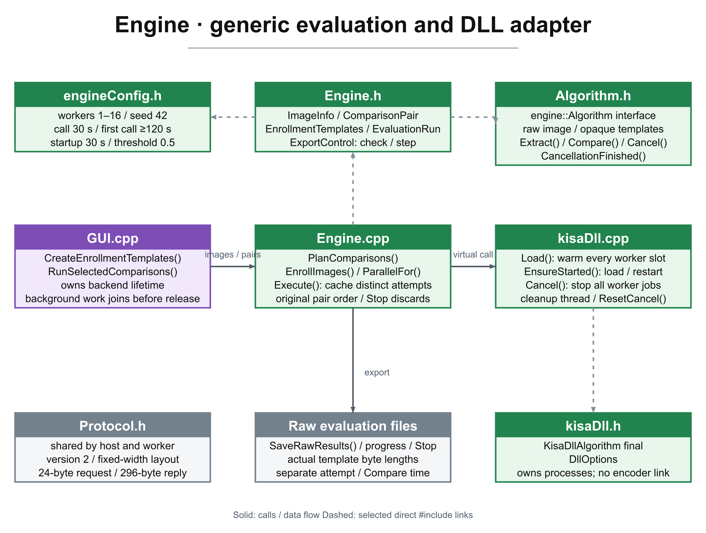
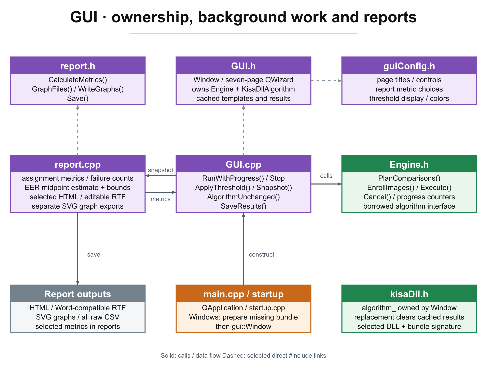
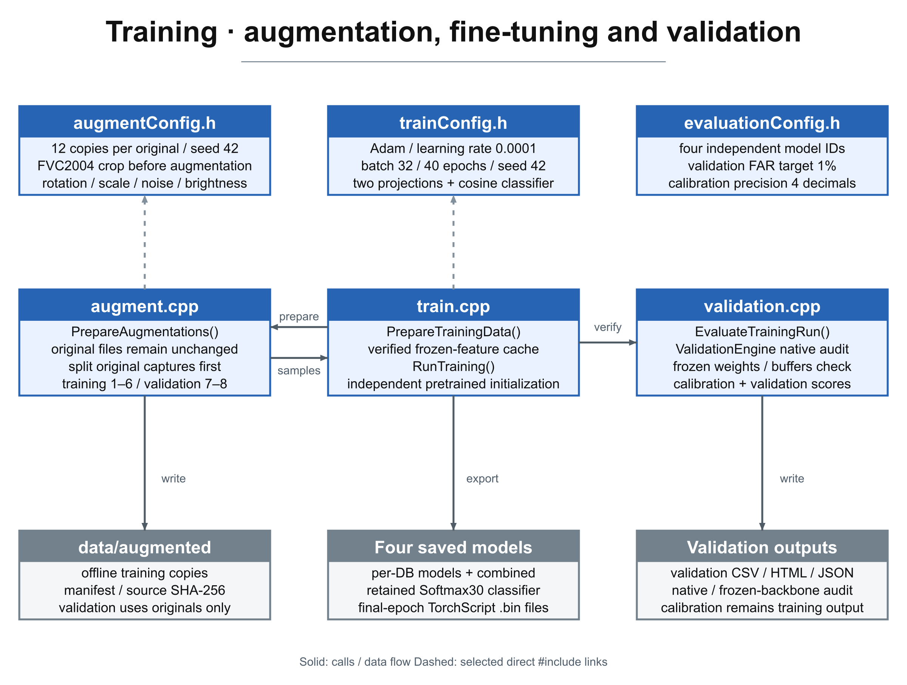
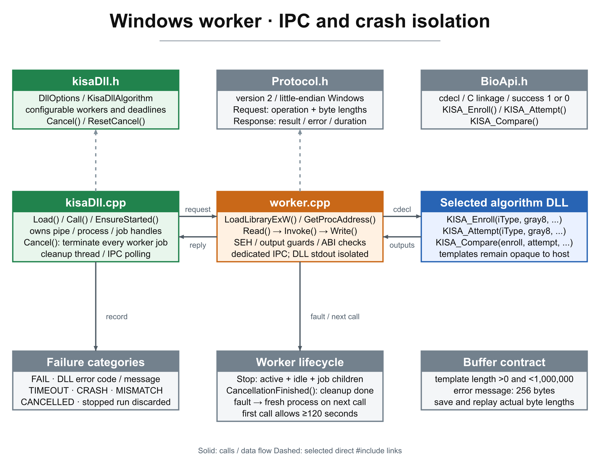
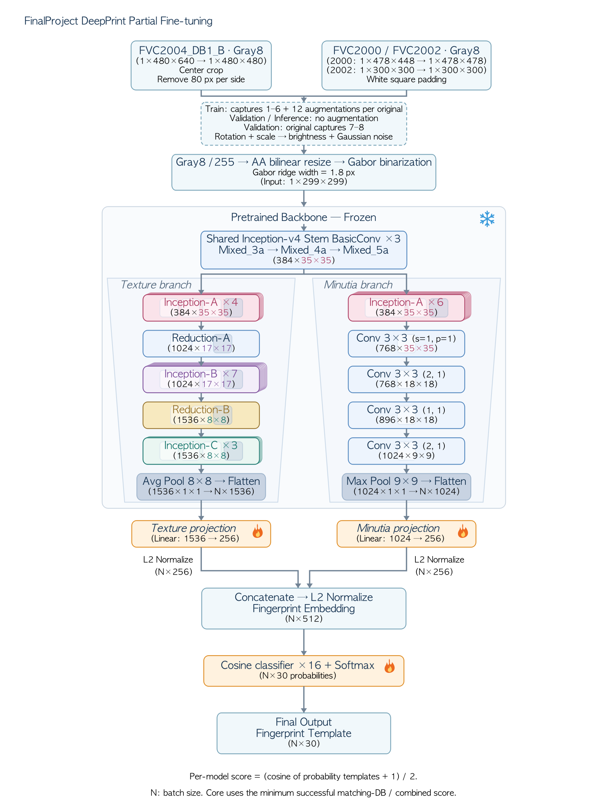
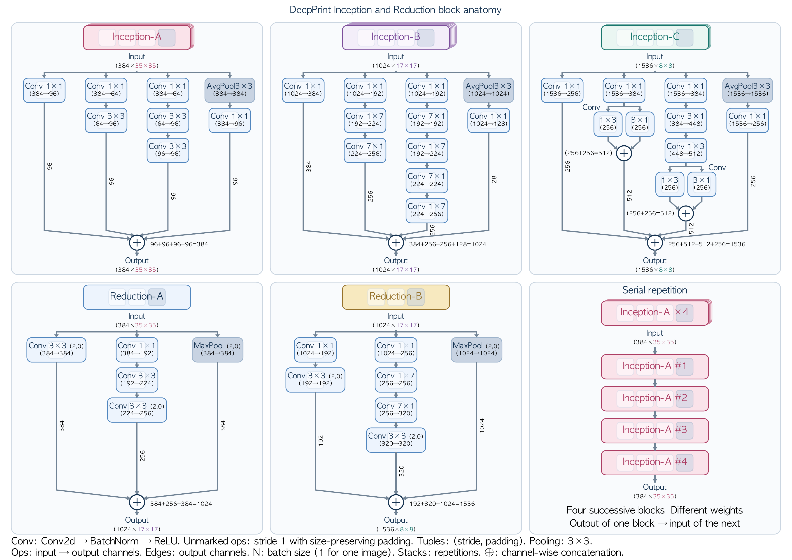

# 다이어그램 안내

SVG는 편집 원본, PNG는 README 표시용입니다. 본문 그림은 본문 폭에 맞춰 aspect ratio를 유지합니다. 아래 thumbnail을 누르면 SVG 원본을 엽니다. 실선은 호출·데이터 흐름이며, 점선은 선택한 직접 `#include` 관계입니다.

| 그림 | 내용 | 모듈 안내 |
|---|---|---|
|  Overview | 평가·worker·DLL·학습 경계 | [소스 안내](../../src/readme.md) · [빌드](../build.md) |
|  Algorithm | 공개 계약, wrapper·Core·encoder | [Public](../../src/Public/readme.md) · [Kisa](../../src/Kisa/readme.md) · [Algorithm](../../src/Algorithm/readme.md) |
|  Engine | 인터페이스·cache·DLL adapter | [Engine](../../src/Engine/readme.md) |
|  GUI | 소유 관계·백그라운드 실행·보고서 | [GUI](../../src/GUI/readme.md) |
|  Training | 증강·학습·검증 | [Training](../../src/Training/readme.md) |
|  Worker | IPC·버퍼·timeout·재시작 | [Worker](../../src/Worker/readme.md) |
|  Fine-tuning | Backbone·projection·cosine classifier | [Training](../../src/Training/readme.md) · [학습 설정](../baseline/training_configuration.md) |
|  Blocks | Inception·Reduction 내부 경로 | [Algorithm](../../src/Algorithm/readme.md) · [upstream 소스](../../third_party/deepprint/flx/models/InceptionV4.py) |

`source_manifest.json`은 기준 소스의 SHA-256을 기록합니다. [스타일](../diagram_style.md) · [검증 상태](../verification.md)
