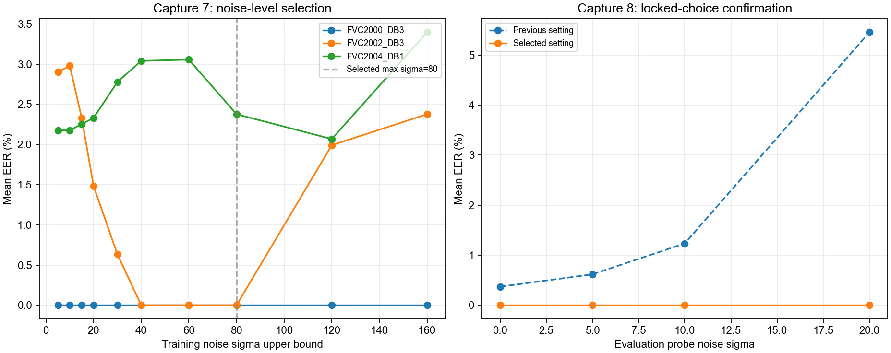

# Gaussian noise 증강 비교 — 2026-11-22

기존 σ=[1,5]에서 상한만 [5, 10, 15, 20, 30, 40, 60, 80, 120, 160]로 바꿔 모델 4개씩 학습했습니다. Capture 7 기준으로 선택한 설정은 **σ=[1,80]·적용 확률 70%**입니다. 여기서 최적은 제공된 데이터·후보 범위·고정 seed 내의 선택이며 일반적인 최적값을 뜻하지 않습니다.

최종 배포 설정은 **σ=[1,80]**입니다. 선택 후보는 Capture 8에서도 DB별 원본 EER가 악화되지 않아야 채택합니다. 악화되면 사전에 고정한 기존 설정을 유지하며 Capture 8로 다른 noise 수준을 재선택하지 않습니다.

## 실험 조건

- 원본 240장·30개 DB:finger identity. 원본 픽셀 중복 그룹 0개. 원본 파일을 수정하지 않았습니다.
- Capture 1–6 학습, 7 후보 선택, 8 선택 잠금 후 확인. 평가 gallery는 capture 1–6의 원본입니다. Capture 7/8의 증강본은 학습에 넣지 않았습니다.
- 기존 Training 검증이 생성하는 capture 7/8 통합 CE·calibration은 noise 선택에 사용하지 않았습니다. 별도 분석의 capture 7 EER로만 선택하며, 학습은 validation loss와 관계없이 40 epochs를 수행합니다.
- 원본당 증강 12개, noise 확률 .7·최소 σ=1 고정. 회전·배율·밝기·crop·seed 및 전체 증강 수를 고정하고 noise 최대 σ만 변경했습니다.
- Adam·40 epochs·batch 32·lr/weight_decay=.0001·seed 42 유지. 모델마다 같은 pretrained에서 독립 초기화하고 projection 2개와 cosine head만 학습했습니다. 최종 epoch를 export했습니다.
- 평가 probe는 clean 및 Gaussian σ=5/10/20. 비영 σ마다 독립 seed 3개를 사용했으며, 모든 후보에 같은 noise realization을 적용했습니다. Gallery는 clean입니다.
- clean은 추가 Gaussian noise가 없는 원본을 뜻합니다. 원래 촬영에 포함된 노이즈·부분 지문과 기존 전처리 정책은 그대로입니다.
- 실제 DLL과 같은 matching-DB·combined 점수의 최솟값을 기준으로 비교했습니다. DB와 noise 수준을 동일 가중하고, seed별 EER를 먼저 평균했습니다.
- 사용자 요청에 따라 원본 성능 유지가 우선입니다. Capture 7의 평균 및 각 DB clean EER가 기존보다 나빠지지 않는 후보 중 noise 포함 평균 EER가 가장 작은 설정을 선택합니다. 동률이면 clean EER, 그다음 작은 noise 상한을 우선합니다.
- 학습·평가는 임시 native Qt·LibTorch CPU 실행 파일로 수행했습니다. Windows 지원 코드와 공개 ABI는 변경하지 않았습니다.

## 후보 비교

EER는 %이며 작을수록 좋습니다. 평균은 clean·σ5·σ10·σ20을 동일 가중한 값입니다. Capture 8 값은 후보 선택이 완료된 뒤 계산했습니다.

EER는 기존 Training validation처럼 FMR/FNMR 교차 구간을 선형 보간합니다. GUI 보고서의 과제 기준 midpoint·구간 표시와는 계산 표현이 다릅니다.

| 학습 σ 범위 | Capture 7 평균 EER | Capture 7 clean EER | Capture 8 평균 EER | Capture 8 clean EER | 선택 |
|---|---:|---:|---:|---:|---|
| 1–5 | 1.6924 | 0.3704 | 1.9187 | 0.3704 | 기존 |
| 1–10 | 1.7181 | 0.3704 | 1.7644 | 0.3704 |  |
| 1–15 | 1.5278 | 0.3704 | 1.1780 | 0.0000 |  |
| 1–20 | 1.2706 | 0.3704 | 0.9259 | 0.0000 |  |
| 1–30 | 1.1368 | 0.7407 | 0.9053 | 0.3704 |  |
| 1–40 | 1.0134 | 0.7407 | 0.2572 | 0.0000 |  |
| 1–60 | 1.0185 | 0.3704 | 0.0617 | 0.0000 |  |
| 1–80 | 0.7922 | 0.3704 | 0.0000 | 0.0000 | 배포 |
| 1–120 | 1.3529 | 1.6049 | 0.2006 | 0.0000 |  |
| 1–160 | 1.9239 | 1.9753 | 0.5761 | 0.0000 |  |

## 선택 후 DB별 확인

Capture 8에서 기존 → 선택 설정의 EER입니다.

| DB | Clean | σ5 | σ10 | σ20 |
|---|---:|---:|---:|---:|
| FVC2000_DB3_B | 0.0000 → 0.0000 | 0.0000 → 0.0000 | 0.0000 → 0.0000 | 0.0000 → 0.0000 |
| FVC2002_DB3_B | 1.1111 → 0.0000 | 1.8519 → 0.0000 | 3.7037 → 0.0000 | 16.3580 → 0.0000 |
| FVC2004_DB1_B | 0.0000 → 0.0000 | 0.0000 → 0.0000 | 0.0000 → 0.0000 | 0.0000 → 0.0000 |

## 모델 4개별 비교

각 .bin을 단독 사용한 Capture 8 진단입니다. 실제 DLL의 matching-DB·combined 최소 점수 결과는 위 표를 사용합니다.

| 모델 | 평가 DB | Clean EER (기존 → 선택) | 4조건 평균 EER (기존 → 선택) |
|---|---|---:|---:|
| fvc2000_db3 | FVC2000_DB3_B | 0.0000 → 0.0000 | 0.0000 → 0.0000 |
| fvc2002_db3 | FVC2002_DB3_B | 1.1111 → 0.0000 | 6.6821 → 0.0926 |
| fvc2004_db1 | FVC2004_DB1_B | 0.0000 → 0.0000 | 0.0000 → 0.0000 |
| combined | 3 DB 평균 | 0.3704 → 0.0000 | 1.2860 → 0.0000 |

Capture 8 평균 EER 변화(선택−기존)는 **-1.9187 percentage points**입니다. Probe identity 단위 paired bootstrap 1,000회의 조건부 95% 구간은 **[-3.3080, +0.0000] pp**입니다. Gallery와 학습 seed는 고정했으므로 이 구간이 학습 전체의 불확실성을 나타내지는 않습니다. 구간에 0이 포함되므로 통계적으로 확정적인 개선이라고 단정하지 않습니다.

## 추가 Training seed 확인

Noise 선택을 잠근 뒤 동일한 feature·split에서 training seed 43·44로 기존/선택 설정을 각각 다시 학습했습니다. 이 결과로 noise 수준을 다시 고르지 않았고, 배포 모델은 기존과 같은 seed 42를 사용합니다.

| Training seed | 기존 Capture 8 평균 EER | 선택 Capture 8 평균 EER | 선택−기존 (pp) |
|---|---:|---:|---:|
| 42 | 1.9187 | 0.0000 | -1.9187 |
| 43 | 1.6204 | 0.0000 | -1.6204 |
| 44 | 1.7027 | 0.0309 | -1.6718 |

## Threshold와 한계

- CSV의 Capture 8 deployed TAR/FAR에는 Capture 7 clean에서 정한 threshold를 고정 적용했습니다. Capture 8로 threshold를 재조정하지 않았습니다. 개별 모델의 within_split_empirical 행은 진단용 운영점입니다.
- 동일 identity의 다른 capture를 평가했으며, 학습에 없던 finger identity에 대한 독립 test는 아닙니다. DB별 10개 identity·10개 confirmation probe로 작습니다. Noise seed 3회와 bootstrap은 새로운 실제 촬영 데이터를 대체하지 않습니다.
- Gaussian noise에 대한 비교이며 실제 센서의 blur·압력·오염·부분 지문 등 모든 열화를 대표하지 않습니다.
- GUI 기본 threshold .5는 유지합니다. 이 모델은 nonnegative probability cosine을 (cos+1)/2로 변환하므로 점수가 .5 이상입니다. 성능 비교에는 threshold sweep의 EER와 별도 calibration을 사용했으며, 기본 .5의 단순 정답률로 개선을 판단하지 않았습니다.
- 실제 Windows DLL/GUI 재실행 검증은 별도로 필요합니다.

## 보존·검증

- 기존 설정 재학습과 기존 배포 모델의 parameter 차이 및 buffer 일치를 확인했습니다. 모든 후보의 geometry·brightness·split은 같고, noise가 꺼진 증강 이미지도 byte 단위로 같습니다.
- 모든 학습 결과는 native 저장·재로딩 batch 1/2/4, self-score, frozen Backbone·BatchNorm buffer 보존, native Template·점수 검증을 수행했습니다.
- 배포 대상 모델은 한글·공백 배포 경로로 옮긴 실제 C++ Core/Algorithm에서도 세 FVC 타입의 Enroll/Attempt/Compare와 matching-DB·combined 최소 점수를 대조했습니다. 모듈 경로 WinAPI만 검증용 shim이며 실제 Windows 실행은 아닙니다.
- 최종 배포 대상은 fvc2000_db3.bin, fvc2002_db3.bin, fvc2004_db1.bin, combined.bin입니다. SHA-256은 models/trained_result/weights.json에 기록합니다.
- 실험용 source·실행 파일·이미지·feature cache·log를 정리했습니다. 비교용·이전 weight 60개는 로컬 Git 제외 폴더 `models/noise_experiment_weights/noise_augmentation_20261121/`에 보관하며, 최종 분석 자료는 이 문서와 함께 보존합니다.

[그래프 SVG](noise_augmentation_comparison.svg) · [전체 지표 CSV](noise_augmentation_metrics.csv) · [추가 seed 지표 CSV](noise_augmentation_replicate_metrics.csv) · [실험·검증 JSON](noise_augmentation_results.json) · [학습 안내](../../src/Training/readme.md)
