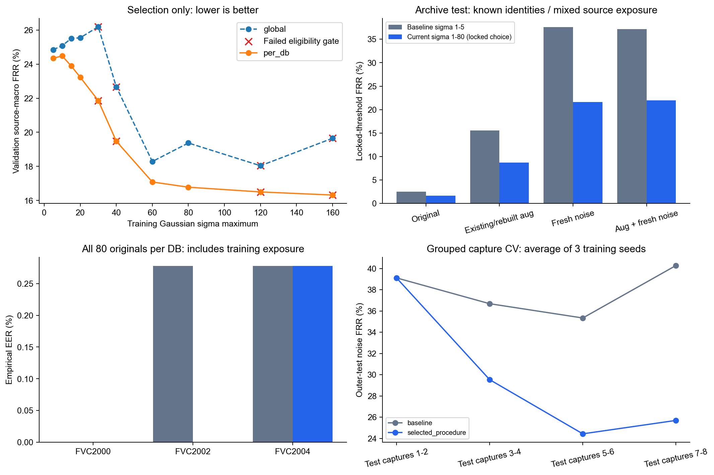
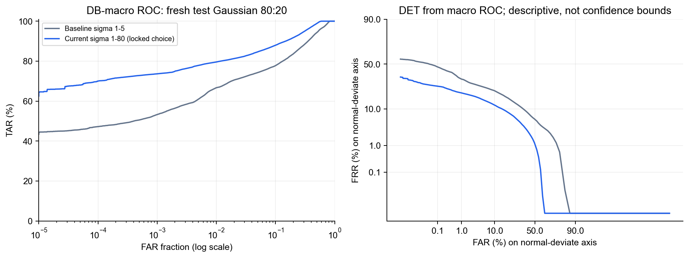
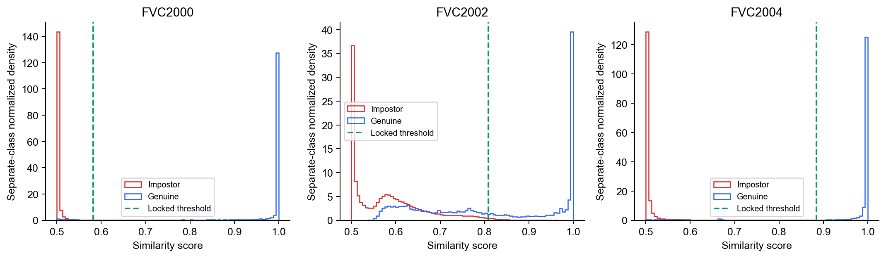
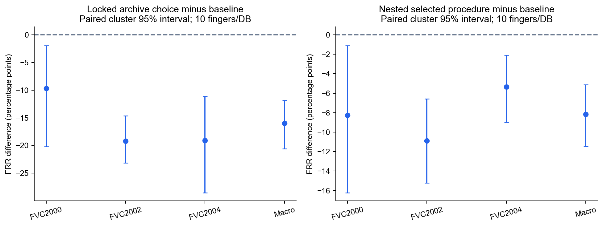

# Noise 증강·Threshold 후속 평가 — 2026-11-22

보관된 모델의 Validation 선택은 **noise_80_seed42 · per_db threshold**입니다. 현재 production 모델과 가중치가 같습니다.

**이 연구의 최적은 지정한 데이터·후보·FAR 목표 안의 선택입니다. 처음 보는 지문·센서에 대한 일반적인 최적값이나 오류율 0을 입증한 결과가 아닙니다.**

**적용 결정: 현재 sigma=[1,80] 모델을 reference로 유지합니다. 새로운 bundle의 엄격한 성능 개선은 확립되지 않았습니다.** Archive 원본 전수 검사에서는 DB별 비악화를 관찰했지만, 학습에서 capture를 보류한 nested 선택 절차는 원본의 FAR·FRR·EER를 모든 DB에서 보존한다는 zero-margin 조건을 통과하지 못했습니다.

가중치 4개와 GUI 기본 threshold는 변경하지 않았습니다. 선정 threshold는 실험용 profile로 제공합니다. 실제 Windows 실행은 이번 환경에서 수행하지 못했습니다.

## 입력과 평가 범위

| 항목 | 수량·구분 |
|---|---|
| 원본 | 240장, DB별 80장·10개 finger identity |
| 기존 증강 | 두 manifest의 5,760장 모두 검증 |
| 재생성 증강 | noise 상한 10수준 × 2,880장 = 28,800장 |
| Static corpus | 원본 포함 logical 34,800건, DB·픽셀 기준 고유 입력 22,419개 |
| 새로운 noise | 원본 36,000건 + 기존 증강에 추가한 compound 12,000건 |
| 원본 전수 비교 | DB별 Genuine 280·Impostor 2,880, 전체 9,480쌍 |
| Archive 후보 | 14개 고유 학습 bundle; previous_production은 sigma5·seed42와 parameter 동일 |
| 추가 학습 | 4 outer folds × 10수준 × 3 training seeds = 120 bundle·480 model heads |
| 구현 재현 확인 | 기존 설정 전체 재학습 1 bundle·4 heads 추가 |

같은 원본의 모든 descendant는 같은 split에 묶었습니다. 같은 source capture끼리의 비교와 동일 픽셀 복제 비교는 주 평가에서 제외했습니다. 원본 파일과 pretrained는 보존했습니다. 모델 4개는 해당 DB 전용 모델과 combined 모델 점수의 최솟값으로 판정합니다.

Static 전수 검사는 학습·기존 선정에 노출된 자료도 포함하는 회귀 검사입니다. 새로운 noise seed는 새로운 촬영본이나 새로운 identity를 의미하지 않습니다.

원본은 FVC2000 448×478, FVC2002 300×300, FVC2004 640×480의 gray8 TIFF이며 240장 모두 `L` mode입니다. 기존 증강 5,760장에는 manifest 밖 이미지·누락·decode 실패가 없었습니다. 서로 다른 source parent 사이의 동일 픽셀 그룹도 0개입니다.

재생성 sigma5의 2,880장은 기존 crop-first v2 파일과 SHA-256이 정확히 같았습니다. 다른 9수준은 보존된 설정·seed와 같은 native augmentation으로 **재구성한** corpus입니다. 삭제됐던 과거 파일 자체와 byte 비교한 것으로 표현하지 않습니다. 고유 증강 probe는 22,182개이며 이 중 3개가 원본과 픽셀이 같아, 원본과 합친 고유 static 입력은 22,419개입니다. Alias는 lineage에 보존했습니다.

새 noise 48,000건 중 선정용은 원본 12,000·compound 4,800건, 별도 최종 Test는 원본 24,000·compound 7,200건입니다. 모든 noise 픽셀 hash와 sigma를 독립 재생성 기록과 전수 대조했습니다. 전체 logical lineage는 82,800건입니다.

Training의 noise도 full-frame입니다. `foreground<235`는 geometry clipping 검사에 쓰며 noise mask가 아닙니다. Compound는 기존 crop-first sigma5 family에서 원본·seed별 한 copy를 순환하는 **bounded coverage**이며, 추가 sigma는 이미 존재하는 증강 noise까지 합친 총 sigma를 뜻하지 않습니다. 모든 static family × 모든 새 noise의 Cartesian product를 평가한 것은 아닙니다.

Pretrained 출처는 고정 upstream commit의 [README](../../third_party/deepprint/README.md)와 [checkpoint metadata](../../models/pretrained/deepprint.json)를 확인했습니다. Upstream은 SFinGe·MCYT 학습을 설명하고 FVC2004/SD4는 논문에서 사용하지 않았다고 기록합니다. 그러나 다운로드 checkpoint의 파일별 학습 manifest가 없어 FVC와의 overlap을 독립적으로 완전히 배제할 수 없습니다. 따라서 unseen-capture 결론도 이 pretrained를 전제로 합니다. 별도의 미사용 finger identity는 없어 unseen-identity 평가는 수행하지 못했습니다.

## 사전 규칙과 split

원본별·seed별 Gaussian noise 10건 중 8건은 sigma=[1,80], 2건은 sigma=(80,160]에서 sigma를 Uniform으로 뽑고 픽셀 noise는 Normal(0,sigma²)로 생성했습니다. 기준은 현재 production의 학습 범위이며, 120·160 모델은 일부 밖 범위 amplitude를 학습한 적이 있습니다. 모든 후보에 같은 픽셀을 적용했습니다.

선정용 seed 5개와 별도 Test seed 10개를 사용했습니다. Compound는 원본마다 기존 증강 하나를 순환 선택해 선정 2개·Test 3개 seed에서 검사했습니다. Noise는 full-frame에 더하고 gray8 clamp·반올림했습니다. 학습의 noise 적용 확률 70%와 평가의 80:20 mixture는 서로 다른 조건입니다.

원본당 증강 12개·기하/밝기·Adam·40 epochs·batch32·lr/weight_decay=.0001·Cosine scale16을 고정했습니다. Frozen Backbone feature를 공유하고 모델마다 같은 pretrained의 projection 2개를 복사했습니다. Retained30 classifier는 정해진 training seed로 초기화해 이 부분과 projection만 학습했습니다. 새 학습 결과는 frozen pretrained를 참조하는 compact head checkpoint로 보관합니다.

Outer Test capture는 [1,2], [3,4], [5,6], [7,8]입니다. 다음 cyclic capture pair가 inner Validation이고, 나머지 4개 capture로 학습합니다. 각 원본이 한 번씩 자신의 모델에서 제외된 채 Test에 등장합니다. Fold 모델은 원본 4개 capture로 학습하므로 6개 capture로 학습한 production bundle과 직접 동일시할 수 없습니다.

Protocol은 먼저 저장했고, 계산 범위·threshold 규칙의 보강은 JSON에 시점과 이전 hash를 남겼습니다. Clean 회귀 pilot은 이미 확인한 상태에서 calibration을 4개 평가군으로 확대했으며, 당시 새 noise 성능·outer Test 결과는 보지 않았습니다. 같은 데이터의 과거 결과를 알고 설계한 후속 연구이므로 외부의 pristine 독립 검증이라고 부르지 않습니다.

## Threshold 선정

각 inner Validation의 clean·static augmentation·noisy original·compound 각각에서 FAR ≤ 1%를 만족하는 가장 낮은 4자리 threshold를 선택했습니다. Genuine과 Impostor에 같은 값을 적용하며, Test의 noise 강도·seed별로 재조정하지 않았습니다. Global과 DB별 정책을 Validation에서 비교했습니다.

| DB | 잠근 threshold |
|---|---:|
| FVC2000_DB3_B | 0.5824 |
| FVC2002_DB3_B | 0.8086 |
| FVC2004_DB1_B | 0.8842 |

현재 GUI 기본값 0.5는 우리 점수 범위 [0.5,1]에서 모든 성공한 비교를 수락합니다. 원본 전수 검사에서 Impostor FAR=100%였습니다. 이는 score가 같은 지문일 확률이라는 뜻이 아니며, 이 profile을 다른 팀 DLL이나 외부 DB에 적용할 수 없습니다.

Threshold 변경은 FAR·FRR·판정을 바꾸지만 같은 score들의 EER·ROC-AUC를 바꾸지 않습니다. FAR 1%는 이 연구의 Validation 목표이며 Test 보장값이 아닙니다.

세 training seeds의 sigma80 calibration입니다. Seed42만 production reference이며, 다른 seed의 threshold를 현재 bin에 적용하지 않습니다.

| DB | Seed42 | Seed43 | Seed44 |
|---|---:|---:|---:|
| FVC2000_DB3_B | 0.5824 | 0.5923 | 0.5777 |
| FVC2002_DB3_B | 0.8086 | 0.8047 | 0.7999 |
| FVC2004_DB1_B | 0.8842 | 0.8468 | 0.7996 |

같은 current score에 대한 사전 고정 global threshold는 0.8842입니다. 두 정책의 Test 진단은 다음과 같으며 재선정에 사용하지 않았습니다.

| 정책 | 원본 FRR | 새 noise FAR | 새 noise FRR |
|---|---:|---:|---:|
| global | 2.2619% | 0.1259% | 26.3488% |
| per_db | 1.6667% | 0.9014% | 21.5923% |

4자리 반올림은 FAR를 증가시키지 않도록 위로 올렸습니다. FAR 제약을 만족하는 threshold가 1을 넘으면 infeasible로 표시하고, threshold1의 진단값을 목표 달성으로 취급하지 않았습니다. Profile은 정확한 4개 weight SHA·preprocessing source hash·seed42에 연결되며 실제 Windows DLL SHA는 아직 없습니다.

## Archive의 고정 threshold Test

| 입력 | 기존 sigma5 EER | 선정 EER | 기존 FAR → 선정 FAR | 기존 FRR → 선정 FRR |
|---|---:|---:|---:|---:|
| 전체 원본 | 0.1852% | 0.0926% | 0.0810% → 0.0810% | 2.5000% → 1.6667% |
| 고유 기존·재생성 증강 | 5.8057% | 3.2860% | 0.3881% → 0.3867% | 15.5744% → 8.6873% |
| 새 noise 원본, 80:20 | 14.1712% | 8.9741% | 0.9911% → 0.9014% | 37.5750% → 21.5923% |
| 기존 증강 + 새 noise | 13.9960% | 8.9915% | 0.9014% → 0.8511% | 37.1329% → 21.9861% |

표는 DB별 수치의 macro 평균입니다. Static 이미지 수가 원본을 압도하지 않도록 선정 objective는 source·augmentation family를 먼저 평균한 FRR를 사용했습니다. 표의 FAR/FRR는 비교 쌍 기준이며 source-macro 값도 CSV에 제공합니다.



원본 주 지표는 DB별 unique unordered pair의 FAR·FRR를 평균합니다. CSV의 `source_macro_*`는 probe 방향 진단값이며, full-original 상삼각 행에서는 주 결과로 사용하지 않습니다. Static 선정 objective는 source·family를 먼저 평균하지만 아래 descriptive Test 지표는 해당 조건의 유효 비교 쌍을 사용합니다.

### 새 noise의 범위와 DB 차이

| 조건 | 기존 EER → current EER | 기존 FAR → current FAR | 기존 FRR → current FRR |
|---|---:|---:|---:|
| Weak [1,27.33) | 1.4559% → 0.3411% | 0.1470% → 0.1321% | 6.7816% → 2.0402% |
| Medium [27.33,53.67) | 10.3798% → 3.7273% | 0.8892% → 0.4545% | 30.7423% → 12.3105% |
| Strong [53.67,80] | 18.2581% → 12.0813% | 1.5756% → 1.0265% | 49.3893% → 29.4011% |
| In-range [1,80] | 10.4182% → 5.5072% | 0.8735% → 0.5407% | 29.0618% → 14.7068% |
| Out-of-range (80,160] | 27.8908% → 21.4842% | 1.4618% → 2.3443% | 71.6280% → 49.1339% |

| DB | 새 noise 80:20 EER / FAR / FRR | Out-of-range EER / FAR / FRR |
|---|---:|---:|
| FVC2000_DB3_B | 2.5268% / 1.2019% / 3.9268% | 9.6771% / 4.4158% / 19.6339% |
| FVC2002_DB3_B | 22.1472% / 1.3302% / 52.5821% | 47.7934% / 2.3976% / 97.0536% |
| FVC2004_DB1_B | 2.2482% / 0.1722% / 8.2679% | 6.9821% / 0.2196% / 30.7143% |

**FAR ≤ 1%는 Validation 목표였으며 Test 보장값이 아닙니다.** Current의 FVC2000·FVC2002 80:20 Test FAR는 각각 1.2019%·1.3302%였고, FVC2002 밖 범위 FRR는 97.0536%였습니다. Macro 평균만으로 이 취약점을 가리지 않습니다.

Original Test in-range에서 gray8 saturation은 DB별 약 13.13%·5.86%·43.22%, 추가 noise RMSE는 약 35.59·37.86·30.27입니다. Out-of-range는 saturation 37.21%·31.98%·49.14%, RMSE 84.69·86.26·82.08입니다. Saturation에는 원래 white background가 포함되므로 모두 새 정보 손실로 해석하지 않습니다. 같은 명목 sigma도 DB별 실제 clipping·유효 손상이 다릅니다. 원시 통계는 `corruption_summary.json`에 있습니다.

### 다른 지표와 gallery 보조 조건

| Current 입력 | ROC-AUC | TAR@empirical FAR≤1% | Balanced Accuracy | Precision | F1 / MCC |
|---|---:|---:|---:|---:|---:|
| clean | 0.999977 | 100.0000% | 99.1262% | 99.1667% | 0.9874 / 0.9863 |
| static_aug | 0.994732 | 93.3366% | 95.4630% | 95.7979% | 0.9334 / 0.9286 |
| noisy_original | 0.960740 | 79.5786% | 88.7531% | 88.1039% | 0.8195 / 0.8125 |
| compound | 0.961935 | 79.7282% | 88.5814% | 88.6913% | 0.8206 / 0.8136 |

TAR@FAR와 partial ROC-AUC는 ROC의 empirical 진단값이며 새로운 Test threshold를 배포한 값이 아닙니다. FAR0.1%는 비교 쌍 수가 최소 1,000일 때만 CSV에 진단값을 기록했습니다. Nested clean의 Impostor 720쌍에서는 N/A입니다. 원본 2,880쌍도 FAR0.1%에서 겨우 2건 수준의 분해능이고 독립 finger는 10개이므로 population low-FAR 인증 근거로 사용하지 않습니다. Partial AUC는 FPR [0,.01] 면적을 .01로 나눈 값입니다.

| 증강 gallery 조건 | 기존 EER → current EER | 기존 FAR → current FAR | 기존 FRR → current FRR |
|---|---:|---:|---:|
| 원본 probe | 0.2315% → 0.1997% | 0.0434% → 0.1360% | 1.8750% → 1.2500% |
| 고유 static 증강 probe | 5.8208% → 3.2953% | 0.3156% → 0.3888% | 15.1832% → 8.3766% |

Gallery는 원본마다 v2 copy01·07 두 장, DB별 160장입니다. 모든 고유 static 증강 probe를 포함하고 같은 source 비교를 제외했습니다. FRR 개선과 FAR 소폭 증가가 함께 있었으며 primary ranking을 바꾸는 데 사용하지 않았습니다.

## 학습에서 제외된 원본과 noise

| Outer Test captures | inner 선택 noise max | 정책 | 원본 EER 기존 → 선정 | 원본 FRR 기존 → 선정 | 새 noise FRR 기존 → 선정 |
|---|---:|---|---:|---:|---:|
| [1, 2] | 5 | per_db | 0.3704% → 0.3704% | 5.4167% → 5.4167% | 39.1111% → 39.1111% |
| [3, 4] | 60 | global | 0.1235% → 0.1235% | 2.2222% → 1.1111% | 36.6819% → 29.5319% |
| [5, 6] | 120 | per_db | 2.9938% → 2.0833% | 8.3333% → 3.3333% | 35.3375% → 24.4319% |
| [7, 8] | 160 | per_db | 0.3395% → 1.2346% | 4.4444% → 3.3333% | 40.2750% → 25.6944% |

각 행은 3 training seeds·3 DB 평균입니다. Outer Test 전에 fold별 선택·threshold를 잠갔습니다. Fold마다 선택 수준이 달라 강도 하나를 보편적 최적으로 단정할 수 없습니다. 이는 기존 fingerprint identity의 새로운 capture 평가이며 unseen identity 평가는 아닙니다.



Nested 원본 Test의 DB별 평균입니다. 각 값은 4 folds × 3 training seeds 평균이며 EER는 pooled score의 EER와 다릅니다.

| DB | EER 기존 → 선택 | FAR 기존 → 선택 | FRR 기존 → 선택 | Zero-margin 관찰 조건 |
|---|---:|---:|---:|---|
| FVC2000_DB3_B | 0.2778% → 0.2778% | 0.2778% → 0.2778% | 3.3333% → 2.5000% | 통과 |
| FVC2002_DB3_B | 2.4537% → 2.4884% | 0.0463% → 0.0694% | 11.9792% → 6.9792% | 미통과 |
| FVC2004_DB1_B | 0.1389% → 0.0926% | 0.4167% → 0.2083% | 0.0000% → 0.4167% | 미통과 |

FVC2002는 평균 FRR 개선과 작은 FAR·EER 증가가 함께 있었고, FVC2004는 baseline의 원본 FRR 0%가 선택 절차에서 0.4167%가 됐습니다. 이는 Test 후 noise 수준이나 threshold를 다시 고를 근거로 사용하지 않았습니다. 고정된 sigma80 자체의 별도 fold 진단은 CSV의 `current_level_diagnostic`이며 fold별 선택 정책을 재사용하므로 sigma80의 독립 최적 정책 비교로 해석하지 않습니다.

| Nested Test 입력 | 기존 EER → 선택 EER | 기존 FAR → 선택 FAR | 기존 FRR → 선택 FRR |
|---|---:|---:|---:|
| clean | 0.9568% → 0.9529% | 0.2469% → 0.1852% | 5.1042% → 3.2986% |
| static_aug | 6.8641% → 5.1062% | 0.3890% → 0.4266% | 18.6413% → 14.1353% |
| noisy_original | 15.2431% → 12.0001% | 0.8871% → 0.6782% | 37.8514% → 29.6924% |
| compound | 15.0791% → 11.7604% | 0.7728% → 0.6323% | 37.7130% → 29.8322% |

## EER 0과 수치 검증

기존 Capture8 결과의 EER 0은 재현됐지만, 전체 원본의 current bundle EER는 DB macro 0.0926%였습니다. 작은 subset에서 분리 가능한 threshold가 있다는 결과를 전체 오류율 0으로 해석할 수 없습니다. 고정 threshold에서의 FAR·FRR는 별도로 확인해야 합니다.

Primary EER는 기존 Training validation과 같은 선형 교차 보간입니다. GUI는 과제 규칙의 bracketing midpoint·bounds를 표시하므로 수치가 다를 수 있습니다. GUI 방식 값과 threshold 근처 ±1e-6 민감도도 별도 기록했습니다.

실제 C++ Core의 원본·noise·compound 30사례에서 score 최대 차이는 5.39e-08, 저장된 native probability로 재계산한 cosine·minimum 차이는 0였습니다. Float32 경로의 기존 검증 tolerance를 적용했으며 exact bit 일치로 과장하지 않습니다.

Archive와 current reference의 64개 모델 파일은 C++ LoadModel의 model ID·metadata·30차원 출력·SHA 검사에 통과했습니다. 원본/기존 증강 18사례의 전처리·feature·head 출력은 native 경로와 일치했고, 전체 baseline 재학습은 parameter 최대 차이 약9.54e-7·735행 probability 최대 차이 약5.96e-7로 재현됐습니다.

원시 score 684개 파일에서 DB:finger label·same-source/pixel 제외·minimum fusion·finite range를 전수 확인했습니다. 18,402개 metric 행의 EER를 독립 계산과 대조했고, 정확한 zero EER 행은 Genuine/Impostor가 모두 존재하고 cross-class tie가 없으며 separation margin이 양수였습니다. 같은 조건의 component·threshold 진단을 포함한 행 수이며 독립 실험 횟수가 아닙니다. `zero_eer_audit.json.gz`에 각 margin을 보존했습니다.

과거 FVC2000 Capture8은 baseline threshold0.5135에서 FP=4/540(0.7407%), current threshold0.5168에서 FP=13/540(2.4074%)였습니다. Current의 최소 Genuine 0.996094와 최대 Impostor 0.566221은 잘 분리됐지만, 선택한 threshold가 Impostor 꼬리보다 낮았습니다. 따라서 EER0과 고정 threshold FAR 상승은 모순이 아닙니다. 새 calibration0.5824는 이번 원본에서 FAR0을 만들었지만 이것도 외부·noise 전체 FAR0 보장은 아닙니다.



ROC/DET 그림의 0·1은 normal-deviate 시각화에서 10^-5 경계로 clip했습니다. 원래 score·metric은 변경하지 않았습니다. C++ ABI에서 FVC2004의 정사각 crop-first 증강을 확인할 때는 480×480을 640×480 white canvas 중앙에 두어 고정 Type 크기를 맞췄고, 이후 center crop의 tensor가 같은지 확인했습니다.

## 불확실성과 적용 결정



Bootstrap은 finger identity를 gallery/probe에서 함께 재표집하고 training/evaluation seed도 paired로 처리했습니다. 개별 비교 쌍·증강본을 독립 표본으로 세지 않았습니다. DB별 10개 finger clusters이며 사람 간 연결 정보는 없어 person-level 독립성까지 확인하지 못했습니다.

모든 오류가 0인 subgroup의 bootstrap 구간이 [0,0]이어도 실제 오류 확률 0이나 엄격한 zero-margin non-inferiority를 입증하지 않습니다. 결과는 고정 데이터·gallery·선정 정책에 조건부인 추정입니다.

선정 bundle의 전체 원본 Test에서 기존 대비 관찰된 FAR·FRR·EER 비악화 조건: **통과**. 이것과 통계적으로 입증된 population non-inferiority는 구분합니다.

현재 4개 bin은 그대로 보존했습니다. 실험용 threshold profile은 자동 적용하지 않으며, 실제 Windows DLL/GUI replay와 적용 범위 확인이 남아 있습니다.

| 평가 | 조건 | FRR 차이 pp [95% CI] | FAR 차이 pp [95% CI] |
|---|---|---:|---:|
| archive | clean | -0.8333 [-2.5000, +0.0000] | +0.0000 [+0.0000, +0.0000] |
| archive | static_aug | -6.8871 [-8.5088, -5.2537] | -0.0014 [-0.2054, +0.2468] |
| archive | noisy_original | -15.9827 [-20.5975, -11.8546] | -0.0897 [-0.7283, +0.4818] |
| archive | compound | -15.1468 [-19.7171, -11.4574] | -0.0503 [-0.5611, +0.4142] |
| nested | clean | -1.8056 [-3.4722, -0.4132] | -0.0617 [-0.2686, +0.0782] |
| nested | static_aug | -4.4946 [-6.1159, -2.9499] | +0.0376 [-0.1770, +0.2682] |
| nested | noisy_original | -8.1590 [-11.4590, -5.1153] | -0.2088 [-0.7809, +0.2266] |
| nested | compound | -7.8808 [-10.9909, -4.9105] | -0.1404 [-0.5597, +0.2546] |

차이는 선택−baseline이며 FRR는 음수가 개선입니다. 새 noise의 macro FRR 개선은 조건부 cluster 분석에서 지지됐지만, FAR 구간은 0을 포함했습니다. 이 구간은 고정 DB·gallery·threshold·모델·capture fold에 조건부입니다. Bootstrap 안에서 모델을 재학습하거나 level/threshold를 다시 고르지 않았고, 새로운 사람·센서의 불확실성을 대표하지 않습니다. CI는 다중 비교 보정 없이 제시한 1,000회 percentile interval입니다. Static nested CI는 fold의 유효 비교 건수를 DB 안에서 합친 추정이라, 표의 단순 fold 평균과 소폭 다를 수 있습니다.

### Seed 변동과 학습에서 얻은 메시지

| 수준 | 3 training seeds의 noise EER 평균±SD | noise FRR 평균±SD |
|---|---:|---:|
| sigma1-5 | 14.0905% ± 0.0777 | 37.6464% ± 0.0945 |
| sigma1-80 | 8.8731% ± 0.1093 | 21.5875% ± 0.1953 |

Training seed42를 Test로 교체하지 않았습니다. 각 seed는 같은 규칙의 별도 Validation threshold를 사용합니다. 같은 seed42 current의 10개 Test noise seed별 DB-macro EER는 다음 범위였습니다.
EER 8.8385~9.2669%, FRR 20.9583~22.0536%. 이는 고정 원본에서의 corruption seed 변동이며 새로운 촬영 데이터 10세트를 뜻하지 않습니다.

Validation의 source/family-macro FRR objective는 sigma5 24.3454%, sigma60 17.0865%, sigma80 16.7792%였습니다. Sigma60은 약한 대안으로 가깝지만 통계적 동등성은 입증하지 않았습니다. Sigma120·160은 objective를 더 낮췄어도 FVC2002의 원본 Validation EER가 3.7037%로 올라 clean gate에서 제외됐습니다. Fold 선택이 5/60/120/160으로 달라지는 점도 안정적인 단일 최적 강도를 뒷받침하지 않습니다.

강한 noise 학습은 이 데이터에서 fresh-noise·static 증강의 FRR를 줄였지만, 원본의 모든 DB와 운영점을 동시에 최적화하지 못했습니다. 특히 FVC2002의 강한/밖 범위 noise에서 점수 분포가 크게 겹칩니다. Threshold는 operating point를 옮길 뿐, 겹친 분포나 높은 EER를 복구할 수 없습니다.

보조 probability 진단은 선택 이후에만 확인했습니다. 아래는 current의 새 noise 80:20에서 closed-set classifier 동작입니다. Template 비교의 확률 보정이나 unseen identity 인증으로 해석하지 않습니다.

| DB | specialized top1 | combined top1 | 둘 다 같은 오답 class |
|---|---:|---:|---:|
| FVC2000_DB3_B | 93.688% | 92.112% | 2.975% |
| FVC2002_DB3_B | 56.100% | 57.663% | 34.163% |
| FVC2004_DB1_B | 96.737% | 94.388% | 0.637% |

Original 전체의 좋은 수치에는 captures1–6 학습 노출과 기존에 확인한 capture7/8이 포함됩니다. Unseen noise의 개선은 확인했지만 unseen identity·센서·실제 pressure/blur/오염 전반에 대한 성능은 아직 뒷받침되지 않습니다.

## 측정과 재현 자료

별도 native Core timing probe는 다른 연구 계산이 끝난 뒤 수행했습니다. 12회 Extract 중 첫 호출 6963.6ms, 나머지 11회의 median 299.8ms·p95 354.1ms, 순차 throughput 3.23 images/s였습니다. 1,000회 cached-template Compare는 median 0.079ms·p95 0.080ms, 순차 throughput 12505 pairs/s였습니다. Peak RSS는 1.54 GiB입니다. macOS ARM의 검증용 module-path shim·현재 C++ Core·현재 가중치 결과이며 Windows 성능·Worker timeout 측정이 아닙니다. Image decode는 시간에서 제외했고 작은 timing sample의 p95입니다.

전체 metrics에는 EER·ROC-AUC·low-FAR partial AUC·TAR@FAR·FAR·FRR·Balanced Accuracy·Precision·Recall·F1·MCC·confusion counts를 포함했습니다. Precision/F1/accuracy는 비교 쌍의 Genuine 비율에 영향을 받습니다. 실제 Windows의 timeout/IPC 실패율은 미측정이며 0이라고 기록하지 않습니다.

| 실패율 범위 | 측정 결과 |
|---|---|
| Research 입력 decode·feature·probability | 70,419 unique 입력 전체 finite, 실패·분모에서 빠진 입력 0 |
| Research comparison | 모든 유효 raw score finite, 실패 0. 성공 matcher와 이 research task의 결과가 같음 |
| Native Core 표본 | 30쌍 parity 검사 실패 0; 별도 timing의 Extract12·Compare1000 실패 0 |
| 실제 Windows FTE·REJ·timeout·IPC | 미측정, N/A |

실패를 낮은 점수로 대체하거나 실패한 입력을 몰래 제외하지 않았습니다. Self/same-source/pixel 제외는 비교 protocol의 규칙이며 실패가 아닙니다. Native 표본의 성공이 전체 Windows 실행의 실패율 0을 뜻하지 않습니다. 개별 specialized·combined metric은 같은 deployed threshold를 적용한 진단값이며 각 component의 독립 최적 운영점이 아닙니다.

[Primary 요약 CSV](noise_followup_summary.csv) · [증강 gallery 보조 CSV](noise_followup_secondary_summary.csv) · [결과 JSON](noise_followup_results.json) · [Protocol JSON](noise_followup_protocol.json) · [실험용 threshold profile](noise_followup_calibration.json)

[후보·SHA inventory](noise_followup_inventory.csv) · [원본 Windows replay CSV·예상 score](noise_followup_replay/manifest.json) · [전체 artifact 경로·SHA](noise_followup_artifacts.json)

대형 원시 score·lineage·manifest·checkpoint는 로컬 Git 제외 경로 `models/noise_experiment_weights/noise_followup_20261122/`에 보관합니다. `input_lineage.jsonl.gz`, `raw_archive_scores/`, `raw_fold_scores/`, `raw_secondary_scores/`, `trained_heads/`, `lineage_manifests/`에서 추적할 수 있습니다.

Windows replay는 GUI에서 해당 DB 원본 80장을 선택·Enroll하고, [`noise_followup_replay/`](noise_followup_replay/manifest.json)의 Genuine/Impostor CSV를 각 단계에서 사용합니다. 같은 폴더의 compressed expected score CSV는 current seed42의 9,480쌍 기준값입니다. Weight SHA는 manifest와 대조하고 실행한 Windows DLL의 SHA도 별도 기록합니다. Profile의 DLL SHA는 미측정(null)입니다. 양쪽 Results에는 동일한 해당 DB threshold를 입력합니다. EER 방식 차이와 float32 tolerance를 고려해 원시 score·FAR·FRR를 비교합니다.

실제 Windows에서 실행할 명령:

```powershell
Set-ExecutionPolicy -Scope Process -ExecutionPolicy Bypass -Force
.\tools\setup_windows.ps1
if (-not $?) { throw "Setup failed." }
Get-FileHash .\dist\FingerprintAlgorithm\FingerprintAlgorithm.dll -Algorithm SHA256
Get-FileHash .\dist\FingerprintAlgorithm\*.bin -Algorithm SHA256
.\dist\FingerprintEvaluator\FingerprintGUI.exe
```

이번 후속 실험에서 생성한 source·실행 파일·생성 이미지·feature/prediction cache·log는 증거 저장·검증을 마친 뒤 제거했습니다. 기존 증강·과거 archive·새 head weights는 보존합니다. Head checkpoint는 4개 모델의 trainable state와 receipt의 immutable pretrained SHA를 함께 사용하는 형식이며 바로 배포하는 `.bin`과 구분합니다.

이 연구 때문에 새로운 production 의존성을 추가하지 않았습니다. 학습에 없던 finger identity·센서·실제 오염/압력/blur 전반에 대한 독립 성능은 입증되지 않았습니다. Gaussian 범위와 고정된 preprocessing/architecture/fusion 안의 결과입니다.

기존 연구: [Noise 증강 비교](noise_augmentation.md). 평가 원칙 참고: [NIST ROC·운영점 분석](https://www.nist.gov/publications/operational-measures-and-accuracies-roc-curve-large-fingerprint-data-sets), [Threshold tuning](https://scikit-learn.org/stable/modules/classification_threshold.html), [Group 기반 cross-validation](https://scikit-learn.org/stable/modules/cross_validation.html#cross-validation-iterators-for-grouped-data).
