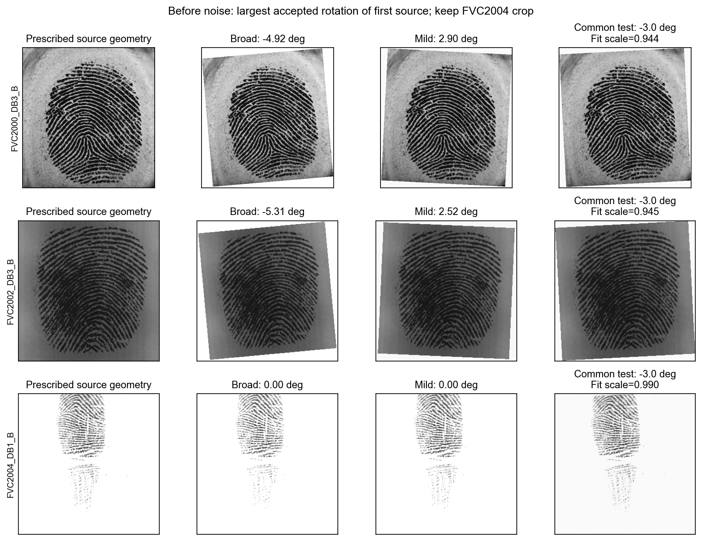
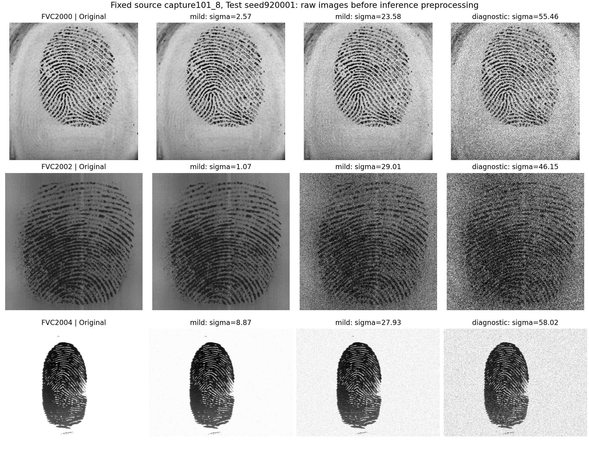
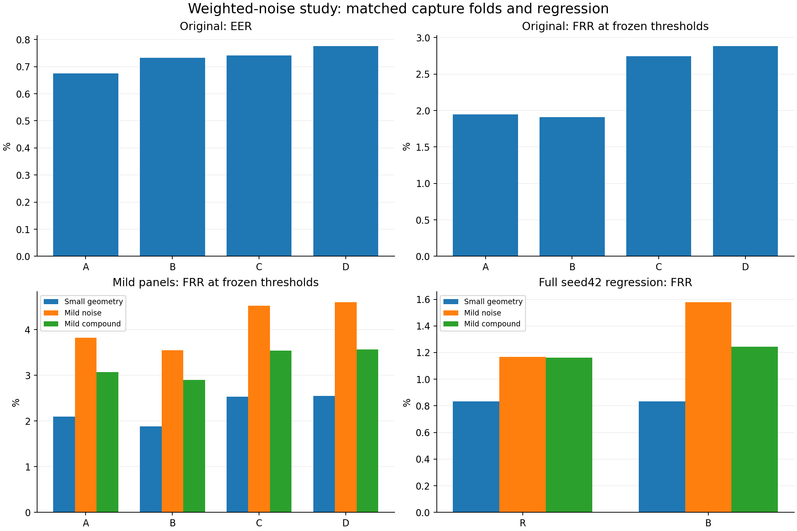
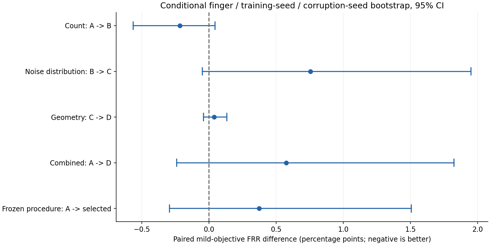

# 원본·Mild noise 우선 증강 실험 — 2026-11-22

**현재 production 모델 4개를 유지합니다. 사전에 잠근 조건을 모두 만족하는 업그레이드는 확인되지 않았습니다.**

Full bundle의 Validation 선택은 **B · per_db**입니다. 12→40장 확대는 nested mild FRR가 0.2180pp 낮아지는 point estimate였지만 95% CI[-0.5664, 0.0450]은 0을 포함했습니다. 감소 noise 분포와 mild geometry의 추가 이득도 입증되지 않았습니다.

잠긴 선택 절차는 nested FVC2000 원본 FRR가 0%→2.5%로 높아졌습니다. Full seed42 B도 FVC2000 원본 FAR가 .5208%→.5556%로 높아졌고, mild objective FRR는 current R 1.0542%보다 높은 1.2183%였습니다. EER가 같더라도 고정 threshold의 FAR·FRR가 같다는 뜻은 아닙니다.

이 선택과 Test를 본 뒤의 배포 수락 여부는 구분합니다. Strong noise 성능 저하는 허용했고 선정·수락 조건에 넣지 않았습니다. 여기서 말하는 선택은 정한 네 후보와 데이터 범위 안의 결과이며, 모든 분포의 최적 noise 수준을 찾았다는 뜻이 아닙니다.

[Root](../../readme.md) · [이전 실험](noise_followup.md) · [Protocol](weighted_noise_protocol.json) · [수치·판정](weighted_noise_results.json) · [상세 CSV](weighted_noise_metrics.csv)

## 어떤 것을 비교했는가

| Arm | 새 view / 원본 | Noise-enabled 조건의 σ | Geometry·brightness |
|---|---:|---|---|
| R | 현재 production | Uniform [1,80] | 현재 배포 설정; descriptive reference |
| A | 12 | Uniform [1,80] | 기존 범위 + 공통 content guard |
| B | 40 | Uniform [1,80] | A와 같음 |
| C | 40 | 감소 분포 | A와 같음 |
| D | 40 | 감소 분포 | Rotation ±3°, brightness .97–1.03 |

C/D의 조건부 확률은 σ=[1,30] 60%, (30,40] 15%, (40,50] 10%, (50,60] 7.5%, (60,70] 5%, (70,80] 2.5%입니다. Noise 적용 확률은 70%로 고정했습니다. 각 구간 안에서는 Uniform sigma를 뽑고 full-frame Gaussian을 더한 뒤 gray8 clipping·반올림했습니다. 구간 경계의 한 점은 연속 분포에서 확률 0입니다. 이것은 전체 학습 stream의 분포와 다릅니다. 각 원본의 40장에 모든 구간이 반드시 포함된다는 뜻도 아닙니다. 범위 전체의 학습 support를 유지하면서 강한 noise 빈도를 줄였으며, 연속적인 새로운 noise·새 capture·새 identity 자체가 없어지는 것은 아닙니다.

| Arm | 생성 view | Noise 적용 % | σ1–30 % | 30–40 % | 40–50 % | 50–60 % | 60–70 % | 70–80 % |
|---|---|---|---|---|---|---|---|---|
| A | 2880 | 70.1042 | 37.7910 | 12.0852 | 14.3140 | 11.8871 | 12.1842 | 11.7385 |
| B | 9600 | 69.9167 | 35.7569 | 12.9470 | 13.3492 | 12.7831 | 12.7384 | 12.4255 |
| C | 9600 | 69.9167 | 59.7288 | 15.3308 | 10.1907 | 7.1663 | 5.3188 | 2.2646 |
| D | 9600 | 69.9167 | 59.7288 | 15.3308 | 10.1907 | 7.1663 | 5.3188 | 2.2646 |

표는 전체 source에서 생성한 새 pool의 실제 분포이고, 구간 백분율은 noise-enabled view 안의 값입니다. Held-out source의 view는 해당 학습에서 제외했습니다.

A→B는 새 pool 크기, B→C는 noise 분포, C→D는 rotation·brightness 범위 효과를 비교합니다. D도 scale 확률·범위는 A/B/C와 같습니다. A/B/C는 기존 rotation ±15°·brightness .9–1.1 범위를 유지하되 모두 더 엄격한 지문 보존 검사를 적용했습니다. 따라서 R→A는 단일 요인 실험이 아닙니다. A와 B는 앞 12개의 view를 공유하고 B/C/D는 noise 적용 여부·sigma quantile·표준 Gaussian stream을 맞췄습니다.

## 원본 비중·학습량

기존 sampler의 raw-original 비중은 실제 설정과 노출 횟수로 **1/13 = 7.6923%**임을 확인했습니다. 새 실험도 원본별 effective epoch마다 **raw 1 + legacy 6 + new 6**을 사용했습니다. 원본·legacy·new를 합쳐 파일마다 균등 추출하지 않았습니다.

40 effective epochs 동안 원본은 40번, 기존 24개의 logical legacy view는 각각 10번, A의 새 12개는 각각 20번, B/C/D의 40개는 각각 6번 노출했습니다. 원본별·DB별·identity별 노출을 균형 있게 맞췄습니다. 저장 pixel은 중복 제거하되 logical slot의 sampling mass와 lineage를 보존했습니다. Alias가 독립적인 학습 정보라고 계산하지 않았습니다.

| Arm | Raw-tag % | Pixel-original % | No noise % | σ≤30 % | 30<σ≤40 % | 40<σ≤80 % |
|---|---|---|---|---|---|---|
| A | 7.6923 | 7.8953 | 34.7650 | 45.0000 | 4.1667 | 16.0684 |
| B | 7.6923 | 7.9316 | 34.6709 | 44.5085 | 4.3910 | 16.4295 |
| C | 7.6923 | 7.9316 | 34.6709 | 52.4829 | 5.0128 | 7.8333 |
| D | 7.6923 | 7.8162 | 34.6709 | 52.4829 | 5.0128 | 7.8333 |

위 표는 full combined seed42의 **실제 전체 stream**입니다. Pixel-original은 변환 취소·noise 미적용 등으로 원본과 pixel이 같은 모든 노출을 포함하므로 raw-tag보다 클 수 있습니다. No-noise도 geometry·brightness까지 없는 원본을 뜻하지 않습니다. 두 legacy pool은 과거 sigma5 증강을 그대로 보존하므로 새 pool의 감소 분포가 전체 stream에 그대로 적용되지는 않습니다. 모든 source의 실제 exposure는 bundle별 receipt·exposure 파일에 남겼습니다.

Backbone은 eval·frozen이고 pretrained의 projection을 복사해 projection 2개와 retained30 classifier만 학습했습니다. Batch32·Adam(lr=weight_decay=.0001)·Cosine scale16·40 effective epochs를 고정했습니다. Full은 specialized 각각 1,000·combined 2,960 updates, outer fold는 각각 680·1,960 updates로 네 arm이 같습니다. 각 arm에 training seed42/43/44를 적용했습니다. 총 **60 bundle·240 model heads**를 새로 학습했습니다.

## 지문 정보 보존과 입력 검증

원본 240장, 기존 두 manifest의 5,760장을 모두 사용했습니다. 기존 증강은 학습 source에 해당하는 것만 parameter 학습에 들어갔습니다. 새 training logical view는 28,800건, 작은 geometry 평가 view는 960건, 새로운 noise는 19,200건입니다. 전체 lineage는 **54,960건**, DB·pixel 기준 고유 입력은 **49,599개**입니다. 새로운 noise 기록 중 4,800건은 Validation, 14,400건은 최종 Test입니다.

Foreground<235의 pixel-area convex hull이 출력 canvas 안에 남도록 geometry를 검사했습니다. Unsafe 변환은 최대 32회 재시도한 뒤 identity geometry로 대체했습니다. Brightness에 의한 추가 foreground saturation은 noise를 더하기 전에 검사했습니다. Noise 자체의 clipping 때문에 strong example을 버리지는 않았습니다. 기존 FVC2004의 640×480→중앙 480×480 crop은 유지했으므로 이미 원본/crop 밖에 없는 지문을 복원했다는 뜻은 아닙니다.

Broad training 9,600개의 identity fallback은 672개, mild training 9,600개는 686개였습니다. 모든 foreground가 경계까지 닿으면 작은 회전도 거절됩니다. 평가의 geometry 960개는 필요한 경우 흰 여백 안에서 scale≥.94로 fit해 모두 실제 nonzero rotation을 갖도록 했습니다. 760개가 fit을 사용했고 최소 scale은 .9441099였습니다. 이 보완은 후보 성능을 계산하기 전에 pixel QA로 확정했습니다. Training D의 scale 범위를 결과를 본 뒤 변경하지 않았습니다.



실제로 취소된 회전은 그림에도 0°로 표시했습니다. FG 보존 검사는 추가 잘림을 제한하지만 interpolation에 의한 모든 ridge 변화까지 없음을 보증하지는 않습니다. 새 geometry·brightness의 추가 foreground saturation은 0이었습니다.

## Split과 Threshold

모든 원본과 descendant를 같은 source group으로 묶었습니다. 서로 다른 parent 사이 동일 pixel은 0개였고 fold마다 train120·Validation60·Test60 source가 겹치지 않았습니다.

| Outer Test captures | Inner Validation captures | 선택 arm | 정책 |
|---|---|---|---|
| [1, 2] | [3, 4] | C | global |
| [3, 4] | [5, 6] | B | per_db |
| [5, 6] | [7, 8] | A | per_db |
| [7, 8] | [1, 2] | B | per_db |

Full 모델은 capture1–6 학습, 7 Validation, 8 confirmation입니다. 전체 원본 전수 평가는 학습·이전 선택에 노출된 source까지 포함하는 regression 검사입니다. Nested Test는 해당 fold의 학습에서 제외한 capture이며 identity는 이미 학습한 상태입니다. 새로운 noise seed, 새로운 capture, 새로운 identity는 다릅니다. 이번 데이터로 unseen-identity 성능은 측정하지 못했습니다.

Validation corruption seed910001–910005와 별도 Test920001–920010을 사용했습니다. 원본마다 각 seed에 mild strata [1,10], (10,20], (20,30] 한 장씩, 작은 geometry에 mild compound 한 장을 생성했습니다. Test에는 (30,40]와 (40,80] 각 한 장을 추가했습니다. 범위 밖 (80,160] stress와 모든 legacy×noise의 Cartesian product는 이번 bounded study에서 수행하지 않았습니다.



위 예시는 세 DB의 capture101_8·Test seed920001로 Test score 확인 전에 고정한 raw pixel이며 모델 결과로 고른 사례가 아닙니다. FVC2004도 inference crop 이전의 전체 이미지를 표시합니다. 같은 nominal sigma라도 원본 대비·배경·clipping에 따라 손상 정도가 다릅니다.

Threshold는 original·small geometry·mild noise 세 strata·mild compound 각각의 Validation FAR≤1%를 만족하는 가장 낮은 4자리 값을 위로 올려 선택했습니다. Global/per-DB를 Validation에서 비교했고 Genuine/Impostor에 같은 threshold를 적용했습니다. Arm마다 자기 Validation으로 정책을 잠갔으며 strong noise·legacy는 threshold 제약에도 넣지 않았습니다.

| DB | Full 선택 threshold | Current R threshold (새 규칙) |
|---|---|---|
| FVC2000_DB3_B | 0.5325 | 0.5384 |
| FVC2002_DB3_B | 0.7327 | 0.7378 |
| FVC2004_DB1_B | 0.9161 | 0.8842 |

이 값은 이번 primary 조건으로 다시 calibrate한 값입니다. 이전 연구의 80:20 profile과 동일한 목적이 아닙니다. 모든 fold의 선택·threshold를 새 Test score 평가 전에 잠갔습니다. GUI 기본 0.5는 바꾸지 않았습니다. 현재 score 범위 [0.5,1]에서는 0.5가 모든 성공 비교를 수락하므로 적절한 운영 threshold로 간주할 수 없습니다. 다른 팀 DLL에 우리 threshold를 적용하면 안 됩니다.

## 결과

아래 수치는 DB macro 평균입니다. Nested는 4 folds×3 training seeds의 지표 평균이고 pooled EER가 아닙니다. Full은 현재 배포 seed42와 같은 seed의 새 후보입니다. FAR/FRR는 frozen threshold에서 계산했습니다. Threshold 변경으로 EER·AUC가 바뀌는 것은 아닙니다.

| 조건 | Original EER % | Original FAR % | Original FRR % | Mild noise FRR % | Mild compound FRR % |
|---|---|---|---|---|---|
| A | 0.6752 | 0.5247 | 1.9444 | 3.8218 | 3.0729 |
| B | 0.7330 | 0.4861 | 1.9097 | 3.5463 | 2.9028 |
| C | 0.7407 | 0.4514 | 2.7431 | 4.5243 | 3.5382 |
| D | 0.7755 | 0.4514 | 2.8819 | 4.5961 | 3.5625 |
| Fold별 Validation 선택 | 0.6443 | 0.5131 | 2.6389 | 4.2801 | 3.3924 |

| 모델 | Original EER % | Original FAR % | Original FRR % | Mild noise FRR % | Mild compound FRR % | Strong diagnostic FRR % |
|---|---|---|---|---|---|---|
| R | 0.0926 | 0.2546 | 0.8333 | 1.1687 | 1.1607 | 11.7857 |
| A | 0.0926 | 0.2662 | 0.8333 | 1.6687 | 1.2738 | 15.5714 |
| B | 0.0926 | 0.2662 | 0.8333 | 1.5774 | 1.2440 | 14.8810 |
| C | 0.0926 | 0.2662 | 0.8333 | 1.6230 | 1.3095 | 16.7351 |
| D | 0.0926 | 0.2662 | 0.8333 | 1.6667 | 1.2917 | 17.0357 |



### 단계별 증강 효과의 불확실성

Mild objective는 DB를 동일하게, small geometry·mild noise·mild compound를 각각 1/3로 반영한 source-macro FRR입니다. FRR 차이는 오른쪽 후보−왼쪽 기준이며 음수가 개선입니다.

| 비교 | Mild objective FRR 차이 pp | 95% CI pp | 해석 |
|---|---|---|---|
| A_to_B | -0.2180 | [-0.5664, 0.0450] | 개선 불확실 |
| B_to_C | 0.7548 | [-0.0494, 1.9509] | 개선 불확실 |
| C_to_D | 0.0378 | [-0.0425, 0.1318] | 개선 불확실 |
| A_to_D | 0.5747 | [-0.2405, 1.8244] | 개선 불확실 |
| A_to_selected | 0.3721 | [-0.2940, 1.5053] | 개선 불확실 |

증강 개수 증가의 mild FRR point estimate는 0.2180pp 낮아졌습니다. CI 기준으로 개선을 확정하지 못했습니다.

감소 noise 분포의 mild FRR point estimate는 0.7548pp 높아졌습니다. CI 기준으로 개선을 확정하지 못했습니다.

Mild rotation·brightness의 mild FRR point estimate는 0.0378pp 높아졌습니다. CI 기준으로 개선을 확정하지 못했습니다.



Finger cluster를 DB별 10개 단위로 resample하고 동일 identity의 gallery·probe·capture·derivative를 함께 가중했습니다. Training seed와 corruption seed도 paired resampling했으며 세 mild panel이 같은 bootstrap draw를 공유합니다. 1,000회, seed940001입니다. Fold·gallery·Validation 선택은 고정되어 있어 그 선택 불확실성은 포함하지 않습니다. 사람별 연결 정보도 없어 finger보다 상위의 subject dependence를 확인하지 못했습니다. 다중 contrast의 interval은 multiplicity 보정 없는 탐색적 결과이며 population strict non-inferiority의 입증이 아닙니다.

### 원본 보존 수락 조건

| 검사 | DB | EER % | FAR % | FRR % | Zero-margin 관찰 조건 |
|---|---|---|---|---|---|
| Nested 선택 vs A | FVC2000 | 0.2778 → 0.2778 | 0.6829 → 0.6944 | 0.0000 → 2.5000 | 미통과 |
| Nested 선택 vs A | FVC2002 | 1.6088 → 1.5625 | 0.4167 → 0.3704 | 5.8333 → 5.4167 | 통과 |
| Nested 선택 vs A | FVC2004 | 0.1389 → 0.0926 | 0.4745 → 0.4745 | 0.0000 → 0.0000 | 통과 |
| Full seed42 vs R | FVC2000 | 0.0000 → 0.0000 | 0.5208 → 0.5556 | 0.0000 → 0.0000 | 미통과 |
| Full seed42 vs R | FVC2002 | 0.0000 → 0.0000 | 0.0000 → 0.0000 | 0.0000 → 0.0000 | 통과 |
| Full seed42 vs R | FVC2004 | 0.2778 → 0.2778 | 0.2431 → 0.2431 | 2.5000 → 2.5000 | 통과 |
| Capture8 seed42 vs R | FVC2000 | 0.0000 → 0.0000 | 0.3704 → 0.3704 | 0.0000 → 0.0000 | 통과 |
| Capture8 seed42 vs R | FVC2002 | 0.0000 → 0.0000 | 0.0000 → 0.0000 | 0.0000 → 0.0000 | 통과 |
| Capture8 seed42 vs R | FVC2004 | 0.0000 → 0.0000 | 0.0000 → 0.0000 | 0.0000 → 0.0000 | 통과 |

기본 margin은 DB별 FAR·FRR·EER 모두 **0**이며 결과를 본 뒤 완화하지 않았습니다. Frozen 선택 절차의 CV mild improvement CI 상한<0 조건은 **미통과**입니다. Full·Capture8의 mild FRR point 비악화 조건은 **미통과**입니다. Strong noise 악화는 이 결정과 무관합니다. 실패한 Test를 보고 다른 후보를 재선정하지 않았습니다.

### Noise 강도·Worst DB

| Arm | Sigma stratum | EER % | FAR % | FRR % |
|---|---|---|---|---|
| R | s1_10 | 0.2560 | 0.2546 | 0.8333 |
| R | s10_20 | 0.2795 | 0.2853 | 0.8750 |
| R | s20_30 | 0.7087 | 0.5556 | 1.7976 |
| R | s30_40 | 2.2731 | 0.9884 | 5.1488 |
| R | s40_80 | 9.3214 | 3.1649 | 18.4226 |
| A | s1_10 | 0.3029 | 0.2656 | 0.9107 |
| A | s10_20 | 0.3810 | 0.2824 | 0.9464 |
| A | s20_30 | 1.1071 | 0.5903 | 3.1488 |
| A | s30_40 | 3.2235 | 0.8461 | 7.7917 |
| A | s40_80 | 10.2142 | 1.6649 | 23.3512 |
| B | s1_10 | 0.1962 | 0.2569 | 0.8690 |
| B | s10_20 | 0.2886 | 0.3056 | 0.9286 |
| B | s20_30 | 1.0307 | 0.5868 | 2.9345 |
| B | s30_40 | 3.0015 | 0.9358 | 7.5119 |
| B | s40_80 | 9.6024 | 1.8947 | 22.2500 |
| C | s1_10 | 0.2255 | 0.2633 | 0.9702 |
| C | s10_20 | 0.2698 | 0.2674 | 0.9524 |
| C | s20_30 | 1.0301 | 0.5081 | 2.9464 |
| C | s30_40 | 3.3119 | 0.8160 | 8.3631 |
| C | s40_80 | 11.2853 | 1.8432 | 25.1071 |
| D | s1_10 | 0.2209 | 0.2633 | 0.9524 |
| D | s10_20 | 0.2541 | 0.2801 | 0.9583 |
| D | s20_30 | 1.0476 | 0.5556 | 3.0893 |
| D | s30_40 | 3.4374 | 0.8762 | 8.3988 |
| D | s40_80 | 11.3125 | 1.8420 | 25.6726 |

σ>30 두 stratum은 diagnostic이며 더 나빠져도 수락 실패 원인이 아닙니다. 같은 frozen mild-use threshold를 유지했습니다.

| Full seed42 | Worst DB (mild objective) | Worst DB mild FRR % | Worst DB Original EER % |
|---|---|---|---|
| R | FVC2004 | 2.5000 | 0.2778 |
| A | FVC2004 | 2.5139 | 0.2778 |
| B | FVC2004 | 2.5000 | 0.2778 |
| C | FVC2004 | 2.5000 | 0.2778 |
| D | FVC2004 | 2.5000 | 0.2778 |

평균 개선이 취약한 DB를 가리지 않도록 worst DB도 분리했습니다.

### Training seed와 corruption seed

| Arm | Training seed | Original EER % | Original FRR % | Mild objective FRR % |
|---|---|---|---|---|
| A | 42 | 0.0926 | 0.8333 | 1.2586 |
| A | 43 | 0.1852 | 1.5476 | 1.6852 |
| A | 44 | 0.0926 | 1.6667 | 1.7679 |
| B | 42 | 0.0926 | 0.8333 | 1.2183 |
| B | 43 | 0.0926 | 1.4286 | 1.4927 |
| B | 44 | 0.0926 | 0.8333 | 1.2573 |
| C | 42 | 0.0926 | 0.8333 | 1.2553 |
| C | 43 | 0.1852 | 2.5000 | 2.3509 |
| C | 44 | 0.0926 | 0.8333 | 1.1349 |
| D | 42 | 0.0926 | 0.8333 | 1.2639 |
| D | 43 | 0.1852 | 2.5000 | 2.4256 |
| D | 44 | 0.0926 | 0.8333 | 1.2606 |

| Test corruption 조건 | FRR 최소 % | 평균 % | 최대 % | SD pp |
|---|---|---|---|---|
| Mild noise | 1.2302 | 1.5774 | 1.7857 | 0.1692 |
| Mild compound | 0.8333 | 1.2440 | 1.6667 | 0.3205 |
| Strong noise (diagnostic) | 13.4524 | 14.8810 | 16.5179 | 1.0647 |

Full의 training seed별 결과와 Test corruption seed별 결과를 분리했습니다. 개별 DB·noise stratum·seed·specialized/combined/deployed·confusion counts는 상세 CSV 및 local compressed evidence에 보존했습니다. 세 seed는 초기화·shuffle 민감도를 보여주는 제한적인 표본이며 전반적인 안정성을 확정하지 않습니다. Geometry pool은 정책별로 고정 생성했으며 augmentation-pool seed 자체를 여러 번 반복하지 않았습니다. 따라서 C→D는 이 고정 pool에서의 정책 비교이며 여러 geometry-pool realization을 평균한 순수 range 효과 추정은 아닙니다.

### 선택 bundle의 상세 지표

| DB | 조건 | EER % | FAR % | FRR % | ROC-AUC | Balanced Accuracy % | Precision % | F1 | MCC |
|---|---|---|---|---|---|---|---|---|---|
| FVC2000 | Original | 0.0000 | 0.5556 | 0.0000 | 1.0000 | 99.7222 | 94.5946 | 0.9722 | 0.9699 |
| FVC2000 | Small geometry | 0.0000 | 0.6814 | 0.0000 | 1.0000 | 99.6593 | 93.4501 | 0.9661 | 0.9634 |
| FVC2000 | Mild noise | 0.0000 | 0.6244 | 0.0000 | 1.0000 | 99.6878 | 93.9650 | 0.9689 | 0.9663 |
| FVC2000 | Mild compound | 0.0000 | 0.7135 | 0.0000 | 1.0000 | 99.6432 | 93.1625 | 0.9646 | 0.9618 |
| FVC2000 | Legacy (diagnostic) | 0.0000 | 0.7711 | 0.0000 | 1.0000 | 99.6144 | 92.6513 | 0.9619 | 0.9588 |
| FVC2000 | Strong noise (diagnostic) | 0.2925 | 1.2231 | 0.0000 | 0.9999 | 99.3885 | 88.8254 | 0.9408 | 0.9367 |
| FVC2002 | Original | 0.0000 | 0.0000 | 0.0000 | 1.0000 | 100.0000 | 100.0000 | 1.0000 | 1.0000 |
| FVC2002 | Small geometry | 0.0000 | 0.0000 | 0.0000 | 1.0000 | 100.0000 | 100.0000 | 1.0000 | 1.0000 |
| FVC2002 | Mild noise | 0.8214 | 0.3368 | 2.2321 | 0.9997 | 98.7155 | 96.5779 | 0.9717 | 0.9689 |
| FVC2002 | Mild compound | 0.7143 | 0.2448 | 1.2321 | 0.9997 | 99.2615 | 97.5141 | 0.9814 | 0.9796 |
| FVC2002 | Legacy (diagnostic) | 0.0116 | 0.0000 | 0.2679 | 1.0000 | 99.8661 | 100.0000 | 0.9987 | 0.9985 |
| FVC2002 | Strong noise (diagnostic) | 17.3929 | 2.8845 | 40.7232 | 0.9179 | 78.1961 | 66.6432 | 0.6274 | 0.5947 |
| FVC2004 | Original | 0.2778 | 0.2431 | 2.5000 | 0.9999 | 98.6285 | 97.5000 | 0.9750 | 0.9726 |
| FVC2004 | Small geometry | 0.3819 | 0.1606 | 2.5000 | 0.9999 | 98.6697 | 98.3341 | 0.9792 | 0.9771 |
| FVC2004 | Mild noise | 0.6059 | 0.1881 | 2.5000 | 0.9999 | 98.6560 | 98.0545 | 0.9778 | 0.9756 |
| FVC2004 | Mild compound | 0.7143 | 0.1406 | 2.5000 | 0.9999 | 98.6797 | 98.5382 | 0.9802 | 0.9783 |
| FVC2004 | Legacy (diagnostic) | 0.3313 | 0.1251 | 2.5000 | 0.9999 | 98.6874 | 98.6970 | 0.9809 | 0.9791 |
| FVC2004 | Strong noise (diagnostic) | 1.2143 | 0.1380 | 3.9196 | 0.9996 | 97.9712 | 98.5440 | 0.9730 | 0.9705 |

CSV에는 TAR/Recall, TP/FN/FP/TN, empirical TAR@FAR≤1%, normalized partial AUC(FPR0–.01), score margin·tie와 source-macro FAR/FRR도 있습니다. FAR0.1% 진단은 Impostor≥10,000인 경우만 기록했습니다. 서로 종속된 비교 쌍 수가 큰 것은 독립 지문 수가 많다는 뜻이 아니며 low-FAR population 인증으로 사용하지 않습니다. EER는 독립적인 두 계산법으로 대조했고 zero EER가 나온 모든 행의 비어 있지 않은 Genuine/Impostor·양의 분리 margin·cross-class tie0을 검사했습니다. 관측 오류0과 퇴화한 zero bootstrap interval은 실제 위험0을 입증하지 않습니다.

## 계산·호환성·재현 범위

| Arm | Bundle 수 | 학습 총 시간 s | Bundle median s |
|---|---|---|---|
| A | 15 | 131.0737 | 7.7916 |
| B | 15 | 130.7948 | 7.8701 |
| C | 15 | 130.6694 | 7.8560 |
| D | 15 | 130.6803 | 7.8849 |

위 시간은 feature 추출을 공유한 head 학습의 host wall time이며 동시에 수행된 작업의 영향도 포함합니다. 각 arm의 optimizer update는 같습니다. arm64·Python 3.14.0·PyTorch 2.15.0 CPU, feature threads4·training threads2에서 수행했습니다. Runtime·memory와 native Core 검사는 local `environment.json`, `compute_summary.json`, `native_core_*.json`을 참고합니다. Windows Worker timeout은 이 환경에서 측정하지 못했습니다.

| Bundle | Extract 건 | Compare 건 | Cold ms | Steady median ms | Steady p95 ms | Compare median ms | Peak RSS GiB |
|---|---|---|---|---|---|---|---|
| B | 33 | 30 | 6848.7238 | 295.0804 | 325.1719 | 0.0808 | 1.3965 |
| R | 33 | 30 | 7132.0337 | 296.6640 | 306.2812 | 0.0804 | 1.4516 |

Native 표는 background feature·학습·평가 계산이 끝난 뒤의 작은 순차 표본입니다. 실제 Windows 속도·메모리나 Worker 개수에 따른 성능을 뜻하지 않습니다.

현재 C++의 preprocessing·feature·probability를 original/new augmentation/geometry 18건에서 대조했고 최대 차이0이었습니다. Batch1과 cache batch4, 실제 Scripted embedding과 factored 계산의 1회 Adam update도 차이0이었습니다. 새 60 bundle·240 heads를 실제 production TorchScript wrapper에 각각 넣고 18개 native feature 표본에서 출력 검사를 수행했습니다. 모든 raw Test 비교를 실제 Windows에서 재실행한 검사는 아닙니다. 확장한 33개 입력에서 batch1과 batched head의 확률 성분은 최대1.1921e-6 차이가 있었습니다. R의 strict1e-6 component 검사는 미통과로 보존했습니다. 별도 진단에서 preprocessing·frozen feature 차이는0, 같은 batch1 head와 native Core 확률 차이도0이어서 head의 batch-size 연산 차이로 확인했습니다. R/B 각각30쌍의 score 차이는 최대6.63e-8이고 frozen threshold 판정은 모두 같았습니다. 61 bundle의 원본 score matrix 222개를 batch1 head로 전수 재계산한 결과 threshold 판정 변경0·EER 변화0이었습니다. 최대 score 차이는9.713e-7이었습니다. `original_batch1_sensitivity.json`에 별도로 기록했으며, 이를 Test 재선정에 사용하지 않았습니다. 이 표본 결과를 모든 corrupted Test 쌍의 end-to-end native 동등성으로 확대하지 않습니다.

전체 연구 score의 failure0은 **이 연구 harness의 계산 성공**이며 Windows DLL/Worker의 failure·timeout0이라는 뜻이 아닙니다.

Production은 Windows/MSVC 전용을 유지합니다. 이 연구의 native helper는 Windows module-location API만 shim한 임시 검증용이며 production에 추가하지 않았습니다. 실제 Windows/MSVC build·PE DLL loading·Worker IPC·Stop·timeout·GUI 점수 재현은 수행하지 못했습니다. Windows replay는 기존 설치 절차로 빌드한 뒤 정확한 네 weight SHA를 확인하고, Step3에서 해당 DLL을 Load하여 세 DB의 `101_1`↔`101_8`/`102_8` Template·Compare를 반복합니다. `native_core_*.json`에 기록한 score·threshold 판정과 비교하고 workers1/4·한글 경로·Stop·timeout·재시작을 추가 확인해야 합니다. 외부 DLL에는 이 calibration을 사용하지 않습니다.

선택된 full B의 standalone 모델 4개는 local archive에만 있습니다. Windows 검증 복사본으로 `models/noise_experiment_weights/weighted_noise_20261122/standalone_full_B_seed42/`를 옮긴 뒤, 기존 설치·빌드가 완료된 프로젝트 루트의 PowerShell에서 별도 배포 폴더를 만듭니다. 아래 명령은 실제 Windows에서 실행 검증하지 못했습니다.

```powershell
cmake -S . -B build "-DFINGERPRINT_PACKAGE_MODELS=$((Resolve-Path models\noise_experiment_weights\weighted_noise_20261122\standalone_full_B_seed42).Path)" "-DFINGERPRINT_PACKAGE_DIR=$((Get-Location).Path)\dist\FingerprintAlgorithmResearch"
if ($LASTEXITCODE -ne 0) { throw "Research package configure failed." }
cmake --build build --config Release --target FingerprintAlgorithmPackage
if ($LASTEXITCODE -ne 0) { throw "Research packaging failed." }
.\dist\FingerprintEvaluator\FingerprintGUI.exe
```

GUI Step3에서 `dist/FingerprintAlgorithmResearch/FingerprintAlgorithm.dll`을 선택합니다. DLL·모델 변경 후 Template을 다시 만들고 Results의 **Genuine·Impostor 두 Threshold를 모두** 해당 DB의 같은 표 값으로 입력합니다. 현재 GUI에는 이 연구 profile을 자동 적용하는 기능이 없습니다. 이 bundle은 수락 검사를 통과하지 못하면 production용으로 추천하지 않습니다.

확인 후 기본 패키징 경로 설정을 복원합니다.

```powershell
cmake -S . -B build "-DFINGERPRINT_PACKAGE_MODELS=$((Resolve-Path models\trained_result).Path)" "-DFINGERPRINT_PACKAGE_DIR=$((Get-Location).Path)\dist\FingerprintAlgorithm"
if ($LASTEXITCODE -ne 0) { throw "Default package configure failed." }
```


Pretrained는 기존 DeepPrint 그대로이며 upstream provenance와 FVC overlap을 파일 단위로 완전히 독립 입증하지 못한 한계도 이전 연구와 같습니다. 과거 이 원본·capture들의 결과를 이미 보고 설계했습니다. Protocol은 로컬 파일로 먼저 저장했고 performance 계산 전 입력·통계 규칙의 보강을 amendment에 남겼습니다. 외부에 사전 등록한 pristine confirmation이라고 표현하지 않습니다.

## 보관과 정리

새 학습 결과는 Git-ignored `models/noise_experiment_weights/weighted_noise_20261122/trained_heads/`에 **60개의 `heads.pt`와 receipt·exposure**로 보관합니다. 각 checkpoint는 네 model head의 projection·classifier·scale과 pretrained SHA를 갖고 frozen Backbone은 공유 참조합니다. `.bin` 네 개를 각각 60번 중복 저장한 형식은 아닙니다. Production의 네 `.bin`과 이전 archive는 별도로 보존합니다. Validation에서 선택된 새 full bundle은 standalone `.bin` 네 개로도 local archive에 보관하며, production 수락 여부와 구분합니다. Reconstruction metadata에는 정확한 reference module·pretrained SHA, parameter mapping, preprocessing·label 순서·sampler·noise RNG·split과 update budget을 기록합니다.

Final protocol·선택 lock·calibration·metrics·figures·compressed raw scores·pixel lineage·generation audit·zero-EER audit·보존 SHA를 남깁니다. 실행 중인 study process가 없는지 확인한 뒤, 사용한 연구 source·build·executable·생성 image pool·feature/prediction cache·logs·scratch export·추가 임시 cache를 모두 제거했습니다. 실제 삭제와 보관 파일의 hash/readability 확인 결과는 [artifact·cleanup 기록](weighted_noise_artifacts.json)에 연결합니다. 기존 데이터·이전 weights·공유 runtime은 삭제 범위에 포함하지 않습니다.
