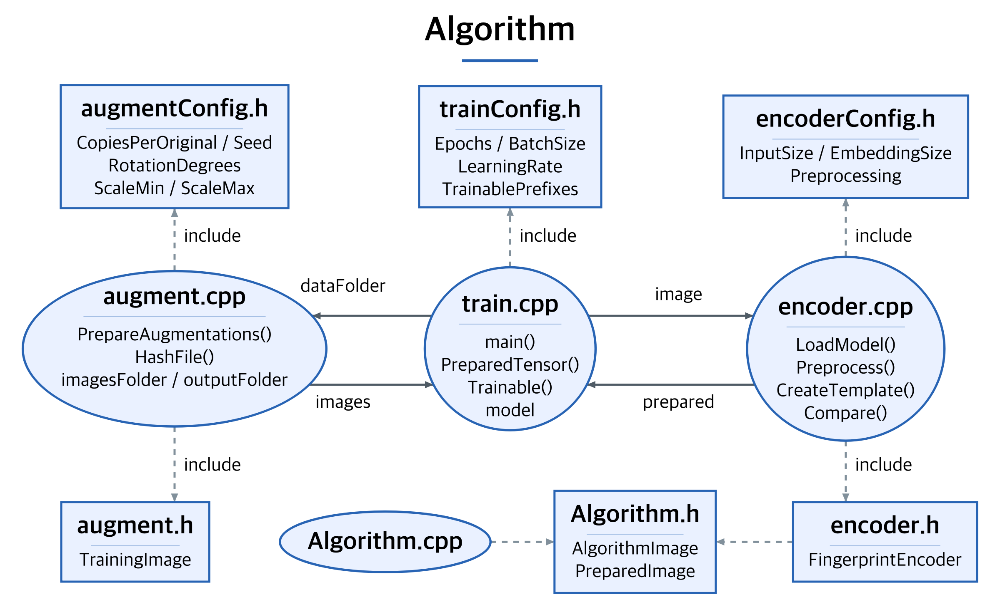
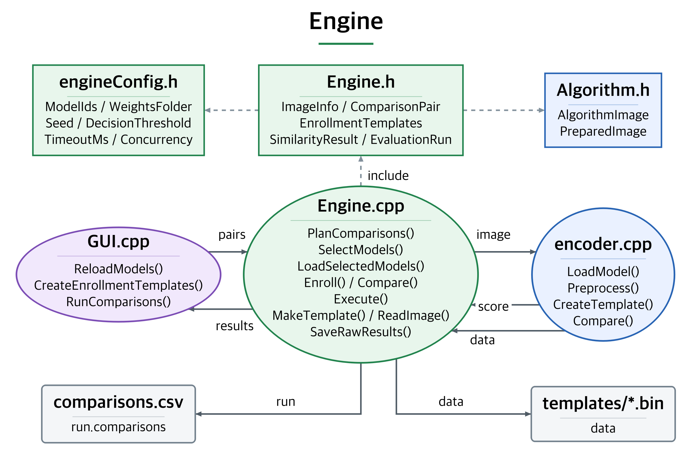
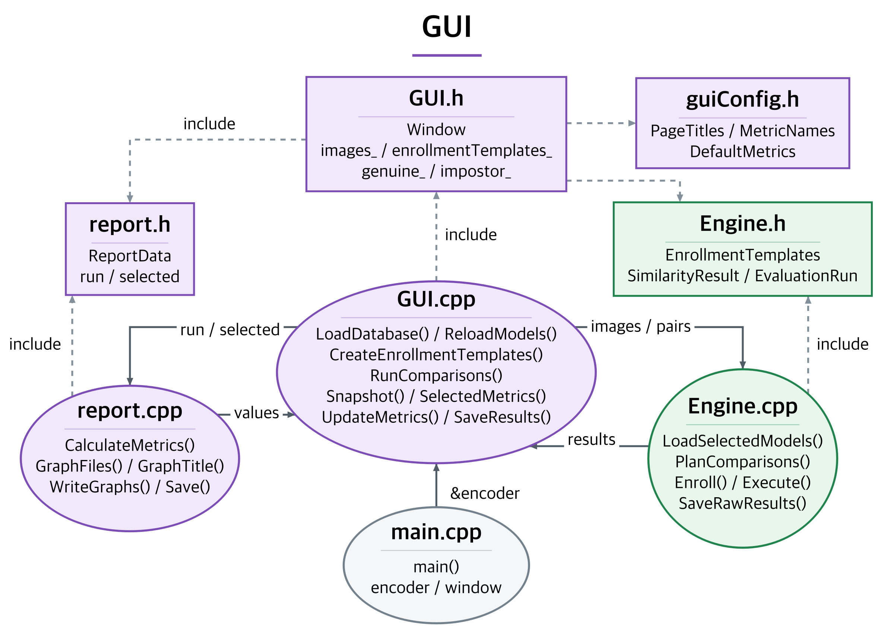
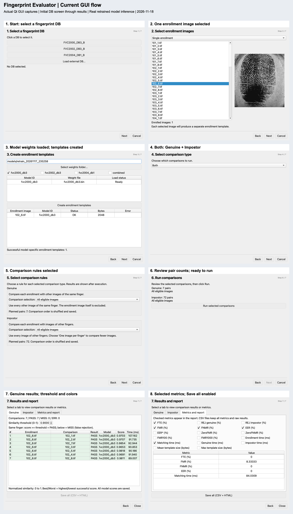

# Fingerprint Evaluator

## Purpose

지문 이미지로 Enrollment template을 만들고 Genuine·Impostor comparison을 실행하는 C++ 프로그램이다. 선택한 모델의 Normalized similarity, 처리 시간, 오류와 Report를 저장한다. 각 Enrollment 이미지는 독립적인 Template을 만든다.

Score는 `(cosine + 1) / 2`로 정규화한 `[0,1]` 유사도다. 높은 값이 더 유사하며, Calibration한 확률은 아니다. GUI는 소수점 4자리, 원시 CSV는 17 significant digits로 저장한다. Threshold 기본값은 `0.75`이며 Genuine·Impostor 결과 Tab에서 각각 `[0,1]`로 변경한다. Best score를 Threshold와 비교한다. Genuine은 기준 이상 PASS·미만 MISS, Impostor는 기준 미만 REJ·이상 FA다. PASS/REJ는 올바른 판정, MISS/FA는 오판정이다. 새 결과의 `settings.txt`에 Score 형식을 기록하며 과거 결과는 변경하지 않는다.

## Inputs / Outputs

| 구분 | 경로·형식 | 설명 |
|---|---|---|
| Original DB | [data/original](data/original) | FVC2000_DB3_B·FVC2002_DB3_B·FVC2004_DB1_B, 각 80 TIFF. External DB도 선택할 수 있다. |
| Model weight | `models` | `fvc2000_db3.bin`, `fvc2002_db3.bin`, `fvc2004_db1.bin`, `combined.bin`. Fine-tuning한 TorchScript archive다. 기존 Root Weight는 삭제했다. 새 네 Weight는 `models/retrain_20261117_235258`에 있으며 GUI에서 해당 폴더를 선택한다. |
| Optional comparison plan | CSV | `enrollment,attempt`에 DB 내 파일명을 쓴다. `type`은 Genuine/Impostor 구분용 선택 열이다. |
| Augmentation cache | `data/augmented` | 재학습을 위해 재생성한 PNG 2,880장과 Manifest가 있다. Inference에서는 사용하지 않는다. |
| Evaluation output | 선택한 폴더의 `run_N` | 원시 CSV, Template, 전체 Metric CSV, 선택 Metric의 HTML·SVG를 저장한다. |

`models/*.bin`은 입력 Weight다. `run_N/templates/*.bin`은 출력 Feature vector다. 둘은 저장 형식과 용도가 다르다.

## Parts / Files

Source 연결은 [Overview SVG](docs/diagrams/overview.svg) · [PNG](docs/diagrams/overview.png)에서 확인한다. 실선은 실행·호출·데이터 전달, 점선은 Include·Config 참조다. 미구현 연결은 TODO로 표시한다.

[](docs/diagrams/overview.svg)

| Part | 책임 | 구성 파일 |
|---|---|---|
| [Algorithm](src/Algorithm/readme.md) | Preprocessing·Encoding·Cosine comparison, Offline augmentation·Fine-tuning | [Algorithm.h](src/Algorithm/Algorithm.h), [Algorithm.cpp](src/Algorithm/Algorithm.cpp), [encoder.h](src/Algorithm/encoder.h), [encoder.cpp](src/Algorithm/encoder.cpp), [encoderConfig.h](src/Algorithm/encoderConfig.h), [augment.h](src/Algorithm/augment.h), [augment.cpp](src/Algorithm/augment.cpp), [augmentConfig.h](src/Algorithm/augmentConfig.h), [train.cpp](src/Algorithm/train.cpp), [trainConfig.h](src/Algorithm/trainConfig.h) |
| [Engine](src/Engine/readme.md) | Comparison plan·모델 호출·시간/오류 수집·원시 저장 | [Engine.h](src/Engine/Engine.h), [Engine.cpp](src/Engine/Engine.cpp), [engineConfig.h](src/Engine/engineConfig.h) |
| [GUI](src/GUI/readme.md) | 화면·사용자 선택·결과 표시, Metric·Graph·Report 생성 | [GUI.h](src/GUI/GUI.h), [GUI.cpp](src/GUI/GUI.cpp), [guiConfig.h](src/GUI/guiConfig.h), [report.h](src/GUI/report.h), [report.cpp](src/GUI/report.cpp) |
| Entry / Build | Backend 수명 관리·실행 파일 구성 | [main.cpp](src/main.cpp), [CMakeLists.txt](CMakeLists.txt) |
| Checkpoint conversion | Python checkpoint를 C++에서 읽는 Archive로 변환 | [prepare_deepprint.py](tools/prepare_deepprint.py) |

<details>
<summary><strong>Algorithm</strong> — 증강·학습·특징 추출</summary>

[](docs/diagrams/algorithm.svg)

[SVG 원본](docs/diagrams/algorithm.svg) · [PNG](docs/diagrams/algorithm.png)

</details>

<details>
<summary><strong>Engine</strong> — 비교 계획·실행·결과 수집</summary>

[](docs/diagrams/engine.svg)

[SVG 원본](docs/diagrams/engine.svg) · [PNG](docs/diagrams/engine.png)

</details>

<details>
<summary><strong>GUI / Report</strong> — 화면·입력·지표·리포트</summary>

[](docs/diagrams/gui.svg)

[SVG 원본](docs/diagrams/gui.svg) · [PNG](docs/diagrams/gui.png)

</details>

## macOS / Build, Train, Run

모든 명령은 Project root(`FinalProject` 또는 Clone 폴더)에서 실행한다. C++17 compiler, CMake, Qt Widgets·TIFF plugin, LibTorch가 필요하다. 아래 경로는 현재 Mac에서 확인했다: Qt 5.15.17, LibTorch 2.15.0, CMake 4.1.2, arm64 CPU. 다른 Mac은 Library 경로를 설치 위치로 바꾼다. `--fresh`에는 CMake 3.24 이상이 필요하다. `/private/tmp/fingerprint-libtorch/torch`가 삭제되면 LibTorch 경로를 다시 지정한다.

#### Build — GUI / Training executable

```sh
cmake --fresh -S . -B build \
  -DCMAKE_PREFIX_PATH="/opt/homebrew/opt/qt@5;/private/tmp/fingerprint-libtorch/torch" \
  -DCMAKE_BUILD_TYPE=Release &&
cmake --build build --target FingerprintGUI FingerprintTrain --parallel 2
```

#### Train — Augmentation → Four models → Reload verification

```sh
cmake --build build --target FingerprintTrain --parallel 2 &&
training_output="models/retrain_$(date +%Y%m%d_%H%M%S)" &&
./build/FingerprintTrain data/original models/pretrained/deepprint.bin "$training_output"
```

증강 Cache가 없으면 먼저 생성하고 네 모델을 학습한다. 출력 폴더는 매번 새로 정하며 기존 `models/*.bin`을 보존한다. `*Config.h` 수정은 위 Build 단계에서 반영한다. 증강만 먼저 확인하려면 마지막 명령 끝에 `--augment-only`를 붙이고, 확인 후 같은 명령에서 해당 옵션을 빼고 학습한다. 증강 설정·원본이 같으면 생성한 Cache를 재사용한다.

#### Run — Existing GUI executable

```sh
./build/FingerprintGUI
```

Build·Training을 실행하지 않고 GUI만 연다. 새 Weight를 평가하려면 Step 3의 `Select weights folder...`에서 학습 Log에 출력된 `models/retrain_날짜_시간` 폴더를 선택한다. GUI는 기본적으로 기존 `models`를 사용한다.

## Windows / Visual Studio 2022

**Visual Studio IDE** 기준이며 Windows에서는 아직 실행 검증하지 않았다. Visual Studio Installer에서 **Desktop development with C++**, MSVC v143 x64, Windows SDK, **C++ CMake tools for Windows**를 설치한다. 아래 Generator에는 CMake 3.21 이상이 필요하다. Qt는 MSVC x64용 Widgets·Image Formats(TIFF 포함), LibTorch는 Windows x64 **CPU / Release** 배포본을 준비한다. MinGW용 Qt나 macOS Library를 혼용하지 않는다. LibTorch의 Debug/Release는 ABI가 다르므로 아래는 모두 Release로 맞춘다. 확인 근거: [Microsoft CMake](https://learn.microsoft.com/en-us/cpp/build/cmake-projects-in-visual-studio?view=msvc-170), [CMake VS 2022 Generator](https://cmake.org/cmake/help/latest/generator/Visual%20Studio%2017%202022.html), [LibTorch Windows](https://docs.pytorch.org/cppdocs/installing.html).

아래 명령은 Visual Studio의 **Tools → Command Line → Developer PowerShell**에서 Project root로 이동한 뒤 실행한다. `$qtRoot`와 `$torchRoot`는 예시이므로 실제 설치 폴더로 바꾼다. 현재 Checkpoint를 만든 PyTorch/LibTorch는 2.15.0이며 Windows 배포본의 API·Archive 호환성은 별도 확인 대상이다.

#### Build — Solution generation / Release x64

```powershell
$qtRoot = "C:\deps\Qt\msvc2022_64"
$torchRoot = "C:\deps\libtorch"
if (!(Test-Path "$qtRoot\lib\cmake") -or !(Test-Path "$torchRoot\share\cmake\Torch")) {
    throw "Set qtRoot and torchRoot to the installed MSVC x64 libraries."
}
$env:PATH = "$qtRoot\bin;$torchRoot\lib;$env:PATH"
$env:QT_PLUGIN_PATH = "$qtRoot\plugins"
cmake -S . -B build-vs -G "Visual Studio 17 2022" -A x64 "-DCMAKE_PREFIX_PATH=$qtRoot;$torchRoot"
if ($LASTEXITCODE -ne 0) { throw "CMake configure failed." }
cmake --build build-vs --config Release --target FingerprintGUI FingerprintTrain --parallel 2
if ($LASTEXITCODE -ne 0) { throw "Build failed." }
Copy-Item "$torchRoot\lib\*.dll" ".\build-vs\Release\" -Force
& "$qtRoot\bin\windeployqt.exe" --release ".\build-vs\Release\FingerprintGUI.exe"
```

생성한 `build-vs/FingerprintEvaluator.sln`을 Visual Studio에서 연다. 상단을 **Release / x64**로 설정하고 **Build → Build Solution**으로 다시 Build할 수 있다. GUI를 실행하려면 Solution Explorer의 **FingerprintGUI → Set as Startup Project** 후 **Ctrl+F5**를 누른다. LibTorch DLL은 두 실행 파일 옆에 두고, Qt DLL·Plugin은 `windeployqt`로 준비한다. TIFF를 읽지 못하면 `$qtRoot/plugins/imageformats/qtiff.dll` 설치 여부와 위 `QT_PLUGIN_PATH`를 확인한다. 실행 환경을 새로 열면 PATH·Plugin 환경변수도 다시 설정한다. `windeployqt`는 LibTorch 같은 외부 Library를 배포하지 않는다. [Qt Windows deployment](https://doc.qt.io/qt-6/windows-deployment.html)

#### Train — Augmentation / Four independent models

```powershell
$env:PATH = "$qtRoot\bin;$torchRoot\lib;$env:PATH"
$env:QT_PLUGIN_PATH = "$qtRoot\plugins"
cmake --build build-vs --config Release --target FingerprintTrain --parallel 2
if ($LASTEXITCODE -ne 0) { throw "Training build failed." }
$trainingOutput = "models\retrain_$(Get-Date -Format 'yyyyMMdd_HHmmss')"
& ".\build-vs\Release\FingerprintTrain.exe" "data\original" "models\pretrained\deepprint.bin" $trainingOutput
```

증강 Cache가 없으면 재생성한 후 학습하며, 마지막에 네 Weight의 Reload·Inference를 검증한다. IDE에서 학습하려면 **FingerprintTrain → Set as Startup Project**로 바꾸고 **Properties → Debugging**에서 `Working Directory`를 Project root, `Command Arguments`를 `"data\original" "models\pretrained\deepprint.bin" "models\retrain_vs_01"`로 설정한 뒤 **Ctrl+F5**를 누른다. 두 번째 학습에는 새 출력 폴더명을 쓴다. IDE 실행의 `Environment`에도 `PATH`와 `QT_PLUGIN_PATH`를 같은 설치 경로로 지정한다.

#### Run — Existing GUI executable

```powershell
$env:PATH = "$qtRoot\bin;$torchRoot\lib;$env:PATH"
$env:QT_PLUGIN_PATH = "$qtRoot\plugins"
& ".\build-vs\Release\FingerprintGUI.exe"
```

새 PowerShell 창에서는 Build 블록의 `$qtRoot`·`$torchRoot` 값도 먼저 설정한다. 새 학습 결과는 GUI의 Weight folder에서 선택한다. 현재 CMake는 Build 후 원본 DB를 GUI 실행 파일 옆 `data/original`로 복사하지만 Weight는 복사하지 않는다. 다른 PC에 실행 파일만 복사하는 Installer·배포 검증은 포함하지 않는다.

## Retraining / Current Preparation

기존 증강 Cache와 Root의 네 Fine-tuned Weight를 삭제한 뒤 재학습을 완료했다. 현재 `data/augmented/12_per_image_seed42`에 재생성한 PNG 2,880장과 Manifest가 있고, 새 네 Weight는 `models/retrain_20261117_235258`에 있다. 원본 TIFF 240장, Pretrained checkpoint, 기존 Metadata·학습 CSV·과거 검증 결과는 보존했다. 과거 `models/augmentation_check.json`은 이전 생성 기록이며 현재 Cache의 존재를 뜻하지 않는다.

| 설정 파일 | 현재 값 |
|---|---|
| [augmentConfig.h](src/Algorithm/augmentConfig.h) | 원본당 12장, Seed 42, 회전 ±15°, Scale 0.90~1.10, FVC2004 1.00~1.30, Noise σ 1~5 [gray8], Brightness 0.90~1.10 |
| [trainConfig.h](src/Algorithm/trainConfig.h) | Adam, LR 0.0001, Weight decay 0.0001, Batch 32, Epoch 20, Projection 두 Layer 학습 |
| Data split | Capture 1~6 Training, 7~8 Validation. 증강본은 원본 Split을 상속하며 Validation 증강본은 학습·검증에서 제외 |
| Initialization / Output | 매 모델은 `models/pretrained/deepprint.bin`에서 독립적으로 시작한다. 새 출력 폴더에 `fvc2000_db3.bin`, `fvc2002_db3.bin`, `fvc2004_db1.bin`, `combined.bin`과 Metadata·Training CSV·`verification.json`을 저장한다. |

Feature Cache는 매 Training 실행에서 메모리에 새로 만들므로 별도로 삭제할 Cache 파일이 없다. 같은 Seed·설정·원본으로 증강을 다시 만들면 같은 변형을 재현한다. 다른 증강을 원하면 `augmentConfig.h`의 Seed나 범위를 수정한 뒤 다시 Build한다. 새 Run의 `verification.json`에서 네 Weight의 Reload 일치와 실제 Template·Inference 결과를 확인했다.

## GUI / Actual Flow

1. DB를 선택한다. Built-in DB 버튼은 실행 파일 옆 `data/original`을 읽는다. CMake가 Build 후 원본 DB를 복사한다.
2. Single/Multiple enrollment에서 이미지를 선택한다.
3. Model과 Weight folder를 확인하고 `Create enrollment templates`를 누른다. 기본 Weight folder는 실행 파일 옆 `models`, 없으면 Source root의 `models`다.
4. `Genuine`, `Impostor`, `Both` 중 Comparison type을 선택한다.
5. 선택한 Type의 Comparison rule을 정한다. Both는 두 Rule을 각각 설정한다.
6. Pair 수를 확인하고 `Run selected comparisons`를 누른다. 선택한 Comparison을 실행한 뒤 Results로 이동한다.
7. Results tab에서 순번·Score·PASS/MISS/REJ/FA을 확인하고 Threshold를 조절한다. Metrics and report Tab에서 Metric checkbox를 선택하고 `Save all (CSV + HTML)`을 누른다. Checkbox는 화면·Report만 제한한다. CSV에는 전체 Metric과 선택한 Comparison의 원시 결과를 남긴다.

기존 Weight가 있으면 Conversion·Training을 반복할 필요가 없다. 처음부터 준비하는 순서는 [Algorithm의 Conversion / Offline run](src/Algorithm/readme.md#conversion--offline-run)을 따른다. 학습한 다른 Run을 쓰려면 GUI에서 해당 Weight folder를 선택한다.

### GUI Captures

현재 7단계 화면을 실제 재학습 Weight로 실행한 Capture다. 전체 흐름은 아래 그림을 클릭해 크게 볼 수 있다. 각 Scenario는 설정·실행 6개 화면과 Genuine·Impostor·Metrics 결과 3개 Tab을 3×3으로 묶었다.

[](GUI_flows/00_overview.png)

| Scenario | 등록 / 비교 | Capture |
|---|---|---|
| Single enrollment | FVC2000, 한 장·대응 Model 하나, Genuine 7 / Impostor 72 | [9개 화면](GUI_flows/01_single_enrollment.png) |
| Multiple enrollment | FVC2004, 두 장·네 Model, Genuine 14 / Random impostor 10, Seed 42 | [9개 화면](GUI_flows/02_multiple_enrollment.png) |
| External folder | FVC2002의 실제 TIFF 9장을 별도 폴더로 불러온 예시, Genuine 2 / Impostor 2 | [9개 화면](GUI_flows/03_external_db.png) |

[Threshold·색상·저장 버튼 상세](GUI_flows/UI_updates.png) · [Capture 설정](GUI_flows/readme.md). 이 사진은 GUI 동작 예시이며 독립 Test DB의 성능 검증 결과는 아니다.

## Repository / Clone

```sh
git clone --recurse-submodules https://github.com/12B-theDon/AdvancedOOP_TeamProj.git
cd AdvancedOOP_TeamProj
```

`third_party/deepprint`는 Git submodule이며 원본 Commit `7accfca1f33b9b42bfd220e43cd5bc13b4a7fa13`으로 고정한다. 일반 Clone만 했다면 `git submodule update --init --recursive`로 받는다. 프로젝트 C++ Build에는 Qt·LibTorch가 별도로 필요하다.

원본 Python checkpoint를 처음 변환하기 전에 아래 Patch를 **한 번만** 적용한다. 기존 로컬 Binarization 수정 두 곳을 재현하며, 외부 저장소에 Commit하지 않는다. C++ Training·Inference는 변환된 Archive를 사용한다.

```sh
git -C third_party/deepprint apply ../deepprint.patch
```

업로드 제외 규칙은 [.gitignore](.gitignore)에 있다. Build·`data/augmented`·`model`·`models` 전체를 제외하므로 **Weight·Pretrained checkpoint는 Clone에 포함되지 않는다.** 공개 Checkpoint 준비·변환은 [Algorithm 안내](src/Algorithm/readme.md#conversion--offline-run)를 따른다. 문서에 적힌 `models/...`는 로컬 생성 경로다. 원본 DB·Source·다이어그램·GUI Capture·[실제 Report 예시](Report_example/report.html)는 포함한다.

GUI Capture와 Report_example은 현재 7단계 및 실제 재학습 결과로 갱신했다. 저장소 구성과 검증 항목은 [Repository setup](docs/repository_preparation.md)에 있다.

## Dependencies / License

| 이름·확인 Version | 실제 사용 | 출처·확인 가능한 License |
|---|---|---|
| Qt Core / Gui / Widgets 5.15.17 | File·JSON·SHA-256, TIFF decoding·QPainter, QWizard 화면 | [Qt 5.15 licensing](https://doc.qt.io/archives/qt-5.15/licensing.html): LGPL-3.0 / GPL / Commercial 조건. Image plugin의 Third-party 조건은 별도다. |
| LibTorch / PyTorch 2.15.0 | C++ Tensor·Autograd·Adam·TorchScript load/save. Python은 Conversion에 사용 | [PyTorch source / License](https://github.com/pytorch/pytorch/blob/v2.15.0/LICENSE): 주 Library는 BSD-style. Binary의 Third-party License도 확인해야 한다. |
| torchvision 0.29.2 | 원본 Gabor preprocessing의 Python image utility. C++ 실행에는 연결하지 않는다. | [torchvision License](https://github.com/pytorch/vision/blob/v0.29.2/LICENSE): BSD-3-Clause |
| NumPy 2.5.5 / Pillow 13.0.0 | torchvision image utility의 Python dependency. 프로젝트 C++에서는 직접 사용하지 않는다. | [NumPy License](https://numpy.org/doc/stable/license.html): BSD-3-Clause / [Pillow License](https://github.com/python-pillow/Pillow/blob/main/LICENSE): MIT-CMU |
| Python 3.12.12 | 1회 Checkpoint conversion과 호환성 확인 | [Python License](https://docs.python.org/3/license.html): PSF License와 포함 고지 |
| DeepPrint_TexMinu_512 | 지문용 Pretrained encoder. Texture 256 + Minutia 256 feature를 사용 | [Rohwedder et al. 재구현](https://github.com/tim-rohwedder/fixed-length-fingerprint-extractors/tree/7accfca1f33b9b42bfd220e43cd5bc13b4a7fa13), [Local License](https://github.com/tim-rohwedder/fixed-length-fingerprint-extractors/blob/7accfca1f33b9b42bfd220e43cd5bc13b4a7fa13/LICENSE): LGPL-3.0 |
| InceptionV4.py / Remi Cadene | DeepPrint의 Stem·Texture branch·Minutia stem 구성 | [사용 Source와 License 고지](https://github.com/tim-rohwedder/fixed-length-fingerprint-extractors/blob/7accfca1f33b9b42bfd220e43cd5bc13b4a7fa13/flx/models/InceptionV4.py): BSD-3-Clause |
| best_model.pyt | 공개 Pretrained checkpoint. 로컬 `models/pretrained/best_model.pyt`을 `models/pretrained/deepprint.bin`으로 변환했다. | [저자 공개 Weight](https://drive.google.com/file/d/1R9v73hFBuy0iihz7v8eDlBcGrMDmQ9TH/view). 별도 Weight License는 확인되지 않았다. Source License만으로 Weight 조건을 확정하지 않는다. |

Commit·수정 내역은 [NOTICE.txt](third_party/deepprint.NOTICE.txt), Weight 식별 정보는 `models/pretrained/deepprint.json`에 있다. 실제 다운로드한 Checkpoint의 이력과 원본 논문의 실험은 [Algorithm 문서](src/Algorithm/readme.md#pretrained-model--training-provenance)에서 구분한다.

## Status

| 항목 | 현재 상태 |
|---|---|
| Fine-tuning / Reload / Inference | 재학습 Run `models/retrain_20261117_235258`의 네 Weight와 Reload 검증 기록이 있다. 아래 링크는 이전 실행 기록이다. `models/verification.json`, `models/implementation_check.json` 참고. |
| GUI / Raw export / Report | macOS Offscreen GUI에서 실제 모델 호출·CSV 저장을 확인했다. Metric·선택 Report는 별도 합성 사례로 확인했다. |
| Execution control | Synchronous runner다. `TimeoutMs=0`, `Concurrency=1`만 지원한다. Worker process·강제 중단·Crash isolation은 미구현이다. |
| Windows / KISA | CMake에 `WIN32` 실행 파일 설정은 있으나 Windows 실행은 미확인이다. Algorithm/Engine Target은 STATIC library이며 KISA DLL·Installer는 미구현이다. |
| Evaluation quality | 현재 FVC_B로 Fine-tuning했다. 독립 Test DB의 FAR/FRR/EER나 모델 간 Score calibration을 검증한 것은 아니다. |

문서 확인일: 2026-11-18. macOS의 두 Target을 Build했고, 증강 Cache·기존 네 Fine-tuned Weight 삭제와 원본·Pretrained checkpoint 보존을 확인했다. 새로 완료된 재학습 Run의 Weight로 GUI Capture를 갱신했다. Windows 명령은 현재 CMake와 공식 문서를 기준으로 작성했으며 Windows 실기 검증은 미확인이다.
