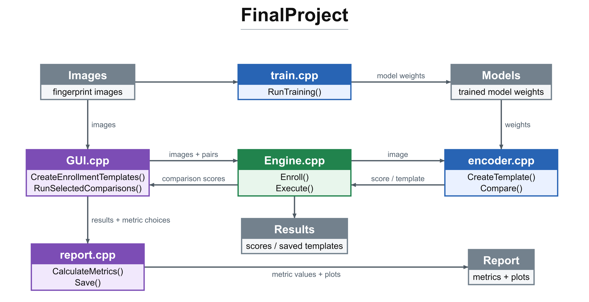

# Fingerprint Evaluator

지문 이미지를 등록하고 다른 이미지와 비교해, 지문인식 모델의 성능을 평가하는 C++ 프로그램입니다. DeepPrint 기반 모델로 특징을 추출하고, 유사도·처리 시간·평가지표를 화면과 리포트로 확인합니다.

[](docs/diagrams/overview.svg)


현재 모델은 등록 이미지와 비교 이미지에서 각각 30차원 템플릿을 만들고 유사도를 비교합니다. 점수는 동일 지문일 확률이 아니며, 판정 기준은 결과 화면에서 조절할 수 있습니다. 구조도와 `GUI_flows`는 현재 흐름을 설명하고, `demo.gif`와 `Report_example`은 이전 실행 예시로 보존합니다.

처음 사용하는 경우 **의존성 설치 → 빌드 → 사전학습 파일로 Fine-tuning → GUI에서 학습 결과 선택** 순서로 진행합니다. Clone에는 학습 초기 파일이 포함되지만, GUI용으로 학습된 네 모델은 포함되지 않습니다. [Windows](#windows--visual-studio) · [macOS/Linux](#macos--linux) · [GUI 사용법](#gui-guide)

## Windows / Visual Studio

보라색 아이콘의 **Visual Studio 2022 IDE** 기준입니다. Installer에서 **Desktop development with C++**, MSVC v143 x64, Windows SDK, **C++ CMake tools for Windows**를 설치합니다.

Git·Git LFS, CMake 3.21 이상, MSVC x64용 Qt Widgets·TIFF plugin, Windows x64 CPU용 LibTorch가 필요합니다. LibTorch와 프로젝트는 **Release** 구성을 사용합니다. [Visual Studio 안내](https://learn.microsoft.com/en-us/cpp/build/cmake-projects-in-visual-studio?view=msvc-170) · [LibTorch 설치](https://docs.pytorch.org/cppdocs/installing.html)

아래 명령은 **Developer Command Prompt for VS 2022**에서 실행합니다. Windows 실행은 아직 검증하지 않았습니다.

#### 1. Clone

```bat
git lfs install && git clone --recurse-submodules https://github.com/12B-theDon/AdvancedOOP_TeamProj.git && cd AdvancedOOP_TeamProj
```

#### 2. Build

예시는 Qt가 `C:\deps\Qt\msvc2022_64`, LibTorch가 `C:\deps\libtorch`에 설치된 경우입니다. 설치 위치가 다르면 아래 경로를 바꿉니다.

```bat
set "PATH=C:\deps\Qt\msvc2022_64\bin;C:\deps\libtorch\lib;%PATH%"
set "QT_PLUGIN_PATH=C:\deps\Qt\msvc2022_64\plugins"
cmake -S . -B build-vs -G "Visual Studio 17 2022" -A x64 -DCMAKE_PREFIX_PATH="C:\deps\Qt\msvc2022_64;C:\deps\libtorch" && cmake --build build-vs --config Release --target FingerprintGUI FingerprintTrain --parallel 2
```

빌드가 성공하면 실행에 필요한 DLL과 Qt plugin을 준비합니다.

```bat
copy /Y "C:\deps\libtorch\lib\*.dll" "build-vs\Release\" && "C:\deps\Qt\msvc2022_64\bin\windeployqt.exe" --release "build-vs\Release\FingerprintGUI.exe"
```

`build-vs/FingerprintEvaluator.sln`을 Visual Studio에서 열면 IDE에서도 빌드할 수 있습니다. 구성은 **Release / x64**로 선택합니다. [Qt 배포 안내](https://doc.qt.io/qt-6/windows-deployment.html)

#### 3. Training

사전학습 파일 **`models/pretrained/deepprint.bin`**과 정보 파일 `deepprint.json`은 Clone할 때 함께 받습니다. 모델이 내려오지 않았다면 프로젝트 폴더에서 `git lfs pull`을 실행합니다. Python 변환은 필요하지 않습니다. [사전학습 파일 안내](src/Algorithm/readme.md#conversion--offline-run)

**Clone 직후에는 `models/run_01`이 없습니다.** 아래 명령을 실행하면 출력 폴더가 자동 생성되고, 학습이 완료되면 GUI에서 사용할 네 모델이 저장됩니다. `deepprint.bin`은 학습 초기값이며 GUI에서 직접 선택하는 비교용 모델은 아닙니다.

```bat
build-vs\Release\FingerprintTrain.exe data\original models\pretrained\deepprint.bin models\run_01
```

세 DB의 개별 모델과 통합 모델을 각각 학습합니다. 네 모델 모두 30개 값을 출력하며, 판정 기준을 담은 `calibration.json`도 함께 저장합니다. 재학습에는 `run_02`처럼 **새 출력 폴더명**을 사용합니다. 이미 학습된 네 모델을 별도로 받은 경우에는 이 단계를 생략할 수 있습니다. [IDE에서 학습하기](src/Algorithm/readme.md#windows--visual-studio)

#### 4. Inference

```bat
build-vs\Release\FingerprintGUI.exe
```

GUI의 Step 3에서 `Select weights folder...`를 누르고 **학습이 완료된 모델 폴더**를 선택합니다. 위 Training 명령을 완료했다면 `models/run_01`, 다른 경로로 학습했거나 모델을 공유받았다면 해당 폴더를 선택합니다. Clone만 한 상태에서는 학습을 먼저 완료해야 비교할 수 있습니다.

IDE에서는 **FingerprintGUI → Set as Startup Project → Ctrl+F5**로 실행합니다. 새 Command Prompt를 열었다면 Step 2의 `set` 두 줄을 다시 실행합니다.

## macOS / Linux

C++17 compiler, Git·Git LFS, CMake 3.21 이상, Qt Widgets·TIFF plugin, OS·CPU에 맞는 LibTorch가 필요합니다. macOS arm64에서 Qt 5.15.17·LibTorch 2.15.0으로 빌드·학습·추론을 확인했습니다. Linux 실행은 아직 검증하지 않았습니다.

#### 1. Clone

```sh
git lfs install && git clone --recurse-submodules https://github.com/12B-theDon/AdvancedOOP_TeamProj.git && cd AdvancedOOP_TeamProj
```

#### 2. Build

**macOS:** Apple Silicon의 Homebrew Qt 5 경로와 `/opt/libtorch` 설치를 가정한 예시입니다. 실제 Qt·LibTorch 위치에 맞게 `CMAKE_PREFIX_PATH`를 수정합니다.

```sh
cmake -S . -B build -DCMAKE_PREFIX_PATH="/opt/homebrew/opt/qt@5;/opt/libtorch" -DCMAKE_BUILD_TYPE=Release && cmake --build build --target FingerprintGUI FingerprintTrain --parallel 2
```

**Linux:** Qt가 `/usr`, LibTorch가 `/opt/libtorch`에 설치된 경우입니다.

```sh
cmake -S . -B build -DCMAKE_PREFIX_PATH="/usr;/opt/libtorch" -DCMAKE_BUILD_TYPE=Release && cmake --build build --target FingerprintGUI FingerprintTrain --parallel 2
```

#### 3. Training

`models/pretrained/deepprint.bin`은 Git LFS로 함께 받습니다. 파일이 없다면 `git lfs pull`을 실행합니다. Python 변환 없이 아래 명령으로 학습할 수 있습니다. [사전학습 파일 안내](src/Algorithm/readme.md#conversion--offline-run)

**`models/run_01`은 Clone에 포함된 폴더가 아니라 학습 명령이 생성하는 출력 폴더입니다.**

```sh
./build/FingerprintTrain data/original models/pretrained/deepprint.bin models/run_01
```

데이터 증강, 네 모델의 학습과 저장, 저장된 모델의 검증, 판정 기준 산정까지 차례로 진행합니다. 출력 폴더의 네 `.bin`과 `calibration.json`을 함께 GUI에 사용합니다. 재학습에는 새 출력 폴더명을 사용합니다. `--augment-only`를 붙이면 증강만 생성하며, GUI용 모델은 생성하지 않습니다.

#### 4. Inference

```sh
./build/FingerprintGUI
```

Step 3에서 **학습이 완료된 모델 폴더**를 선택합니다. 위 명령으로 학습했다면 `models/run_01`입니다. 학습을 생략하려면 별도로 받은 Fine-tuned 모델 폴더가 필요하며, `models/pretrained`는 GUI 비교용 폴더가 아닙니다. Linux에서는 GUI를 표시할 데스크톱 세션이 필요합니다.

## DLL / Algorithm Replacement

**현재 외부 알고리즘 DLL을 교체하는 기능은 미구현입니다.** Algorithm과 Engine은 실행 파일에 정적으로 연결됩니다.

지금은 Step 3에서 **호환되는 `.bin` weight**를 바꿔 다른 학습 모델로 실행할 수 있습니다. 폴더 안의 파일명은 `fvc2000_db3.bin`, `fvc2002_db3.bin`, `fvc2004_db1.bin`, `combined.bin`이며 `calibration.json`도 함께 둡니다. 현재 모델 형식인 Cosine30 v2만 지원합니다. 이전 512차원 모델을 선택하면 재학습 안내가 표시됩니다. 모델을 바꾸면 템플릿을 다시 생성해야 합니다.

외부 DLL을 사용하려면 DLL 로더와 함수 규격을 연결하는 Adapter, GUI의 선택 기능을 추가해야 합니다. Qt·LibTorch DLL 교체는 실행 의존성을 바꾸는 작업이며, 지문 알고리즘 선택과는 별개입니다. [Engine 확장 안내](src/Engine/readme.md#dll-backend--extension)

## Architecture

`algorithm`은 전처리·학습·특징 추출을, `engine`은 모델 실행과 비교를, `gui`는 사용자 입력·결과 표시·리포트를 담당합니다. Qt와 LibTorch를 사용하며, 이미지 정보와 실행 기록은 모듈 간에 공유합니다. 객체의 소유권과 수업 개념을 적용한 설계는 [소유권 설명](src/Algorithm/readme.md#course-concepts--ownership)에 정리했습니다.

### Algorithm

사전학습 모델의 일부만 미세 조정하는 Partial FT를 사용합니다. 학습한 Cosine Classifier를 추론에도 유지하고, Softmax 출력으로 30차원 템플릿을 만듭니다. 등록 이미지와 비교 이미지는 같은 모델로 처리합니다. [상세 설명](src/Algorithm/readme.md)

[](docs/diagrams/algorithm.svg)

### Engine

비교할 이미지쌍을 만들고 선택한 모델을 실행합니다. 동일 이미지의 비교를 제외하고, 모델별 점수·시간·오류를 수집해 저장합니다. [상세 설명](src/Engine/readme.md)

[](docs/diagrams/engine.svg)

### GUI / Report

입력과 선택을 Engine에 전달하고 결과를 표시합니다. Threshold에 따른 판정, 평가지표 계산, HTML 리포트와 SVG 그래프 생성을 담당합니다. [상세 설명](src/GUI/readme.md)

[](docs/diagrams/gui.svg)

## Hyperparameters

대표 설정만 정리했습니다. `*Config.h`를 수정하면 다시 빌드해야 하며, Threshold는 GUI에서도 조절할 수 있습니다.

| 항목 | 기본값 | 설정 파일 |
|---|---|---|
| Encoder 입력 / 중간 특징 | 299×299 [px] / 512 | [encoderConfig.h](src/Algorithm/encoderConfig.h) |
| 템플릿 / 분류기 출력 | 30차원 Softmax / 네 모델 공통 | [encoderConfig.h](src/Algorithm/encoderConfig.h) |
| 정사각형 변환 | FVC2004 중앙 Crop, 나머지 Padding | [전처리 설명](src/Algorithm/readme.md#encoder-architecture--preprocessing) |
| 원본당 증강 수 / Seed | 12장 / 42 | [augmentConfig.h](src/Algorithm/augmentConfig.h) |
| Optimizer / Learning rate | Adam / 0.0001 | [trainConfig.h](src/Algorithm/trainConfig.h) |
| Batch / Epoch | 32 / 20 | [trainConfig.h](src/Algorithm/trainConfig.h) |
| 유사도 판정 기준 | DB·선택 모델별 추천값, 추천값이 없을 때 초기값 0.5954 | [engineConfig.h](src/Engine/engineConfig.h) |

**Partial FT와 Cosine Classifier를 유지하고, 30차원 Softmax 출력끼리 비교하는 구조를 채택했습니다.** 전처리 비교에서는 FVC2004의 중앙 자르기가 더 우수해 이를 적용했습니다. 이후 학습 방식과 분류기 구조를 비교한 결과, 통합 모델의 지문 비교 성능과 기존 구조의 활용을 고려해 현재 방식을 선택했습니다. [실험 과정과 결과](src/Algorithm/readme.md#experiments--selection-history)

최종 Seed 42 모델에서 통합 EER은 기존 512차원 방식의 6.512%에서 30차원 방식의 0.617%로 낮아졌습니다. 이는 학습에 사용한 손가락의 다른 촬영본으로 평가한 결과이며, 새로운 손가락이나 외부 DB에서의 성능을 뜻하지 않습니다. [네 모델의 결과와 판정 기준](src/Algorithm/readme.md#final-production-run--calibration)

학습된 모델과 실험 결과는 로컬에 보존하고 Git에서 제외합니다. 현재 로컬 모델 폴더는 `models/current`이며, [모델 폴더 안내](models/readme.md)에서 용도와 보관 위치를 확인할 수 있습니다. 재학습에 필요한 사전학습 파일은 기존 Git LFS 정책으로 배포합니다.

## GUI Guide

**DB 선택 → 등록 이미지 선택 → Template 생성 → 비교 종류·규칙 선택 → 실행 → 결과 확인**

한 장 또는 여러 장을 등록하고 Genuine(같은 손가락), Impostor(다른 손가락), 또는 두 종류를 함께 비교합니다.

| 단계 | 목적과 선택지 |
|---|---|
| 1. DB | 제공 DB 3개 중 하나를 선택하거나 `Load external DB...`로 TIFF 폴더를 불러옵니다. |
| 2. Enrollment | 등록할 이미지 한 장 또는 여러 장을 선택합니다. 각 이미지는 별도의 Template이 됩니다. |
| 3. Template | 학습이 완료된 Weight 폴더와 사용할 모델을 선택해 Template을 생성합니다. 제공 DB는 해당 개별 모델이 기본값이며, 통합 모델도 선택할 수 있습니다. |
| 4. Comparison type | 같은 손가락은 `Genuine`, 다른 손가락은 `Impostor`, 모두 비교하려면 `Both`를 선택합니다. |
| 5. Comparison rules | 전체 이미지, 손가락당 한 장, 지정 촬영 번호, 무작위 개수, CSV 중 비교 대상을 고르는 방법을 선택합니다. 무작위 선택에만 Seed를 사용합니다. |
| 6. Run | 비교 개수를 확인하고 `Run selected comparisons`를 누릅니다. |
| 7. Results | 결과와 Threshold를 확인합니다. `Metrics and report` 탭에서 지표를 선택하고 `Save all`로 저장합니다. |

등록 이미지마다 별도의 템플릿을 만듭니다. 비교 점수는 높을수록 두 지문이 비슷하다는 뜻이며, 동일 지문일 확률은 아닙니다. 여러 모델을 선택하면 가장 높은 점수로 판정합니다. 결과 표의 Best/Worst는 모델별 최고·최저 점수입니다.

판정 기준은 학습 결과 폴더의 `calibration.json`에서 불러옵니다. DB와 선택 모델에 따라 추천값이 달라지며, Genuine과 Impostor의 기준은 결과 화면에서 각각 조절할 수 있습니다. 외부 DB에 적용하는 값은 제공 DB의 검증 결과를 참고한 값으로, 외부 이미지에서의 정확도를 보장하지 않습니다.

Genuine은 기준 이상이면 **PASS**, 미만이면 **MISS**입니다. Impostor는 기준 미만이면 **REJ**, 이상이면 **FA**입니다. Threshold를 바꾸면 재추론 없이 판정이 갱신됩니다.

화면과 HTML에는 선택한 지표를 표시하고, CSV에는 전체 지표와 원시 결과를 저장합니다. 학습 초기 파일은 Git LFS로 배포하며, 학습된 Weight·증강 데이터·빌드 결과는 제외합니다.

[한 장 등록](GUI_flows/01_single_enrollment.png) · [여러 장 등록](GUI_flows/02_multiple_enrollment.png) · [외부 DB](GUI_flows/03_external_db.png) · [리포트 미리보기](Report_example/report_preview.png)

## Training / Runtime Files

증강·학습·모델 저장·성능 평가·임계값 산정·GUI 추론은 C++에서 수행합니다. 검증 전용이던 `tests/`와 별도 검사 실행 대상은 정리했으며, 학습 과정의 저장·재로딩·출력 검사는 그대로 유지합니다. 저장된 모델의 성능과 판정 기준을 다시 계산하려면 학습 명령에 `--verify-only`를 붙입니다. [평가 명령과 한계](src/Algorithm/readme.md#verification--limits)

[prepare_deepprint.py](tools/prepare_deepprint.py)는 공개 원본 체크포인트를 C++ 학습 초기 파일로 변환하는 도구이므로 유지합니다. 준비된 `models/pretrained/deepprint.bin`으로 학습할 때는 실행할 필요가 없습니다. 그림·화면 생성용 보조 도구는 정리했으며, 기존 SVG·PNG와 캡처 결과는 보존합니다.

## License / Submodule

공개 [DeepPrint 재구현](https://github.com/tim-rohwedder/fixed-length-fingerprint-extractors)을 Submodule로 사용합니다. 위의 Clone 명령은 해당 소스도 함께 받습니다. 출처와 수정 사항은 [NOTICE](third_party/deepprint.NOTICE.txt)에 있습니다.

| 구성 요소 | 확인 가능한 License |
|---|---|
| DeepPrint 재구현 | [LGPL-3.0](https://github.com/tim-rohwedder/fixed-length-fingerprint-extractors/blob/7accfca1f33b9b42bfd220e43cd5bc13b4a7fa13/LICENSE) |
| InceptionV4 / Remi Cadene | [BSD-3-Clause](https://github.com/tim-rohwedder/fixed-length-fingerprint-extractors/blob/7accfca1f33b9b42bfd220e43cd5bc13b4a7fa13/flx/models/InceptionV4.py) |
| Qt | [LGPL-3.0 / GPL / Commercial 조건](https://doc.qt.io/qt-6/licensing.html), 사용하는 모듈과 배포본에 따라 확인 |
| LibTorch / PyTorch | [BSD-style 및 포함된 Third-party License](https://github.com/pytorch/pytorch/blob/main/LICENSE) |

공개 사전학습 weight의 별도 License는 확인되지 않았습니다. 소스 License와 구분하며, 준비 방법은 [Algorithm README](src/Algorithm/readme.md#conversion--offline-run)를 참고합니다.

## Libraries / Headers

| Library | 주요 Header | 용도 |
|---|---|---|
| Qt Core | `QDir`, `QFile`, `QJsonDocument`, `QCryptographicHash` | 파일·경로, 설정·Metadata, Hash 처리 |
| Qt Gui | `QImage`, `QImageReader`, `QPainter`, `QBrush` | TIFF 입출력, 증강, 이미지 표시와 색상 |
| Qt Widgets | `QApplication`, `QWizard`, `QTableWidget`, `QFileDialog`, `QDoubleSpinBox` | 단계별 화면, 선택·입력, 결과 표 |
| LibTorch | `torch/script.h`, `torch/torch.h` | 모델 로드·저장, Tensor 연산, Fine-tuning |
| ATen | `ATen/ops/_upsample_bilinear2d_aa.h` | 전처리의 Antialiased bilinear resize |

사전학습 Archive를 받은 이후 증강·학습·Classifier 포함 저장·보정·GUI 추론은 모두 C++입니다. Python 변환 도구는 공개 원본 체크포인트에서 학습 초기 파일을 직접 준비할 때만 필요합니다. 사용하지 않는 MLP/비교 스크립트와 별도 export_features/predict_id 실행 파일은 운영 소스에서 제거했습니다. 실제 빌드 의존성은 [CMakeLists.txt](CMakeLists.txt)에 있습니다.

## Detailed Documentation

| 문서 | 다루는 내용 |
|---|---|
| [Algorithm README](src/Algorithm/readme.md) | 파일·함수별 역할, 사전학습 데이터와 구조·학습 자원, 변환 방법, 증강·Fine-tuning 상세 |
| [Engine README](src/Engine/readme.md) | 입출력 자료형, 모델 선택, 비교 규칙, DLL 확장 지점, 원시 결과 형식과 실행 제한 |
| [GUI README](src/GUI/readme.md) | 7단계 화면, Threshold 판정·색상, 지표 수식, 그래프·리포트 저장 |
