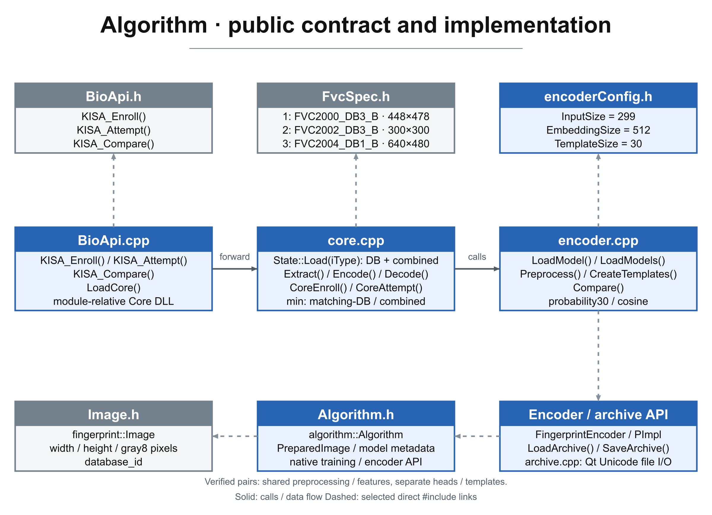
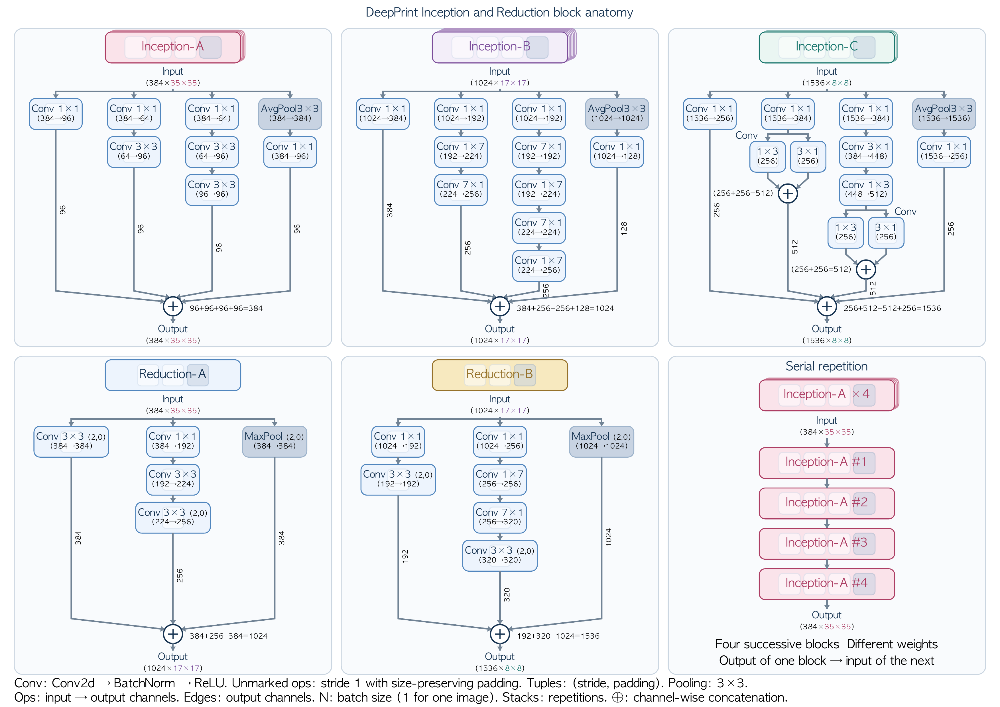

# Algorithm 모듈

`FingerprintEncoder`가 TorchScript 모델을 로딩하고 전처리, Template 생성과 비교를 수행합니다. 학습·검증 도구와 `FingerprintAlgorithmCore`가 이 모듈을 사용합니다.

- `encoder.h/.cpp`: 모델을 실행하고 확률 Template을 직렬화합니다.
- `encoderConfig.h`: 입력 크기, 모델 차원, 전처리·Template 형식을 정의합니다.
- `Algorithm.h`: native encoder 인터페이스와 입력·metadata 자료형을 정의합니다.

512차원 embedding을 cosine classifier ×16과 Softmax에 통과시킨 30차원 확률 벡터를 사용합니다. 모델별 점수는 `(cosine + 1) / 2`입니다.

DeepPrint Inception·Reduction 블록 상세

[블록 그림 SVG 원본](../../docs/diagrams/deepprint_blocks.svg)

[구조도 SVG 원본](../../docs/diagrams/algorithm.svg) · [전처리·학습 설정](../../docs/baseline/training_configuration.md) · [DLL 구성](../Kisa/readme.md)
