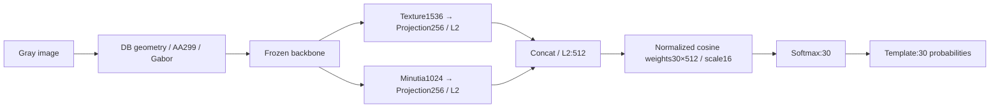

# Algorithm

[Root](../../readme.md) · [Engine](../Engine/readme.md) · [GUI](../GUI/readme.md)

## Responsibility / Files

현재 운영 모델은 **Partial FT로 두 Projection과 Cosine Classifier를 학습하고, 추론에서도 Classifier를 유지해 30차원 Softmax 출력끼리 비교하는 구조**다. 데이터 증강·학습·모델 저장·등록·비교는 C++/LibTorch로 수행한다. 준비된 사전학습 파일을 사용하면 Python 실행은 필요하지 않다.

알고리즘의 자료형·함수·설정은 `algorithm` namespace에 둔다. `.cpp` 내부에서만 쓰는 함수는 익명 namespace로 제한한다. 증강과 학습의 난수 Seed는 `AugmentSeed`와 `TrainSeed`로 구분한다.

| 파일 | 역할 |
|---|---|
| [Algorithm.h](Algorithm.h) | Engine이 사용하는 추상 인터페이스와 이미지·전처리·모델 정보 자료형 |
| [encoder.h](encoder.h), [encoder.cpp](encoder.cpp) | 모델 로딩과 호환성 검사, 전처리, 템플릿 생성·비교, SHA-256 및 모델 저장 공통 함수 |
| [encoderConfig.h](encoderConfig.h) | 512차원 중간 특징과 30차원 출력의 설정, 파일 형식과 전처리 상수 |
| [augment.h](augment.h), [augment.cpp](augment.cpp), [augmentConfig.h](augmentConfig.h) | 데이터 증강과 설정, 입력·출력 이력을 담은 매니페스트 |
| [train.h](train.h), [train.cpp](train.cpp), [trainConfig.h](trainConfig.h) | 학습 데이터와 캐시 준비, 네 모델의 독립 학습, 분류기를 포함한 모델 저장, 성능 평가와 임계값 산정 |

모델 입출력에 관한 공통 구현은 `encoder.cpp`에, 학습 데이터 준비와 학습 후 평가는 `train.cpp`에 모았다. 학습 데이터 구조와 함수 선언은 `train.h`에 둔다. 전역 `main()`은 `algorithm::RunTraining()`으로 학습 실행을 위임한다. 별도의 보조 소스 파일 없이 위 파일들로 알고리즘을 구성한다.

`export_features.cpp`와 `predict_id.cpp`에서 필요했던 기능은 `FingerprintTrain`의 캐시·검증 경로로 통합했다. 더 이상 쓰지 않는 MLP 학습·비교 스크립트도 운영 소스에서 제거했다. 기존 실험 설정과 결과는 로컬 `models/validation/experiments`에 보존하며 Git에는 포함하지 않는다. 이전 소스 스냅샷과 실험 전용 코드는 결과를 확인한 뒤 정리했다.

[prepare_deepprint.py](../../tools/prepare_deepprint.py)는 공개 체크포인트를 C++ 학습 초기 파일로 변환하는 데 사용하므로 유지한다. 디버깅 도구가 아니라 입력 모델을 준비하는 변환 도구이며, 이미 제공된 `deepprint.bin`으로 학습할 때는 필요하지 않다. 별도 검증 전용이던 `tests/`와 CMake 검사 대상은 제거했다. 모델 저장 검증과 학습 후 평가는 `train.cpp`의 운영 경로에 남아 있다. 원본·증강 파일의 해시와 오류 검사에는 Encoder의 공통 함수를 재사용한다. 입력·템플릿 오류는 실패 상태로 반환하고, LibTorch 실행과 학습 파일 입출력의 실제 예외만 호출 경계에서 처리한다.

## Course Concepts / Ownership

공통 인터페이스 `Algorithm`과 구현 `FingerprintEncoder`는 추상 클래스·상속·virtual 소멸자·override/final을 사용한다. `Engine`은 이 인터페이스의 포인터를 빌려 호출하며, 알고리즘 객체를 삭제하지 않는다. `main.cpp`는 Encoder를 지역 객체로 먼저 생성하고 Window를 나중에 생성하므로, Encoder가 Window보다 오래 유지된다. Encoder·Engine·Window는 독립적인 실행 상태를 관리하므로 복사 생성자와 복사 대입을 `= delete`로 금지한다. 이미지·설정·실행 기록처럼 값으로 다루는 구조체는 기존 컨테이너의 복사 규칙을 따른다.

큰 읽기 전용 입력은 const 참조로, 결과를 채우는 인자는 일반 참조로 전달한다. `RetainClassifier`는 원본 Encoder를 공유하고 추론 모드로 바꾸므로 일반 참조를 받는다. 증강 중에는 원본 목록에 새 항목이 추가되어 참조가 무효화될 수 있어 현재 원본 정보를 값으로 보관한다. 기능에 필요한 복사까지 제거하지 않는다. 프로젝트에는 별도 `Array<T>` 구현이 없어 기존 `vector`와 Qt 컨테이너를 유지한다.

수업 범위 밖에서 유지한 기능과 이유는 다음과 같다.

| 기능 | 동작과 유지 이유 |
|---|---|
| `unique_ptr<State>`와 전방 선언 | Encoder만 State를 소유하며 소멸할 때 자동 해제한다. Torch 구현을 헤더 밖에 숨긴다. 수동 new/delete와 별도 복사 관리로 바꾸지 않는다. |
| LibTorch Module/Tensor | 복사는 내부 저장 공간을 공유할 수 있다. 래퍼는 Encoder를 공유하고 Classifier 가중치는 명시적으로 복제한다. 임시 픽셀·파일 버퍼를 가리키는 `from_blob` 결과는 `clone()`하여 버퍼 소멸 후에도 유효하게 만든다. |
| 지역 람다 | 학습의 점수·CSV 집계와 Logits 계산에 필요한 지역 상태를 참조한다. 즉시 사용하고 외부에 저장하지 않으며 인자·반환 타입을 명시한다. 별도 상태 클래스와 긴 인자 목록을 추가하는 대신 유지한다. |
| `inline constexpr` | C++17에서 설정 상수를 헤더에 정의한다. 학습 설정·기본값을 표현하며 GUI에서 조절하는 실제 임계값은 별도 실행 상태다. |
| Tensor 전용 헤더 | `train.h`는 `torch::Tensor`와 같은 타입인 `at::Tensor`의 전용 헤더만 포함한다. JIT·학습 API는 `.cpp`에서 포함해 Qt의 `slots` 매크로와 충돌하지 않게 한다. |

잘못된 명령행 인자는 오류 메시지와 실패 코드로 반환한다. 모델 실행·파일 입출력의 실제 오류는 호출 경계에서 처리하고, 모델 형식·차원·확률·Weight/Label 호환성 검사는 유지한다.

## Pretrained Model / Training Provenance

### Original DeepPrint

아래는 [Engelsma·Cao·Jain의 원본 논문](https://arxiv.org/html/1909.09901v2) III·XIII 절에 보고된 내용이다. 프로젝트가 실제로 사용하는 공개 재구현과는 구분한다.

| 항목 | 논문에 보고된 내용 |
|---|---|
| Training data | Longitudinal rolled fingerprint 약 455K장, 38,291개 Finger identity. |
| Architecture | Localization/Alignment → Inception-v4 Stem → Texture·Minutiae branch. 두 96-dimensional vector를 합쳐 192-dimensional representation을 만든다. |
| Supervision | 두 Identity classification, Center loss, Minutiae map MSE를 결합한다. Loss weight는 1, 0.00125, 0.095다. |
| Training | RMSProp, Batch 30, 140K steps, 약 25시간. Dropout keep probability 0.8, Weight decay 0.00004. |
| Resource | TensorFlow 1.14.0, NVIDIA GeForce RTX 2080 Ti 2대. Search/Authentication 실험용 Core i9-7900X·RAM 32 GB는 Training 자원과 구분한다. |

이 프로젝트는 원 논문의 가중치 대신 공개 재구현의 체크포인트를 사용하며, 논문의 200byte 압축 템플릿은 구현하지 않는다.

### Public Reimplementation / Checkpoint

실제 Source는 [Rohwedder et al.의 fixed-length-fingerprint-extractors](https://github.com/tim-rohwedder/fixed-length-fingerprint-extractors/tree/7accfca1f33b9b42bfd220e43cd5bc13b4a7fa13)다. Commit은 `7accfca1f33b9b42bfd220e43cd5bc13b4a7fa13`이다.

| 근거 | 확인한 Training data·방법 |
|---|---|
| [BIOSIG 2023 논문](https://arxiv.org/html/2307.08615v1) III-A | SFinGe 4,000 fingers × 10 = 40,000장과 MCYT 2,000 fingers × 12 × 2 sensors = 48,000장. 합계 88,000장으로 서술한다. Input은 299×299 [px], Gabor enhancement와 Rotation·Translation·Brightness/Contrast augmentation을 사용한다. |
| [저장소 README](https://github.com/tim-rohwedder/fixed-length-fingerprint-extractors/blob/7accfca1f33b9b42bfd220e43cd5bc13b4a7fa13/README.md)·[datasets.py](https://github.com/tim-rohwedder/fixed-length-fingerprint-extractors/blob/7accfca1f33b9b42bfd220e43cd5bc13b4a7fa13/flx/setup/datasets.py) | SFinGe Training 6,000 fingers × 10 = 60,000장, MCYT Training 2,000 fingers × 12 × 2 = 48,000장이다. Identity는 Sensor 간 공유하므로 총 8,000 classes다. SFinGe Validation은 별도 2,000 fingers × 4장이다. |
| [deep_print_loss.py](https://github.com/tim-rohwedder/fixed-length-fingerprint-extractors/blob/7accfca1f33b9b42bfd220e43cd5bc13b4a7fa13/flx/models/deep_print_loss.py) | Branch별 Cross entropy + Center loss, Minutiae map MSE를 사용한다. 구현의 계수는 각각 1, 0.125, 0.3이다. 원본 논문 계수와 다르다. |
| [model_training.py](https://github.com/tim-rohwedder/fixed-length-fingerprint-extractors/blob/7accfca1f33b9b42bfd220e43cd5bc13b4a7fa13/flx/models/model_training.py) | Adam을 사용한다. 저장 Code는 Validation EER가 가장 좋은 시점의 Checkpoint를 보관한다. README의 종료 설명만으로 정확한 학습 Epoch을 확정할 수 없다. |

논문에는 합성 손가락 4,000개, 저장소에는 6,000개로 서로 다르게 기재되어 있다. 내려받은 파일의 분류기 크기는 `[8000,256]`으로 저장소 설정과 맞지만, 클래스 수만으로 실제 학습 이미지 목록을 확정할 수는 없다. 해당 체크포인트의 전체 데이터 매니페스트와 학습 로그는 제공 파일에서 확인되지 않았다.

| 실제 다운로드 파일 | 확인 내용 |
|---|---|
| `models/pretrained/best_model.pyt` | 저자 [Google Drive 공개 파일](https://drive.google.com/file/d/1R9v73hFBuy0iihz7v8eDlBcGrMDmQ9TH/view). Python의 `model_state_dict`, `loss_state_dict`, `optimizer_state_dict`를 포함한다. |
| SHA-256 | `2683a04427bacd54adc00cfdc97474625b1e11e5a9e6672c5129f033018f8a28` |
| Architecture 확인 | `DeepPrint_TexMinu(8000,256,256)`에 `strict=True`로 전체 State dict가 일치했다. |
| Optimizer snapshot 확인 | LR 0.0015, Betas `(0.9,0.999)`, Epsilon `1e-8`, Weight decay 0, Step 526,500. 이는 저장 시점의 State이며 전체 LR schedule·총 Epoch을 뜻하지 않는다. |
| Converted archive | `models/pretrained/deepprint.bin`, `models/pretrained/deepprint.json`. `model_id=pretrained`이며 Fine-tuning 초기값으로 사용한다. GUI의 네 Model ID와는 다르다. |

### Pretraining Resource / Known Limits

| 근거 | 확인 범위 |
|---|---|
| Upstream README | A100에서 Epoch당 약 10–15분, 최대 약 100 Epoch의 안내가 있다. CPU 8 cores 이상을 권장한다. 해당 Checkpoint의 실측 시간으로 단정할 수 없다. |
| [torch_helpers.py](https://github.com/tim-rohwedder/fixed-length-fingerprint-extractors/blob/7accfca1f33b9b42bfd220e43cd5bc13b4a7fa13/flx/models/torch_helpers.py) | Training Batch 16, CUDA device 0, A100 분기와 40 GB 관련 주석이 있다. 실제 GPU 수·GPU 사용량·Peak RAM/VRAM 기록은 아니다. |
| Checkpoint 자체 | GPU model·수량, OS, 정확한 PyTorch version, Wall time, Peak memory, Epoch 이력은 확인되지 않았다. 이를 현재 PC의 실행 환경으로 대신 채우지 않는다. |

## Encoder Architecture / Preprocessing

아래는 전처리부터 최종 출력까지의 현재 구조다. Inception·Reduction 블록은 사전학습 모델의 구조를 유지한다.

[모델·Fine-tuning 구조도](../../docs/diagrams/deepprint_finetuning.svg) · [PNG](../../docs/diagrams/deepprint_finetuning.png) · [Inception·Reduction 내부 구조](../../docs/diagrams/deepprint_blocks.svg) · [PNG](../../docs/diagrams/deepprint_blocks.png)

구조도의 `FC + Softmax`는 현재 Cosine Classifier와 Softmax를 묶은 표기이며 MLP를 추가한 구조가 아니다.



선택한 공개 `TexMinu` 모델에는 위치 정렬용 `Loc` 네트워크가 없다. Texture 분기는 Inception-A×4 → Reduction-A → Inception-B×7 → Reduction-B → Inception-C×3 → 평균 풀링을 거쳐 1,536개 특징을 만든다. Minutia 분기는 Inception-A×6 → Conv384→768→768→896→1024 → 최대 풀링을 거쳐 1,024개 특징을 만든다. 두 Projection은 각각 256차원으로 변환한 뒤 L2 정규화한다. 이를 이어 붙인 512차원 벡터를 다시 L2 정규화하고, 편향 없는 30개 클래스의 Cosine Classifier와 Softmax를 통과시킨다.

전처리 순서는 `Gray8/255 → DB별 정사각형 변환 → 안티앨리어싱을 적용한 bilinear 299×299 축소 → Gabor(ridge width 1.8)`다. FVC2004는 640×480 이미지의 좌우 80px를 잘라 중앙 480×480 영역을 사용한다. FVC2000·FVC2002와 출처를 알 수 없는 이미지는 흰색 여백을 채워 정사각형으로 만든다. FVC2004는 증강하기 전에도 중앙 자르기를 먼저 적용한다. 학습·등록·비교는 같은 `FingerprintEncoder::Preprocess`를 사용하며, Gabor를 중복 적용하지 않는다. 원본 파일은 보존한다.

현재 모델 형식은 `deepprint-cosine-probabilities-v2`다. Encoder의 중간 특징은 512차원, 최종 출력은 30차원이며 각각 별도 상수로 관리한다. 네 모델은 `DB:finger`로 구분한 동일한 30개 ID와 출력 순서를 공유한다. 개별 DB 모델도 30개 출력을 모두 Softmax와 CE 계산에 포함하지만, 정답에는 해당 DB의 10개 ID만 등장한다. 남은 20개를 0으로 덧붙이거나, 다른 DB의 같은 번호를 하나의 손가락으로 합치지 않는다.

## Fine-tuning / Data Split

학습 데이터가 적어 전체 모델을 학습할 때의 과적합이 우려되므로 Partial FT를 사용한다. 사전학습 Backbone과 BatchNorm 통계는 고정하고, 두 Projection의 파라미터 655,872개와 Cosine Classifier의 파라미터 15,360개만 학습한다. 변환한 모델에는 Dropout이 포함되지 않으며 Backbone은 평가 모드를 유지한다.

| 모델 | 출력 수 / 학습 ID 수 | 학습 원본 + 증강 | 검증 원본 |
|---|---|---:|---:|
| fvc2000_db3 | 30 / 10 | 60+720=780 | 20 |
| fvc2002_db3 | 30 / 10 | 60+720=780 | 20 |
| fvc2004_db1 | 30 / 10 | 60+720=780 | 20 |
| combined | 30 / 30 | 180+2160=2340 | 60 |

촬영본 1–6번과 그 증강본으로 학습하고, 촬영본 7–8번의 원본으로 검증한다. 검증 촬영본의 증강본은 학습과 검증 어디에도 넣지 않는다. 학습과 검증에 같은 손가락 ID가 등장하므로, 이 결과는 다른 촬영본에 대한 성능이다. 독립 테스트나 미학습 손가락·외부 DB에 대한 검증으로 해석하지 않는다.

네 모델은 원래 사전학습 파일에서 각각 새로 시작한다. Adam, 학습률 0.0001, Weight decay 0.0001, Batch 32, 40 Epoch, Seed 42로 학습한다. Logit은 `16 × embedding @ normalized_classifier_weight.T`로 계산하며, CE에는 Softmax 이전 값을 넣는다. 추론 모델에는 Softmax까지 포함한다. 마지막 Epoch의 모델을 저장하고 조기 종료나 최적 Epoch 선택은 하지 않는다. 이미지 순서는 이전 비교 실험과 같게 유지한다. Encoder와 Classifier를 모두 저장하되, Optimizer 상태를 저장하는 학습 재개 기능은 제공하지 않는다.

기본 학습 횟수는 동일 조건의 5개 Seed(42–46), 네 모델을 각각 100 Epoch까지 학습한 비교를 바탕으로 40 Epoch로 정했다. 20→40 Epoch에서 평균 EER은 FVC2002 1.148→0.815%, FVC2004 1.444→0.889%, 통합 0.475→0.370%로 낮아졌고, FVC2000은 0%를 유지했다. 100 Epoch에서는 FVC2002가 0.667%로 더 개선됐지만 FVC2004·통합은 40 Epoch와 같았다. 네 모델의 최고 점수를 사용하는 집계의 전체 EER은 40 Epoch 4.444%에서 100 Epoch 4.722%로 높아져, 공통 기본값은 학습 비용과 집계 성능을 함께 고려한 40으로 선택했다. 이는 학습 ID의 다른 촬영본을 평가한 결과이며, 모든 모델·지표에서 40이 최적이라는 뜻은 아니다. 실험용 임시 파일은 확인 후 삭제했다.

특징 캐시는 원본·학습 증강 이미지, 매니페스트, 전처리 설정, 사전학습 파일과 특징 데이터의 SHA-256을 검사한 뒤 재사용한다. 또한 2400×2560 Float32 크기와 각 행의 ID·학습/검증 구분·순서를 확인한다. 캐시를 재사용해도 두 Projection과 Classifier는 새로 학습한다. 캐시 크기는 약 25MB이며, 전체 프로세스의 메모리 사용량을 뜻하지 않는다.

콘솔의 `validation CE loss`는 Epoch마다 검증 원본으로 계산한 평균 Cross Entropy 손실이다. ID 분류 정확도와 지문쌍 비교의 EER·FAR는 별도 지표이며, 손실 감소만으로 최적 Epoch을 결정하지 않는다. 학습 CSV에는 `train_loss`, `validation_loss`, `validation_classification_accuracy`를 기록한다.

## Template / Model Compatibility

등록 템플릿은 학습한 30개 ID에 대한 Softmax 확률 분포다. 비교 이미지도 같은 모델과 전처리, 같은 ID 순서로 처리한다. Template은 Softmax 출력 자체이며, 비교는 모델의 순방향 실행이 끝난 뒤 수행한다. 두 확률 벡터의 점수는 `(cos(p_enroll,p_attempt)+1)/2`로 계산한다. 값이 음수가 아니므로 점수 범위는 [0.5, 1]이며, 동일 지문일 확률은 아니다. 가장 높은 확률의 ID가 같은지 판정하거나 Classifier 가중치끼리 비교하는 방식도 아니다. Genuine/Impostor 정답은 원본 손가락 ID 또는 명시한 CSV 그룹으로 결정하며, 예측 ID로 바꾸지 않는다.

| 파일 | 저장 내용 |
|---|---|
| 모델 `.bin` | Encoder·Classifier·Softmax, 형식 버전, 모델 ID, 중간/출력 차원, ID 순서, 전처리와 학습 이력 |
| 모델 `.json` 및 보정 파일 | 모델 정보와 실제 `.bin`의 SHA-256 |
| 템플릿 `.fpt` | `fingerprint-probability-template-v2` 형식의 식별 정보와 30개 Float32 값 |

`.fpt`는 Magic·버전·모델 ID·실제 Weight SHA·전체 ID 순서와 해시·전처리·출력 차원을 기록한다. Qt 5.15 스트림의 Little endian 형식이며, 확률 값 자체는 120bytes다. 화면과 리포트에는 식별 정보까지 포함한 실제 템플릿 크기를 표시한다.

구형 512차원 모델과 템플릿은 운영 경로에서 안내와 함께 거절한다. 사전학습용 `pretrained` 모델만 학습 초기값으로 허용한다. 모델을 선택하거나 다시 불러오면 Engine의 모델 버전 번호가 갱신되고 등록 템플릿이 초기화된다. 서로 다른 모델·가중치·ID 순서·전처리의 템플릿은 Backend에서도 비교를 거절한다. 모델 재로딩에 실패해도 이전 모델을 재사용하지 않는다. 로딩 실패나 호환성 오류 때문에 프로그램이 기존 파일을 자동으로 삭제하지는 않는다.

진단용 `embed_features`와 `embedding` 메서드는 512차원 특징을 유지한다. GUI의 주 비교 경로는 30차원이다. 외부 이미지의 ID가 학습 목록에 없어도 등록과 비교는 가능하지만, 그 정확도가 검증되었다는 의미는 아니다.

### Augmentation

| 증강 설정 | 현재 값·적용 확률 |
|---|---|
| `CopiesPerOriginal`, `AugmentSeed`, `Version` | 12 [images/original], 42, Cache format 2 |
| `RotationDegrees`, `RotationProbability` | −15~+15 [deg], 0.9 |
| `ScaleMin/Max`, `ScaleProbability` | 0.90~1.10 [ratio], 0.9 |
| `Fvc2004ScaleMin/Max` | 1.00~1.30 [ratio]. 중앙 Crop 후 영역에서 Foreground 잘림 제한을 적용한다. |
| `NoiseStdMin/Max`, `NoiseProbability` | Gaussian sigma 1~5 [gray8], 0.7 |
| `BrightnessMin/Max`, `BrightnessProbability` | Pixel gain 0.90~1.10, 0.8 |
| `ForegroundThreshold`, `MaxClippedForeground` | 235 [gray8] 미만을 Foreground로 보고, 화면 밖으로 나가는 비율을 최대 0.05로 제한한다. |
| `GeometryAttempts` | 32회 재추첨 후 조건을 못 맞추면 Identity geometry를 사용한다. |
| `FolderPattern` | `crop_first_%1_per_image_seed%2`. 설정이 다르면 번호 Suffix를 붙인다. |
| `SourceGeometry` | `fvc2004-center-square-before-augmentation` |

FVC2004는 중앙 480×480 영역을 먼저 자른 뒤 증강하고, 다른 DB는 원본 영역에서 증강한다. 각 변형은 독립적으로 적용 여부를 추첨한다. 회전·크기 변환을 합성한 뒤 밝기 조정과 Gaussian 잡음을 적용하고, 픽셀 값을 Gray8 범위로 제한한다. 지문 영역이 과도하게 잘리는지도 중앙 자르기 이후의 영역을 기준으로 검사한다. 이 검사는 밝기 임계값에 따른 근사이며 정밀한 지문 영역 분할은 아니다. FVC2004 증강 PNG는 이미 정사각형이므로 Encoder에서 추가로 잘리지 않는다.

증강 결과는 `data/augmented/crop_first_12_per_image_seed42`처럼 설정을 알아볼 수 있는 폴더에 저장한다. 같은 설정과 원본으로 완성된 결과만 해시를 확인해 재사용한다. 매니페스트에는 설정, 원본·결과의 SHA-256, 학습/검증 구분, 실제 변형값, 자른 위치와 변환 전후 크기를 기록한다. 설정이 다르면 별도 번호의 폴더를 사용한다. 증강 폴더는 Git에서 제외하며 추론에는 사용하지 않는다.


## Final Production Run / Calibration

이전 20 Epoch 실행 기록은 로컬 `models/validation/runs/cosine30_seed42_20epoch`에 보관한다. 학습 Weight는 배포 시 직접 준비하는 방식에 맞춰 정리했으며, 이 기록도 Clone에는 포함되지 않는다. 아래 기록은 네 모델 모두 기존 사전학습 파일에서 새로 시작해 Seed 42로 20 Epoch 학습한 **단일 실행 결과**이며, 앞선 5개 Seed 평균과 구분한다. 별도로 수행한 40 Epoch 실행의 기록은 `models/validation/runs/cosine30_seed42_40epoch`에 보존한다. 아래 수치는 20 Epoch 결과이며 40 Epoch 결과로 해석하지 않는다. 학습 시 생성되는 각 `.bin`은 약 254MiB다. 이전 동일 조건 실험과 마지막 검증 손실의 최대 차이는 7.5e-8 이하였다.

아래 표는 기존에 실제 저장했던 512차원 모델, 새 모델에서 분류기 직전의 512차원 특징, 새 모델의 최종 30차원 출력을 비교한다. 새 모델의 512차원과 30차원을 비교하면 분류기를 유지한 효과를 분리해 볼 수 있다.

| 모델 | 기존 저장 모델 512차원 EER | 새 모델의 512차원 EER | 최종 30차원 EER | 최종 30차원 AUC |
|---|---:|---:|---:|---:|
| FVC2000 |2.593% |2.593% |0.000% |1.000000 |
| FVC2002 |7.685% |7.778% |0.556% |0.999722 |
| FVC2004 |6.667% |6.667% |2.500% |0.998750 |
| 통합 |6.512% |6.512% |0.617% |0.999816 |

등록에는 원본 촬영본 1–6번, 비교에는 7–8번을 사용했다. DB별 Genuine 120쌍·Impostor 1,080쌍이며 통합 결과는 각 DB 내부의 쌍만 합산했다. 결과는 `validation_metrics.csv/json`, `validation_scores.csv`, `validation_report.html`에 보존했다. 이 EER은 C++ 평가에서 교차점을 보간한 값이다. GUI는 관측한 임계값에서 EER의 범위를 표시하므로 표기 방식이 다르며, 사용자가 고른 이미지쌍에 따라 결과도 달라질 수 있다.

### 판정 임계값 보정 (2026-11-18)

최종 저장 모델의 검증 점수로 FAR 1% 이하인 가장 낮은 임계값을 찾고, GUI 입력 정밀도에 맞춰 소수점 네 자리로 올림했다. 여러 모델을 선택하면 가장 높은 점수로 판정하므로, 단일 모델뿐 아니라 가능한 15개 모델 조합의 최고 점수도 각각 검증했다. 세 DB와 외부 입력용 항목을 합쳐 총 60개 설정을 `calibration.json/csv`에 저장했다.

| 입력 DB / 선택 모델 | 두 조절기의 추천 초기값 | Genuine 통과율 | Impostor 오수락률 |
|---|---:|---:|---:|
| FVC2000 / 해당 개별 모델 | 0.5603 | 100.000% | 0.926% |
| FVC2002 / 해당 개별 모델 | 0.6648 | 100.000% | 0.926% |
| FVC2004 / 해당 개별 모델 | 0.7235 | 95.000% | 0.926% |
| FVC2000 / 통합 모델 | 0.5258 | 100.000% | 0.926% |
| FVC2002 / 통합 모델 | 0.5986 | 100.000% | 0.926% |
| FVC2004 / 통합 모델 | 0.6286 | 96.667% | 0.926% |

각 개별 모델은 해당 DB에서, 통합 모델은 세 DB 내부의 쌍을 합산해 비교한 결과다. 각 방식에서 FAR 1% 이하인 지점을 따로 찾아 비교했다.

| 모델 | 기존 512차원 Genuine 통과율 | 최종 30차원 Genuine 통과율 | 최종 30차원 FAR / 거절률 |
|---|---:|---:|---:|
| FVC2000 | 89.167% | 100.000% | 0.926% / 99.074% |
| FVC2002 | 75.833% | 100.000% | 0.926% / 99.074% |
| FVC2004 | 77.500% | 95.000% | 0.926% / 99.074% |
| 통합 | 77.222% | 100.000% | 0.988% / 99.012% |

두 조절기는 같은 검증 지점에서 시작하지만 이후 독립적으로 바꿀 수 있다. 서로 다른 두 임계값에서 얻은 통과율·거절률을 하나의 공통 경계에서 측정한 전체 정확도로 합산하지 않는다. 초기 설정 0.5954는 통합 모델의 세 DB 합산 결과에서 구한 값이며, 정상 로딩 후에는 입력 DB와 모델 조합에 맞는 추천값을 우선한다.

외부 입력에는 같은 모델 조합으로 검증한 세 DB의 임계값 중 최댓값을 사용한다. 예를 들어 네 모델을 모두 선택했을 때는 0.9983이며, 제공 DB에서도 Genuine 통과율 83.889%·FAR 0.586%다. 모델을 많이 선택한다고 항상 유리한 것은 아니다. 지원 정밀도에서 목표를 충족하지 못하면 `target_met=false`와 안내를 남긴다. 현재 60개 설정은 모두 검증 목표를 충족했다.

이 값들은 학습에 등장한 ID의 검증 촬영본으로 선정했다. 독립 테스트, 외부 DB, 사용자가 구성한 임의의 비교 쌍에서 FAR 1%를 보장하지 않는다. GUI에는 추천값과 조절 방법을 짧게 안내하고, 구체적인 근거는 `validation_report.html`과 원시 결과에 남긴다.

## Experiments / Selection History

### 전처리와 Partial FT 선택

FVC2004에서 여백 채우기와 중앙 자르기를 비교한 결과, 검증 EER이 13.33%에서 6.67%로 낮아져 중앙 자르기를 채택했다. FVC2002에서는 Gabor가 배경에도 반응하는 현상을 관찰했지만, 추가 보정의 일관된 이득을 확인하지 못해 기존 처리를 유지했다. 학습 데이터가 적다는 점을 고려해 Backbone 전체를 바꾸기보다 두 Projection을 조정하는 Partial FT를 기본으로 삼았다.

### SupCon 비교 실험 (2026-11-18)

현재 전처리·증강·Pretrained 초기값을 유지하고 Backbone은 고정한 채 두 Projection만 학습하여 CE와 `CE + 0.1 × SupCon`을 비교했다. SupCon은 최종 512차원 Embedding에 적용했으며 Temperature는 0.1이다. 두 조건에 동일한 초기 분류기와 Batch(손가락 8개 × 서로 다른 촬영본 4개, 원본 또는 증강본 선택)를 사용했다. Seed 42·43·44, Adam(LR·Weight decay 각각 0.0001), 20 Epoch으로 실행하고 마지막 Epoch을 평가했다.

등록은 원본 촬영본 1–6번, Probe는 7–8번으로 DB별 Genuine 120쌍·Impostor 1,080쌍을 비교했다. 아래는 당시 기록한 세 Seed의 평균 Validation EER이며, 낮을수록 좋다. 통합 결과는 각 DB 내부의 비교 쌍만 합산했다.

| 평가 대상 | CE | CE + SupCon |
|---|---:|---:|
| FVC2000 전용 모델 | 2.593% | 2.593% |
| FVC2002 전용 모델 | 7.716% | 7.685% |
| FVC2004 전용 모델 | 6.667% | 6.667% |
| 통합 모델 | 6.512% | 6.512% |

임계값 0.75에서 통합 모델의 오수락률은 27.006% → 26.975%, 오거절률은 모두 1.111%였다. 개선이 작아 기존 CE와 Weight를 유지하고 실험용 코드·생성물은 제거했다. 위 CE는 SupCon과 Batch를 맞춘 비교 조건으로, 기존 무작위 Batch 학습과 구분한다. 이 결과는 같은 손가락의 촬영본을 나눈 작은 Validation에 한정하며 독립 Test 성능을 뜻하지 않는다.

### Adapter와 Partial FT 상세 비교 (2026-11-18)

앞선 LoRA 비교에서는 두 고정 Projection에 Rank 8·Alpha 8을 적용했다. Seed 42·43·44, 학습률 `0.0001/0.0003/0.001`을 비교한 통합 모델의 최선 평균 Validation EER은 6.327%로, Partial FT의 6.512% 대비 소폭 개선에 그쳤다. 이는 기존 촬영본 분할에서의 탐색 결과이며 기본 학습 경로에는 적용하지 않았다.

두 Projection 전체를 학습하는 Partial FT(655,872개 Parameter)와, 고정 Projection 뒤·L2 정규화 앞에 `h + up(ReLU(down(h)))` 형태의 `256→16→256` Adapter만 학습하는 방식(16,928개)을 비교했다. 전처리·증강·Pretrained 초기값·임시 Classifier 초기값·배치 순서를 맞추고, 새 Seed 45·46·47, Adam·Weight decay 0.0001, Batch 32, 고정 20 Epoch으로 총 636회 학습했다.

촬영본 검증은 8장 중 `(1,2)`, `(3,4)`, `(5,6)`, `(7,8)`을 각각 검증으로 두는 4개 분할이며, 검증 촬영본의 증강본도 학습에서 제외했다. 손가락 검증은 DB마다 10개 ID를 2개씩 5개 Fold로 나눴다. 각 실행에서 평가할 2개 ID를 학습·학습률 선택·임계값 보정에서 제외했다. 기본 비교 학습률은 이전 탐색 결과에 따라 Partial `0.0001`, Adapter `0.001`로 고정했다. 추가로 두 방법 모두 `0.0001/0.0003/0.001`을 내부 학습 6개 ID·검증 2개 ID에서 비교하고, 선택 후 평가용 2개 ID를 제외한 8개 ID로 다시 학습했다.

| 통합 모델 평가 조건 | Partial FT 평균 EER | Adapter 평균 EER |
|---|---:|---:|
| 같은 ID의 촬영본 4분할 | 5.586% | 3.452% |
| 미학습 ID끼리만 비교, 고정 학습률 | 1.389% | 1.204% |
| 미학습 Probe를 전체 등록 ID와 비교, 고정 학습률 | 6.265% | 5.761% |
| 미학습 Probe를 전체 등록 ID와 비교, 내부에서 학습률 선택 | 6.265% | 6.574% |

수치는 Fold·Seed 평균이며, DB 내부의 비교 쌍만 합산했다. 미학습 ID끼리의 비교는 Fold당 Genuine 24쌍·Impostor 24쌍/DB, 전체 등록 ID를 상대하는 보조 비교는 24쌍·216쌍/DB다. 고정 학습률의 미학습 ID 검증에서는 Adapter가 5개 Fold 중 2승·2무·1패였고, 전체 등록 ID를 상대할 때는 2승·3패였다. 임계값 0.75에서 미학습 ID의 본인 지문 오거절률도 1.111%에서 6.944%로 증가했다. 같은 ID의 촬영본에는 개선이 컸지만 미학습 ID에 대한 일관된 우위를 확인하지 못해 **기본 Partial FT와 기존 Weight를 유지했다**.

이 추가 검증도 이전 탐색에 사용한 동일 DB의 소규모 교차 검증이며, 완전히 새로운 외부 Test를 뜻하지 않는다. C++ Adapter 시험 구현의 Python 출력 일치·전체 추론·저장·재로딩은 확인했으나 기본 학습 경로에는 적용하지 않았다.

### MLP 깊이 비교 (2026-11-18)

먼저 `512→256→128→K` 구조의 MLP와 Cosine Classifier를 같은 데이터에서 비교했다. 출력층을 포함해 Linear가 3개인 구조이며, 3개 Seed와 3개 학습률 조합으로 총 72회 학습했다. 통합 모델의 ID 분류 정확도는 Cosine 96.67%, 선택한 학습률의 MLP 94.44%였다. 이어 0·1·2·3-layer 조건을 5개 Seed로 총 200회 비교하고, 통합 모델은 60 Epoch 조건도 20회 추가했다. 3-layer의 통합 EER은 20 Epoch의 1.556%에서 60 Epoch의 2.340%로 오히려 높아졌다.

같은 추가 실험에서 Cosine 확률 출력의 통합 EER은 20 Epoch의 0.475%에서 60 Epoch의 0.370%로 낮아졌다. 이는 당시 5개 Seed 평균이며, 현재 최종 Seed 42 모델의 최적 Epoch을 확정한 결과는 아니다. 학습 시간을 늘린 효과는 구조와 비교 벡터에 따라 달랐으므로 CE 손실과 지문쌍 평가를 함께 확인해야 한다.

여기서 층수는 전체 Linear 수다. 1-layer는 `512→K`, 2-layer는 `512→256→K`, 3-layer는 `512→256→128→K`이며, 은닉층에 ReLU를 적용하고 마지막에 Softmax를 둔다. 0-layer는 별도 분류기를 학습한다는 뜻이 아니라, 기존 512차원 특징을 직접 비교하는 조건이다.

### 네 모델의 출력을 30개로 통일한 재학습

개별 모델의 10개 출력과 통합 모델의 30개 출력이라는 차이를 없애기 위해, 모든 분류기의 출력을 30개로 맞추고 총 200회 다시 학습했다. 데이터·증강·Projection 초기값·배치 순서를 맞추고 Seed 42–46을 사용했다. MLP는 학습률 0.0001/0.0003/0.001을 비교했으며 Cosine은 0.0001로 고정했다. MLP에서 EER 기준으로 선택한 공통 학습률은 모두 0.001이었다. 아래 수치는 **당시 5개 Seed의 평균**이며 최종 Seed 42 단일 모델의 결과와 구분한다.

### 최종 표기: Cosine 분류기 제거와 유지

과거 실험 표의 `cosine`은 **분류기를 유지한 Softmax 출력**이었다. 반면 당시 GUI는 분류기를 제외한 **512차원 특징**을 비교했다. 따라서 기존 정의의 `0-layer`와 `cosine w/o classifier`는 같은 조건이다. 현재 GUI는 분류기를 유지하는 `w/ classifier` 방식으로 전환했다. 두 Cosine 조건은 같은 학습 가중치를 사용하되, 분류기 전의 512차원을 비교하는지 이후의 30차원 확률 벡터를 비교하는지가 다르다.

| 조건 | FVC2000 EER | FVC2002 EER | FVC2004 EER | 통합 EER |
|---|---:|---:|---:|---:|
| 0-layer / cosine w/o | 2.593% | 7.778% | 6.667% | 6.512% |
| 1-layer MLP | 0.000% | 0.556% | 3.444% | 0.809% |
| 2-layer MLP | 0.000% | 0.778% | 1.111% | 1.111% |
| 3-layer MLP | 0.000% | 1.352% | 2.407% | 1.556% |
| cosine w/ classifier | 0.000% | 1.148% | 1.444% | 0.475% |

네 모델을 같은 비중으로 평균하면 2-layer는 0.750%, Cosine은 0.767%로 거의 같았다. 차이 −0.017%p에 대한 Seed 재표집 95% 구간은 −0.338~+0.248%p로 0을 포함했다. 일부 개별 DB에서는 1·2-layer가 더 좋았고, 통합 모델의 NLL도 2-layer가 0.125로 Cosine의 0.185보다 낮았다. 따라서 MLP가 모든 지표에서 열세였다고 해석하지 않는다. 통합 모델의 지문쌍 비교 결과, 기존 학습 구조의 활용과 운영 인터페이스를 고려해 **Partial FT + Cosine Classifier 유지 + Softmax 출력 비교**를 채택했다.

분류기를 유지한 통합 모델의 EER은 5개 Seed에서 평균 0.475%, 표준편차 0.119%였다. 분류기를 제외하면 6.512%였다. FVC2002는 1.148±1.966%로 초기값에 따른 변동이 컸다. 이 표준편차는 같은 검증 데이터에서의 학습 변동이며 일반화 성능의 신뢰구간은 아니다. 동일한 모델 파일 20개에서 두 경로를 다시 계산한 70개 지표도 기존 결과와 일치했다.

재학습 없이 출력 후보만 해당 DB의 10개로 제한하는 대조 실험도 했다. 통합 Cosine 모델의 ID 정확도는 96.33%에서 97.67%로 달라졌지만, EER은 0.475%와 0.481%로 거의 같았다. 이는 출력 후보 제한 실험이며, 앞선 30개 출력 재학습과 구분한다. 출력 크기만으로 전체 성능 차이를 설명하기는 어려웠다.

### 임계값에 따른 Genuine 통과율

같은 통합 모델의 5개 Seed를 비교했을 때, 임계값 0.75에서 Genuine 통과율은 512차원 방식 98.889%, 30차원 방식 97.722%였다. 그러나 0.85에서는 각각 90.833%와 95.667%로 순위가 바뀌었다. FAR 1% 이하인 지점끼리 비교하면 77.222%와 100%였다. 고정 임계값 하나의 통과율만으로 구조의 우열을 판단하지 않은 이유다.

임계값 0.60에서 30차원 방식의 Genuine 통과율은 100%, 평균 FAR은 0.914%였지만, 이를 모든 모델에 그대로 적용하지 않았다. 최종 저장 모델과 GUI의 최고 점수 집계 방식에 맞춰 모델 조합별로 다시 산정했다.

실험용 학습·비교 스크립트와 두 보조 실행 파일은 운영 소스에서 제거했다. 설정·결과 CSV는 Git에서 제외한 로컬 폴더에 보존했다. 2026-11-19에 기록을 확인한 뒤 완료된 학습 Weight·캐시·실험 코드와 이전 소스 스냅샷을 정리했으며, 재학습에 필요한 사전학습 파일은 유지했다. 주요 기록은 `models/validation/experiments/` 아래의 `mlp_3layer`, `mlp_depth`, `output_dimensions`에 있으며 새 Clone에는 포함되지 않는다.

## Conversion / Offline Run

### 초기 Weight 준비

학습 초기값인 `models/pretrained/deepprint.bin`과 정보 파일 `deepprint.json`은 저장소에 포함한다. Git LFS를 설치한 뒤 Clone하면 받으며, 빠졌다면 Project root에서 `git lfs pull`을 실행한다. Clone한 사전학습 파일로 바로 Fine-tuning할 수 있으며 아래 Python 변환 과정은 필요하지 않다. C++ 프로그램은 Archive에 포함된 Encoder와 전처리를 사용한다. 이 초기 모델은 `model_id=pretrained`이므로 GUI의 비교용 모델 목록에는 해당하지 않는다.

아래 과정은 원본 checkpoint를 **직접 다시 변환할 때만** 사용한다. 직접 변환하려면 [공개 원본 Weight](https://drive.google.com/file/d/1R9v73hFBuy0iihz7v8eDlBcGrMDmQ9TH/view)를 내려받아 `models/pretrained/best_model.pyt`에 둔다. 위 Provenance 표의 SHA-256으로 파일을 구분할 수 있다. 원본 `.pyt`는 C++에서 직접 읽는 형식이 아니다.

Project root에서 Submodule을 받고 Patch를 **한 번만** 적용한다. 이미 적용한 작업 폴더라면 두 `apply` 명령은 생략한다.

```sh
git submodule update --init --recursive
git -C third_party/deepprint apply --check ../deepprint.patch
git -C third_party/deepprint apply ../deepprint.patch
```

Patch는 사용하지 않는 Display·Device import를 제거하고 상수 이미지의 정규화를 안전하게 처리한다. 고정된 Submodule commit은 유지하며, 이 로컬 수정을 외부 저장소에 Commit하지 않는다.

### macOS / Linux 변환

Python 3.12에서 확인한 변환 환경이다. 아래 명령은 Project root에서 실행한다. Linux에서의 실제 변환은 아직 확인하지 않았다.

```sh
python3.12 -m venv .venv-conversion
.venv-conversion/bin/python -m pip install torch==2.15.0 torchvision==0.29.2 numpy==2.5.5 pillow==13.0.0
.venv-conversion/bin/python tools/prepare_deepprint.py models/pretrained/best_model.pyt models/pretrained/deepprint.bin
```

### Windows 변환

Python 3.12를 설치한 뒤 PowerShell에서 실행한다. `best_model.pyt`의 위치와 Patch 적용 여부는 위와 같다. Windows 변환은 아직 실행 검증하지 않았다.

```powershell
py -3.12 -m venv .venv-conversion
& ".\.venv-conversion\Scripts\python.exe" -m pip install torch==2.15.0 torchvision==0.29.2 numpy==2.5.5 pillow==13.0.0
& ".\.venv-conversion\Scripts\python.exe" tools/prepare_deepprint.py models/pretrained/best_model.pyt models/pretrained/deepprint.bin
```

Converter는 `weights_only=True`로 읽고 Architecture를 Strict load한다. 원본·Wrapper 출력, Batch 1·2·4, 전처리, Gradient, Save/Reload가 맞는지 확인한다. 출력은 `metadata.json`을 포함한 TorchScript Archive이며 같은 이름의 `.json`도 저장한다. 출력 `.bin`이 이미 있으면 덮어쓰지 않고 중단하므로, 준비된 파일이 있다면 변환을 반복하지 않는다.

TorchScript는 Deprecated/Legacy API지만 현재 C++ 학습·재로딩 경로에서 동작을 확인했다. Python 3.14의 JIT 경고 때문에 변환 안내는 확인한 3.12 기준으로 작성했다. 변환한 PyTorch와 실행할 LibTorch의 호환성도 확인해야 한다.

### C++ 증강·학습·추론

Project root에서 실행한다. 학습 결과와 가중치는 Git에서 제외하므로 새로 Clone했다면 먼저 학습해야 한다. 기존 모델이 있는 출력 폴더는 덮어쓰지 않는다.

```sh
cmake --build build --target FingerprintTrain FingerprintGUI --parallel 2
./build/FingerprintTrain data/original models/pretrained/deepprint.bin models/run_01
./build/FingerprintGUI
```

GUI Step 3에서 `models/run_01` 등 학습을 완료한 폴더를 선택한다. 네 `.bin`과 `calibration.json`은 같은 폴더에 둔다. Windows에서는 `build-vs/Release` 아래 실행 파일을 사용하고 빌드 명령에 `--config Release`를 추가한다. IDE에서 학습을 실행할 때 작업 디렉터리는 프로젝트 루트로 설정한다.

```sh
# 증강만 준비: 운영 Weight는 생성하지 않는다.
./build/FingerprintTrain data/original models/pretrained/deepprint.bin models/run_02 --augment-only
# 검증된 Frozen feature cache를 사용하되 Projection·Classifier는 새로 학습한다.
./build/FingerprintTrain data/original models/pretrained/deepprint.bin models/run_02 --feature-cache models/run_01/feature_cache
# 기존 운영 Weight는 바꾸지 않고 보정·검증만 재생성한다.
./build/FingerprintTrain data/original models/pretrained/deepprint.bin models/run_01 --verify-only --feature-cache models/run_01/feature_cache
```

이전 512차원 Weight를 별도로 준비했다면 `--baseline <folder>`로 같은 이미지쌍의 비교를 추가한다. 보관하던 이전 모델의 Weight는 정리했으므로 현재 `models/validation/baselines`에는 설정·로그만 있다. 새 모델의 진단용 512차원 특징과 이전에 저장한 512차원 모델을 구분해 기록한다. 기본 Cache는 출력 폴더의 `feature_cache`이며 운영 추론에는 필요하지 않다.

과거 실험의 특징 캐시는 정리했다. 위 재사용·검증 예시는 직접 학습해 `models/run_01/feature_cache`를 생성한 뒤 사용할 수 있다. 캐시가 없다면 기본 학습 명령으로 새로 생성한다.

## Windows / Visual Studio

[Windows 빌드 안내](../../docs/repository_preparation.md#2-windows--visual-studio)에 따라 Release/x64를 사용한다. `FingerprintTrain`을 Startup Project로 설정하고 Working Directory를 Project root, Command Arguments를 `data\original models\pretrained\deepprint.bin models\run_01`로 지정하면 된다. Qt/LibTorch DLL과 TIFF plugin 준비는 [Windows 실행 환경](../../docs/repository_preparation.md#2-windows--visual-studio)를 따른다. Windows 실제 실행은 아직 확인하지 않았다.

모델 폴더의 용도와 이전 경로 대응은 [모델 보관 안내](../../models/readme.md)를 참고한다.

## Verification / Limits

이 절은 이전에 수행한 검증 기록이며, 문서 수정 때마다 재학습했다는 뜻은 아니다. 수업 개념에 맞춘 소유권 정리 후 `models/validation/oop_refactor`에서 네 모델을 각각 20 Epoch 새로 학습했다. 각 모델의 파라미터 텐서 586개와 버퍼 573개가 기존 운영 모델과 정확히 같았고, 2,400개 입력의 30차원 출력·512차원 특징의 최대 차이는 모두 0이었다. 학습 로그·검증 점수·60개 임계값 설정도 유지됐다. 소유권·헤더 독립성, 잘못된 입력·템플릿 거절, GUI 세 흐름 107쌍, 지표·그래프 100개 조건을 임시 검사로 확인했다. 검사 소스는 프로젝트에 추가하지 않고 결과만 해당 로컬 폴더에 보존한다. 이 검사는 리팩터링 회귀 확인이며 새로운 독립 Test 성능 측정은 아니다.

학습에 필요한 검사는 `train.cpp`에서 함께 수행한다. 저장 전후와 재로딩 후의 출력 일치, Batch 1·2·4에서의 30차원 확률, Engine의 등록·자기 자신 비교를 확인한다. 학습 후 `EvaluateTrainingRun`은 성능과 임계값을 계산하고, Backbone 고정 여부와 특징 캐시·실제 이미지 추론의 일치 여부를 기록한다. 독립 디버깅용 `tests/`와 `FingerprintBackendCheck`·`FingerprintGuiCheck` 대상은 제거했으며, 이들의 이전 실행 결과는 로컬에 보존했다.

이미 학습한 모델의 성능과 추천 임계값만 다시 계산하려면 다음 명령을 사용한다. `models/run_01`은 학습을 완료한 폴더로 바꾸고, 최초 학습에서 사용한 특징 캐시가 다른 위치에 있다면 `--feature-cache` 경로도 맞춘다.

```sh
cmake --build build --target FingerprintTrain FingerprintGUI --parallel 2
./build/FingerprintTrain data/original models/pretrained/deepprint.bin models/run_01 --verify-only --feature-cache models/run_01/feature_cache
```

이 명령은 Weight를 바꾸지 않고 검증 결과와 `calibration.json` 등 평가 파일을 다시 기록한다. 이전 512차원 Weight를 별도로 준비했다면 `--baseline <이전 모델 폴더>`를 추가할 수 있다. 학습 명령 자체의 저장·재로딩 검사를 모두 다시 수행하려면 새 출력 폴더에서 학습한다.

최종 학습에서는 네 모델 모두 Backbone의 파라미터 텐서 581개와 BatchNorm/Gabor 버퍼 573개가 사전학습 파일과 정확히 같았다. 기록은 `frozen_backbone_verification.json`에 남겼다. 특징 캐시로 계산한 점수와 실제 이미지→템플릿→비교 경로의 24개 모델별 결과도 오차 1e-5 이내로 일치했다. 파일 통합 후에도 평가를 다시 실행해 24개 비교와 60개 DB·모델 조합의 임계값을 확인했다.

운영 전환 당시에는 별도 검사 코드로 구형·손상·다른 가중치의 템플릿 거절과 보정 파일 호환성을 확인했다. GUI에서는 제공 DB별 개별·통합 모델과 네 모델의 최고 점수를 사용하는 7개 흐름, 총 140쌍을 검증했다. 외부 파일명 ID의 등록→비교→저장 1개 흐름, 2쌍도 추가로 확인했다. 판정 기준을 독립적으로 바꿔도 추론 점수가 유지되고, `.fpt`·CSV·HTML 저장과 Metrics 탭의 저장 버튼이 동작했다. 이 기록은 검증 전용 소스를 정리하기 전에 수행한 결과다. 외부 검사는 파일 처리 기능 확인이며 새로운 손가락의 정확도를 측정한 실험은 아니다.

GUI 검증은 Qt 오프스크린 모드에서 실행했다. 현재 환경에서는 화면 서버 연결이 실패해 실제 데스크톱 창 조작은 확인하지 못했다. Windows/Linux 실행과 GPU, 외부 미학습 ID의 정확도 역시 미검증이다. GUI는 동기 실행하므로 실행 중 강제 취소와 별도 작업 프로세스를 통한 오류 격리 기능은 제공하지 않는다.

## License / Status

공개 재구현 Source는 [LGPL-3.0](https://github.com/tim-rohwedder/fixed-length-fingerprint-extractors/blob/7accfca1f33b9b42bfd220e43cd5bc13b4a7fa13/LICENSE), Inception Source는 BSD-3-Clause다. 변경 내용은 [NOTICE](../../third_party/deepprint.NOTICE.txt)를 따른다. 공개 Checkpoint의 별도 License는 확인되지 않았다. 외부 Library는 [Root License](../../readme.md#4-license--submodule)를 참고한다. 현재 운영 Weight와 실험 기록은 로컬에 보존하고 Git에서 제외한다. 완료된 실험 Weight는 정리했으며 사전학습 Archive의 기존 Git LFS 배포 정책은 유지한다.
