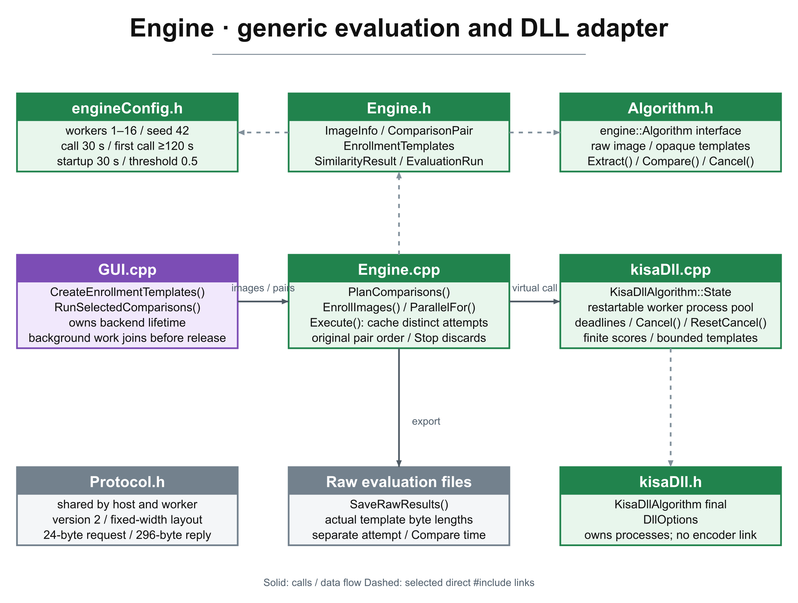

# Engine

비교 계획, 템플릿 캐시, 병렬 실행과 원시 결과 저장을 담당합니다. `Algorithm` 인터페이스로 원본 gray8과 불투명 템플릿 바이트를 주고받으며, GUI가 소유한 backend를 빌려 사용합니다.

- `PlanComparisons()`: 전체·첫 capture·capture 번호·난수·CSV 선택. 동일 픽셀 제외, seed 재현과 CSV 순서 보존.
- `EnrollImages()`·`Execute()`: 등록·비교 실행. 실행별 attempt 캐시와 원래 결과 순서를 유지하며 Stop 시 결과를 버립니다.
- `SaveRawResults()`: 실제 길이의 템플릿과 점수·오류·시간을 저장합니다. DLL 교체 시 이전 템플릿과 결과를 무효화합니다.

`kisaDll.h/.cpp`의 `KisaDllAlgorithm`이 [Windows worker](../Worker/readme.md)를 관리합니다. Compare 시간은 worker의 DLL 호출 구간이며, 유효한 응답이 없으면 경과 시간을 사용합니다. `model_scores.csv`의 attempt 시간은 캐시를 공유하는 행에 반복 기록됩니다.

[구조도 SVG 원본](../../docs/diagrams/engine.svg) · [GUI·지표](../GUI/readme.md)
