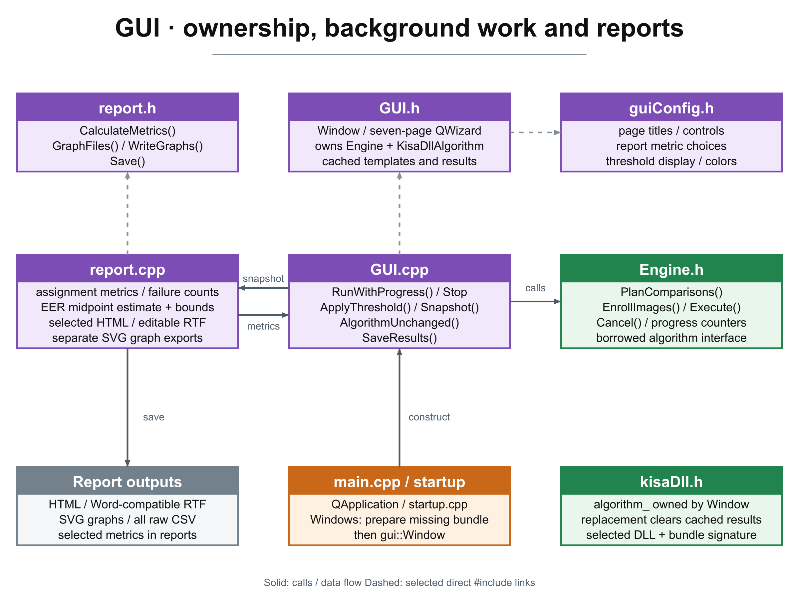

# GUI / Report

[Root](../../readme.md) · [Algorithm](../Algorithm/readme.md) · [Engine](../Engine/readme.md)

GUI는 DB와 등록 이미지를 선택하고 비교를 실행하는 화면이다. 추론과 원시 결과 저장은 Engine에 요청한다. 리포트는 화면 위젯 대신 `EvaluationRun`을 받아 지표·그래프·HTML을 만든다.



[구조도 SVG](../../docs/diagrams/gui.svg)

등록 이미지마다 선택한 모델의 30차원 템플릿을 생성하고, 비교 점수와 판정을 표시한다. 리포트는 같은 실행 기록에서 계산하므로 화면과 저장 결과에 같은 기준을 적용한다.

## Responsibility / Files

화면과 리포트의 자료형·함수·설정값은 `gui` namespace에 둔다. `Window`와 지표·리포트 함수가 같은 범위를 사용하므로 별도 Report namespace는 없다. 리포트에는 실행 기록과 선택 지표를 직접 전달하며 별도 포장 구조는 사용하지 않는다. Engine 결과는 `engine::EvaluationRun`처럼 모듈을 명시해 참조한다.

| 파일 | 역할 |
|---|---|
| [GUI.h](GUI.h) | `Window : QWizard`, 비교 설정과 화면 상태 선언 |
| [GUI.cpp](GUI.cpp) | 7단계 화면, 이미지·모델 선택, 비교 실행, 결과 갱신과 저장 |
| [guiConfig.h](guiConfig.h) | 안내 문구, 화면 크기, 지표 선택과 표시 정밀도 |
| [report.h](report.h), [report.cpp](report.cpp) | 지표 계산, SVG 생성, CSV·HTML 저장 |
| [main.cpp](../main.cpp) | Encoder와 Window를 생성하고 연결하는 진입점 |

이미지 정보는 `engine::ImageInfo`로 한 번만 저장하고 등록·비교·CSV·리포트에서 공유한다. 화면 위젯은 명시적 타입으로 선언하며 이벤트 연결에 필요한 짧은 람다를 사용한다. Qt Widgets를 사용하며 별도의 차트 라이브러리 없이 SVG를 생성한다. 페이지는 Window를 부모로 생성하고, 레이아웃에 넣은 위젯은 Qt의 부모·자식 소유권으로 해제한다. 멤버 위젯 포인터는 소유하지 않는 참조이며 nullptr로 초기화한다. Window 복사는 금지한다. Qt 이벤트 연결의 짧은 람다는 Window를 연결 문맥으로 사용하므로 Window가 소멸하면 연결도 해제된다. 이미지 읽기에는 Qt TIFF 플러그인이 필요하다. 사용하는 라이브러리와 라이선스는 [Root README](../../readme.md#3-libraries--headers)에 정리했다.

## Pages / Actual Flow

| 단계 | 동작 |
|---|---|
| 1. DB | 제공 DB 세 개 중 하나를 선택하거나 외부 TIFF 폴더를 연다. 이미지 수와 해상도를 표시한다. |
| 2. Enrollment | 한 장 또는 여러 장을 선택한다. 여러 이미지는 Ctrl/Shift로 선택하며, 이미지마다 별도 템플릿을 만든다. |
| 3. Templates | 학습된 모델 폴더와 사용할 모델을 선택하고 `Create enrollment templates`를 누른다. 제공 DB는 대응 개별 모델, 외부 DB는 네 모델이 기본 선택된다. |
| 4. Comparison type | 같은 손가락인 Genuine, 다른 손가락인 Impostor, 또는 Both를 고른다. |
| 5. Comparison rules | 비교 대상을 고르는 규칙을 설정한다. Both는 두 종류를 각각 설정한다. |
| 6. Run | 비교 개수를 확인하고 `Run selected comparisons`로 실행한다. |
| 7. Results | 점수와 판정 기준을 확인한다. `Metrics and report` 탭에서 지표를 선택한 뒤 `Save all`로 저장한다. |

학습된 네 `.bin`과 `calibration.json`을 같은 폴더에 둔다. 모델 파일명은 `fvc2000_db3.bin`, `fvc2002_db3.bin`, `fvc2004_db1.bin`, `combined.bin`이다. GUI는 시작할 때 모델 폴더를 비워 두며, **Select weights folder...**로 직접 학습한 출력 폴더를 선택한다. `models/run_01`은 학습 명령이 생성하는 출력 폴더의 예시다. Clone 직후에는 직접 학습하거나 별도로 받은 모델이 필요하며, `models/pretrained`는 GUI 비교용 폴더가 아니다. 구형 512차원 모델을 선택하면 재학습 안내를 표시한다.

GUI의 모델 선택은 호환되는 Cosine30 v2 Weight를 바꾸는 기능이다. 외부 알고리즘 DLL을 교체하는 기능은 현재 제공하지 않으며, 확장 방법은 [Engine 안내](../Engine/readme.md#dll-backend--extension)를 참고한다.

[한 장 등록](../../docs/GUI_flows/01_single_enrollment.png) · [여러 장 등록](../../docs/GUI_flows/02_multiple_enrollment.png) · [외부 DB](../../docs/GUI_flows/03_external_db.png) · [저장 리포트 예시](../../Report_example/report.html)

사용자 안내에는 템플릿의 역할, 점수의 의미와 조절 방법만 간단히 설명한다. HTML의 자세한 실행 설정은 `Run settings`를 펼쳐 볼 수 있다. 모델 형식과 평가 근거는 [Algorithm README](../Algorithm/readme.md)에 정리하고, 실제 모델 정보는 원시 결과에도 보존한다.

### 데모와 저장 리포트

[메인 데모 GIF](../../demo.gif)는 40 Epoch로 학습한 Cosine30 모델을 사용한 macOS GUI 녹화다. 녹화용 실행은 `models/run_check_20261119_011503`에서 네 모델의 학습·저장·재로딩 검증을 마쳤으며, 실제 이미지 기반 모델 비교 24건과 DB·모델 조합별 임계값 60개를 확인했다. 통합 모델의 마지막 Validation CE loss는 0.138468이었다. 이는 분류 손실이며 지문쌍의 오인식률이나 일치 확률이 아니다. 이후 Weight를 정리하고 학습·평가 기록은 `models/validation/runs/cosine30_seed42_40epoch`로 옮겼다.

다시 실행할 때는 새 출력 폴더에 학습하고 GUI에서 해당 폴더를 선택한다. 아래는 프로젝트 루트에서 사용하는 터미널 예시다. 학습이 끝나면 `validation_report.html`을 브라우저로 열어 평가 결과를 확인할 수 있다.

```sh
FINGERPRINT_RUN=models/run_01
./build/FingerprintTrain data/original models/pretrained/deepprint.bin "$FINGERPRINT_RUN"
./build/FingerprintGUI
```

빠른 기능 시연에는 FVC2000 DB3, 해당 개별 모델 하나, 등록 이미지 `101_1.tif`, Genuine 촬영 번호 `7,8`, Impostor의 손가락당 한 장을 권장한다. 총 11쌍이며 전체 성능 평가를 대신하지 않는다. 현재 GUI는 선택한 모델마다 점수 열을 하나씩 표시하며, 화면의 점수는 소수점 6자리다. GIF와 기존 캡처에는 변경 전 Best/Worst 열이 남아 있을 수 있다.

[저장 리포트 예시](../../Report_example/report.html)는 40 Epoch로 학습한 네 모델을 FVC2000 DB3에 적용한 현재 최솟값 방식의 GUI 실행 기록이다. `101_1.tif`, `102_1.tif`, `103_3.tif`, `103_8.tif` 네 장을 등록해 모델별 템플릿 16개를 만들고, 전체 후보 규칙으로 Genuine 28쌍과 Impostor 288쌍을 비교했다. 모든 모델의 점수를 저장하지만 최종 판정에는 FVC2000·통합 모델의 최솟값만 사용하며, 두 임계값은 모두 0.5133이다.

판정은 Genuine PASS 28·MISS 0, Impostor REJ 280·FA 8이다. FMR은 2.77778%, FNMR은 0%, EER은 0%다. EER은 공통 임계값을 순회해 계산하므로 현재 선택한 임계값에서의 FMR과 같을 필요는 없다. 추천 임계값은 별도의 촬영본 1–6 등록·7–8 비교 프로토콜에서 선정했으며, 이번처럼 등록 이미지와 비교 쌍을 바꾸면 같은 FAR을 보장하지 않는다. 전체 후보에는 학습 촬영본도 포함되므로 이 예시는 독립 Test나 전체 검증 성능을 대신하지 않는다.

`settings.txt`, `models.csv`, 원시 점수·시간·HTML·그래프는 실제 저장된 값을 보존한다. `.fpt` 16개는 각 등록 이미지·모델의 30차원 출력과 식별 정보를 담은 템플릿이며 학습 Weight가 아니다. 새 비교는 별도 실행 폴더에 저장해 각 실행의 입력·모델·임계값을 구분한다.

### 이미지와 비교 대상

DB 폴더 바로 아래의 `.tif`·`.tiff`를 읽고 하위 폴더는 재귀 탐색하지 않는다. 파일 수는 TIFF 전체를 기준으로 표시하되, 선택 목록에는 읽을 수 있는 이미지만 넣는다. 파일명이 `finger_capture` 형식이면 손가락과 촬영 번호를 읽는다. 다른 파일명도 등록할 수 있지만 자동 Genuine/Impostor 후보에서는 제외하며, 이때는 CSV로 비교 쌍과 종류를 지정한다.

GUI는 입력 DB 정보를 Engine에 전달한다. FVC2004는 중앙을 자른 뒤 299×299로 줄이고, 다른 DB는 여백을 채운다. 외부 폴더도 알려진 DB 이름이면 해당 규칙을 적용하며, 출처가 불명확하면 여백을 채운다. 등록과 비교에 같은 함수를 사용하므로 사용자가 별도로 자를 필요는 없다. 모델이나 전처리가 바뀌면 템플릿을 다시 만든다.

비교 규칙은 전체 후보, 손가락당 한 장, 지정 촬영 번호, 등록 이미지당 무작위 개수, CSV 순서 중에서 선택한다. 같은 이미지와 동일 픽셀의 복제본은 제외한다. 제공 DB에서 한 장을 등록했을 때 Impostor 전체 후보는 72쌍, 손가락당 한 장은 9쌍이다.

CSV는 `enrollment,attempt`와 선택적인 `type` 열을 받으며, 파일명은 현재 DB에 있어야 한다. 따옴표 이스케이프·BOM·CRLF를 지원하지만 한 레코드는 한 줄이어야 한다. 저장한 `comparisons.csv`도 다시 입력할 수 있다. 잘못된 쌍의 처리 기준은 [Engine 비교 규칙](../Engine/readme.md#comparison-rules)을 따른다.

템플릿을 만들기 전에는 다음 단계로 진행할 수 없다. 규칙이 잘못되었거나 비교 쌍이 없으면 실행을 막는다. DB·등록 이미지·모델·비교 종류·규칙을 바꾸면 이전 비교 결과를 초기화한다. 실행하지 않은 종류는 저장하지 않으며, 두 종류가 필요한 지표는 결과가 부족하면 N/A로 표시한다.

## Result Labels / Thresholds

점수는 높을수록 두 지문이 비슷하다는 뜻이며 동일 지문일 확률은 아니다. 현재 모델은 30차원 Softmax 출력의 코사인 유사도를 `(cos+1)/2`로 바꿔 [0.5, 1] 점수를 만든다. 정답은 원본 손가락 ID 또는 CSV 종류로 결정한다.

선택한 모델이 N개면 모델 ID를 제목으로 한 점수 열 N개를 표시한다. 각 열은 해당 모델로 같은 이미지쌍을 비교한 점수이며, 등록·비교에 실패한 모델은 `ERR`와 원인 툴팁을 표시한다. 모델 선택을 바꾸면 열과 비교 계획을 갱신하고 이전 결과를 초기화한다. 점수의 실제 정밀도는 툴팁과 CSV에서 확인할 수 있다.

입력 DB가 확인되면 해당 DB 모델과 통합 모델의 점수는 검정색으로, 다른 DB 모델의 점수는 회색으로 표시한다. 출처를 알 수 없는 외부 DB는 대응 모델을 정할 수 없으므로 모두 정상 표시한다. Genuine은 점수가 1에 가까울수록, Impostor는 0.5에 가까울수록 잘 구분한 결과다. 다른 DB 모델은 개별 점수를 확인하는 참고용이며 최종 Result 집계에는 참여하지 않는다.

각 모델의 점수 셀은 해당 비교 종류의 현재 임계값으로 개별 판정한 배경색을 사용한다. Genuine의 PASS는 초록색, MISS는 빨간색이고 Impostor의 REJ는 파란색, FA는 주황색이다. 추론 실패는 회색이며, 툴팁에 판정과 임계값을 함께 표시한다. 다른 DB 모델에도 같은 화면 임계값을 적용하고 회색 글씨는 유지한다. 번호·파일명·시간 셀에는 판정 배경색을 적용하지 않는다.

최종 `Result`는 선택한 같은 DB 모델과 통합 모델의 **성공한 점수 중 최솟값**을 사용한다. Genuine과 Impostor 모두 같은 점수를 계산한 뒤 각 화면의 임계값과 비교한다. Genuine은 최솟값이 기준 이상이면 PASS, Impostor는 기준 미만이면 REJ다. 한 모델만 선택했거나 한 모델만 성공했다면 그 점수를 사용한다. 다른 DB 모델은 참고용으로만 표시한다. 출처를 모르는 외부 DB는 통합 모델만 판정에 사용한다. 판정용 모델이 없거나 모두 실패하면 다른 모델의 점수가 있어도 Result는 ERR다.

`Result` 셀에는 최종 판정 색상을 적용하고, 툴팁에 최솟값과 해당 모델을 표시한다. `Time (ms)`는 참고용 모델까지 포함한 전체 비교 시간이다. `comparisons.csv`에는 최종 점수·모델·판정을, `model_scores.csv`에는 모든 모델의 개별 점수와 실패 원인을 저장한다. `settings.txt`에는 최솟값 집계와 참여 모델 범위를 기록한다.

점수 집계가 정답 종류와 무관하게 같으므로 EER·EER*·ZeroFMR·ZeroFNMR·FMR100·FMR1000과 점수 분포·임계값 그래프를 사용할 수 있다. EER과 공통 임계값 그래프는 화면의 두 기준과 별도로 동일한 임계값을 순회한다. 두 화면의 임계값을 다르게 설정했다면 FMR·FNMR을 하나의 운영점 성능으로 합치지 않는다.

| 종류 | 조건 | 표시 |
|---|---|---|
| Genuine | 점수 ≥ Genuine 기준 | PASS |
| Genuine | 점수 < Genuine 기준 | MISS: 본인 지문 오거절 |
| Impostor | 점수 < Impostor 기준 | REJ: 타인 지문 거절 |
| Impostor | 점수 ≥ Impostor 기준 | FA: 타인 지문 오수락 |
| 공통 | 추론 실패 | ERR |

모델을 불러오면 `calibration.json`의 집계 방식·형식·실제 Weight 해시·ID 순서·FAR 정책·정밀도를 검사한다. 현재 형식은 `fingerprint-calibration-v3`이며 최솟값 집계를 사용한다. 화면에서 다른 DB 모델도 선택했더라도, 추천값은 실제 판정에 참여하는 같은 DB·통합 모델의 조합으로 찾는다.

40 Epoch·Seed 42의 현재 검증에서 같은 DB+통합 모델을 모두 선택한 추천값은 FVC2000 0.5133, FVC2002 0.5940, FVC2004 0.6119였다. 다른 실행에서는 해당 Weight에 대해 생성된 보정값을 사용한다. 두 기준은 같은 추천값으로 시작하고 이후 독립적으로 조절할 수 있다. 기준 변경은 재추론 없이 셀 색상·판정·지표를 갱신한다.

이전 최댓값용 v2 보정 파일은 자동으로 혼용하지 않는다. 일치하는 최솟값 보정이 없으면 수동 설정 안내와 초기값 0.5954를 표시하며, 이 값은 FAR 목표가 검증된 추천값이 아니다. 기존 Weight를 유지하려면 [검증 명령](../Algorithm/readme.md#verification--limits)의 `--verify-only`로 보정 파일을 다시 생성한다. 외부 DB는 통합 모델에 대해 알려진 세 DB에서 얻은 보수적인 임계값을 사용하며, 외부 성능을 검증한 값은 아니다.

## Metrics / Report

화면과 HTML에는 계산 가능한 선택 지표를, CSV에는 전체 17개 지표와 계산 불가 사유를 저장한다. 판정 기준을 바꾸면 FMR·FNMR 등을 다시 계산한다. 공통 점수 집계일 때 EER과 고정 오류율 지표는 현재 입력한 기준과 별개다. 점수를 한 번 정렬하고 중복 임계값을 제거한 뒤, 이진 탐색으로 각 기준의 오류 수를 구해 반복 계산을 줄인다. 그래프도 같은 점수 집계와 오류율 함수를 재사용하며, 비정상 점수를 만났을 때의 기존 표시 규칙을 유지한다.

현재 선택과 실행 결과로 계산할 수 없는 지표는 체크박스를 흐리게 표시하고 선택을 막으며, 마우스를 올리면 필요한 조건을 안내한다. FMR에는 Impostor 결과, FNMR에는 Genuine 결과, EER 등 두 분포를 비교하는 지표에는 양쪽 결과가 필요하다. 최솟값 집계를 사용한다는 이유로 지표를 비활성화하지 않는다. 실제 값이 0인 지표는 정상적으로 선택할 수 있다. 비활성 지표는 화면 표와 HTML에서 제외하고, 이전 체크 상태는 보존해 다시 계산할 수 있게 되면 복원한다. CSV에는 계산 불가 사유를 포함한 전체 지표를 계속 남긴다.

| 지표 | 계산 기준 |
|---|---|
| FTE | 등록 실행이 모두 끝났을 때 실패 이미지 수 / 실행 이미지 수. 모델 하나 이상이 성공하면 해당 이미지는 성공이다. |
| REJ genuine / impostor | 해당 종류의 비교가 모두 끝났을 때 실패 비교 수 / 계획한 쌍 수 |
| FMR | Impostor 오수락 수 / 계획한 Impostor 쌍 수. 추론 실패는 오수락으로 세지 않는다. |
| FNMR | Genuine 오거절과 추론 실패 수 / 계획한 Genuine 쌍 수 |
| EER / EER* | 관측 점수와 최고 점수 바로 위의 기준을 순회한다. 일치하면 단일 값, 교차하면 범위를 표시한다. EER*는 성공한 쌍만 분모로 사용한다. |
| ZeroFMR / ZeroFNMR | FMR=0일 때 최소 FNMR / FNMR=0일 때 최소 FMR. 불가능하면 N/A다. |
| FMR100 / FMR1000 | FMR ≤ 0.01 / 0.001일 때 최소 FNMR. 표시는 %다. |
| 처리 시간 | 실행한 등록·비교의 평균 ms. 실패한 실행도 포함하며, 비교 시간에는 비교 이미지의 인코딩이 포함된다. |
| 템플릿 크기 | 성공한 템플릿의 실제 평균·최대 bytes. 120bytes의 확률 값과 식별 정보를 모두 포함한다. |

비교 계획이 없거나 아직 실행 중인 경우, 필요한 종류가 부족한 경우와 EER 교차가 없는 경우를 구분해 N/A로 표시한다. 이미지 읽기와 모델 로딩 시간은 위 처리 시간에 포함하지 않는다.

정확도 지표를 고르면 점수 분포와 임계값 곡선을 만든다. EER 계열 또는 FMR·FNMR을 함께 선택하면 오류율 상관 그래프도 만든다. 시간 지표만 선택하거나 아무 지표도 고르지 않으면 그래프를 저장하지 않는다. 공통 점수 집계에서 생성하는 그래프는 관측 범위를 확장한 41개 임계값을 사용하며, 지표 계산의 관측값 순회와는 다르다. 두 축은 선형 %이며 정규편차 DET 그래프는 아니다.

`Save all`은 Metrics 탭에서 활성화된다. 새 `run_N` 폴더에 원시 결과를 저장한 뒤 지표·HTML·SVG를 저장하며, 실패하면 이번에 만든 폴더만 지운다. 상세 실행 설정은 HTML에서 펼쳐 볼 수 있고 `settings.txt`에도 남긴다.

## Functions / Inputs / Outputs

| 함수 | 역할 |
|---|---|
| `*Page`, `ComparisonPanel` | 화면과 이벤트 연결 생성 |
| `LoadDatabase`, `ReloadModels`, `CreateEnrollmentTemplates` | 입력과 모델 로딩, 템플릿 생성 |
| `UpdateWorkflow`, `UpdateComparisons`, `UpdateEnrollment` | 진행 가능 여부와 비교 계획 갱신 |
| `ReadPairCsv`, `RunSelectedComparisons`, `RunComparisons` | CSV 읽기와 선택한 비교 실행 |
| `ApplyThreshold`, `UpdateMetrics` | 저장된 점수로 판정과 지표 갱신 |
| `SelectedMetrics`, `Snapshot`, `SaveResults` | 선택 지표와 실행 기록을 모아 저장 |
| `CalculateMetrics`, `GraphFiles`, `GraphTitle`, `WriteGraphs`, `Save` | Report의 지표·그래프·파일 생성 |

`SetAlgorithm`으로 연결한 알고리즘 객체는 호출자가 소유하며 Window보다 오래 유지해야 한다. Window는 Backend를 삭제하지 않는다. `validateCurrentPage`는 필수 선택을 검사하고, `eventFilter`와 `resizeEvent`는 안내와 단계 표시를 처리한다. `done`은 종료 확인을 처리한다.

## Hyperparameters / Display Defaults

설정은 [guiConfig.h](guiConfig.h)에, 비교 기준은 [engineConfig.h](../Engine/engineConfig.h)에 둔다. 일부 상태·오류 문구와 배치/CSS/SVG 좌표는 `.cpp`에도 있다.

| 설정 | 기본값 |
|---|---|
| Window / Preview | 900×720 / 340×340px |
| MetricColumns / DefaultMetrics | 3열 / FTE·EER·Matching time |
| ThresholdMinimum/Maximum / Step / Precision | 0~1 / 0.01 / 소수점 4자리 |
| Score / Time / Metric 정밀도 | 소수점 6자리 / 3자리 / 유효숫자 6자리 |
| GraphWidth/Height / HistogramBins | 840×320px / 10개 |
| CurveSteps / CurvePadding | 40 / 0.05 |

## Status / Evidence

운영 전환과 파일 통합 후 `QT_QPA_PLATFORM=offscreen`에서 실제 Window와 위젯으로 제공 DB 7개 흐름·140쌍과 외부 파일명 ID 1개 흐름·2쌍을 확인했다. 등록, 비교, 독립 기준 변경, `.fpt`·CSV·HTML 저장이 정상 동작했다. 검증 전용 `tests/`와 별도 CMake 대상은 이후 정리했으며, 이 검증 기록은 `models/validation/runs/cosine30_seed42_20epoch` 아래에 보존한다. 이후 코드 정리·폴더 이동 검증은 `models/validation`에, 화면 예시는 `docs/GUI_flows`에 보관한다. 외부 검사는 기능 확인이며 미학습 손가락의 정확도 측정이 아니다. 학습에 포함된 검증과 재평가 명령은 [Algorithm README](../Algorithm/readme.md#verification--limits)에 정리했다.

당시 검증은 Qt offscreen으로 수행했으며, 실제 데스크톱 창 조작은 확인하지 못했다. 추론은 GUI 스레드에서 순차 실행하며, 실행 중 강제 취소와 오류 격리는 미구현이다. 진행 표시는 단계 번호이며 이미지쌍별 실시간 진행률이 아니다. Word/PDF 리포트, 정규편차 DET, 지표 수식 선택, KISA DLL은 미구현이고 Windows 배포도 미검증이다.

[GUI 화면 예시](../../docs/GUI_flows/00_overview.png)와 [캡처 기록 안내](../../docs/GUI_flows/captures/readme.md)를 참고한다. [Report_example](../../Report_example/report.html)은 40 Epoch 모델·현재 최솟값 집계의 Genuine/Impostor 실행 기록으로 보존한다.
