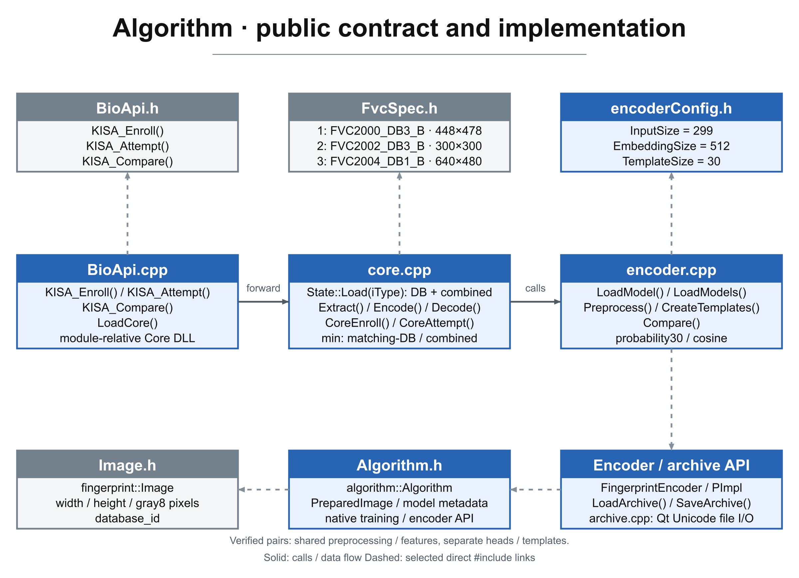

# Algorithm DLL 구성

- `FingerprintAlgorithm.dll` (`BioApi.cpp`): 공개 KISA 세 함수를 export하고 Core로 전달하는 static-CRT wrapper입니다.
- `FingerprintAlgorithmCore.dll` (`core.cpp`): 전처리·inference·Template 인코딩·점수 집계를 수행합니다. DLL 위치에서 모델을 lazy loading하고 Process 안에서 재사용합니다.

Core는 성공한 모델별 Template을 묶어 반환하고, 비교 시 matching-DB·combined 모델의 성공 점수 중 최솟값을 사용합니다. Template에는 가중치·label·전처리 metadata가 포함됩니다.

오류 코드 1–7은 각각 null 인자, iType, 모델 로딩, 추출, 템플릿, 비교, Core 로딩 오류입니다. 공개 ABI와 버퍼 규칙은 [Public](../Public/readme.md), 배포 파일은 [패키징 안내](../../docs/build.md#package)에 정리했습니다.

[구조도 SVG 원본](../../docs/diagrams/algorithm.svg) · [검증 결과](../../docs/verification.md)
