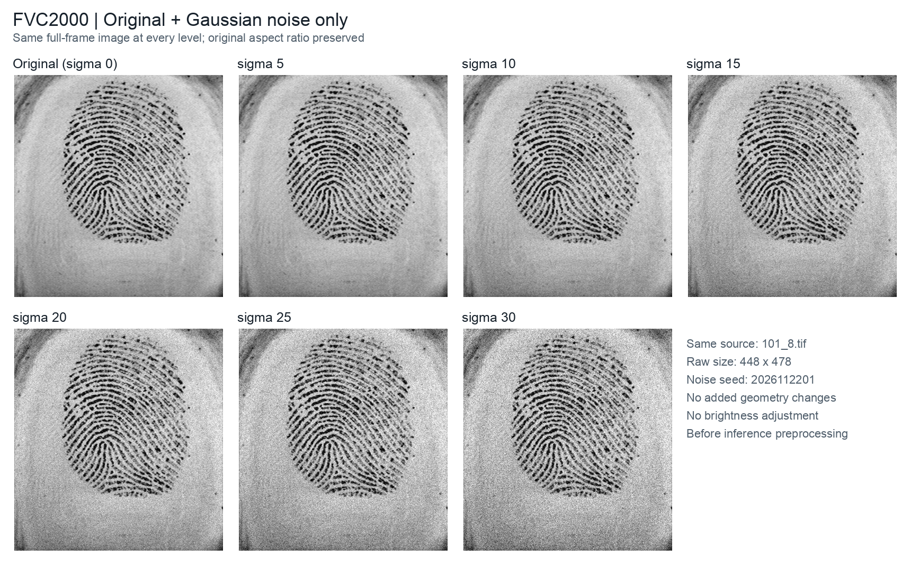
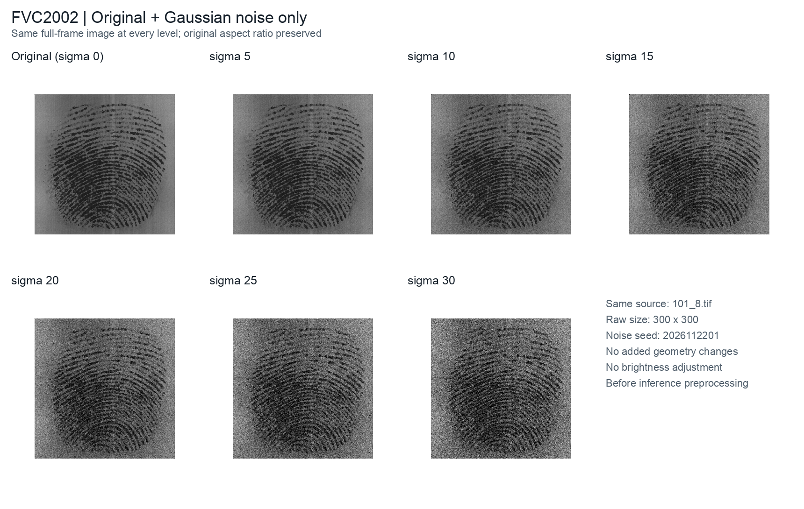
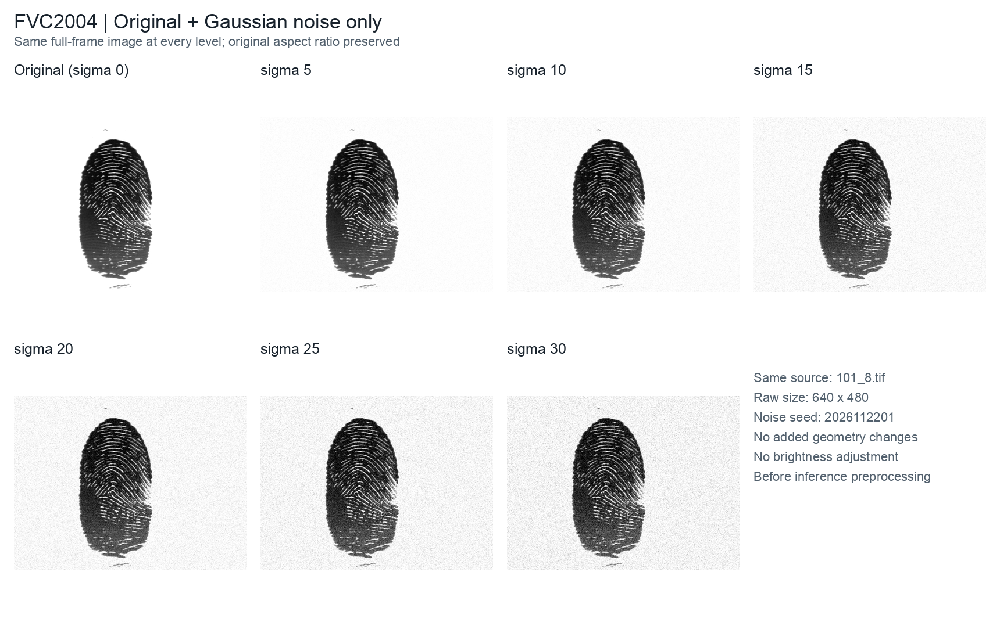
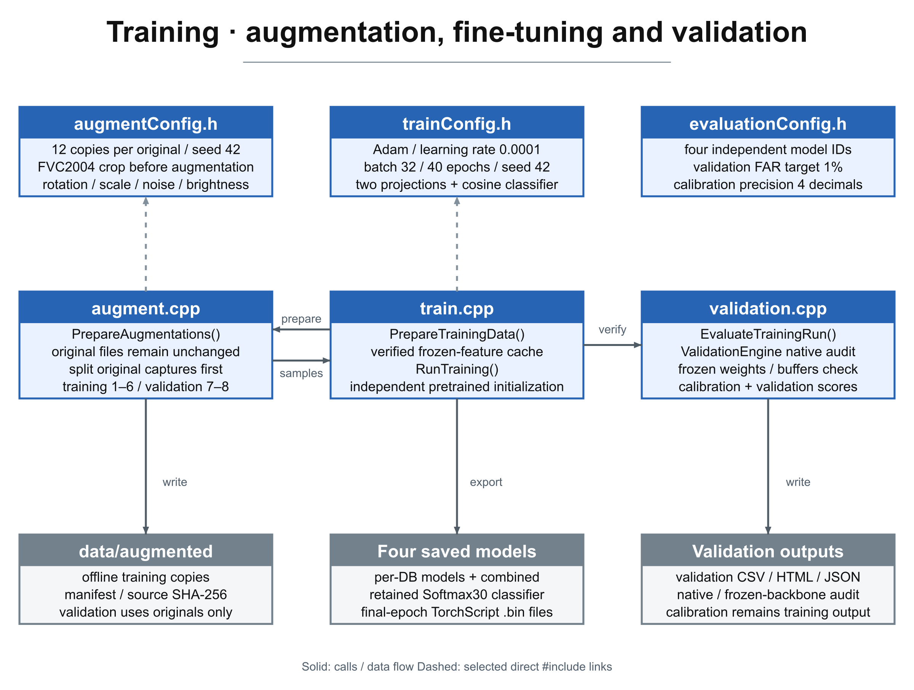

# Training 모듈

모델 입출력은 Algorithm의 `LoadArchive()`·`SaveArchive()`를 공유하며 Windows 한글·공백 경로를 처리합니다. 학습 계산·seed·epoch·optimizer·전처리 설정은 유지합니다.

현재 Gaussian noise는 **적용 확률 70%·σ=[1,80]**, 원본당 증강은 12개입니다. 회전·배율·밝기·crop과 학습 설정은 각 Config 파일에서 관리합니다.

- `augment.cpp`: 원본에서 `data/augmented`를 생성합니다.
- `train.cpp`: 검증된 feature cache로 두 projection과 cosine classifier를 학습합니다.
- `validation.cpp`·`ValidationEngine`: 저장 모델, 고정 parameter·buffer, native 점수와 calibration을 검증합니다.

배포 모델은 Git LFS로 받아 재사용합니다. 설치 스크립트는 모델이 없을 때만 자동 학습합니다. 직접 재학습할 때는 새 출력 폴더를 사용합니다.

```powershell
.\build\Release\FingerprintTrain.exe data\original models\pretrained\deepprint.bin models\trained_result_new
```

기존 배포 모델만 검증하려면 다음 명령을 사용합니다.

```powershell
.\build\Release\FingerprintTrain.exe data\original models\pretrained\deepprint.bin models\trained_result --verify-only
```

기존 가중치는 덮어쓰지 않으므로 학습에는 새 출력 폴더를 사용합니다. `--augment-only`는 증강만 실행하며, cache 재사용에는 원본·전처리·가중치의 일치가 필요합니다.

## Gaussian noise 예시

각 DB의 원본 `101_8.tif`에 Gaussian noise만 추가한 예시입니다. 회전·밝기 조절·이동 등 추가 증강 없이, 전처리 전 전체 이미지와 원본 비율을 유지했습니다. σ는 0~255 밝기 값 기준의 noise 표준편차이며, 값이 클수록 잡음이 강해집니다.

각 그림의 **윗줄은 원본(σ0)·σ5·σ10·σ15**, **아랫줄은 σ20·σ25·σ30**입니다. 같은 noise 패턴의 세기만 바꿨으며, 평가에 사용한 seed `2026112201`의 이미지와 동일합니다.

[개별 PNG 21장 묶음 다운로드](../../docs/images/noise_examples/noise_examples_21_png.zip)

**FVC2000 DB3**



**FVC2002 DB3**



**FVC2004 DB1**



## 학습 구조



<details>
<summary>DeepPrint 전처리·고정 Backbone·부분 학습 구조</summary>


[부분 학습 그림 SVG 원본](../../docs/diagrams/deepprint_finetuning.svg)

</details>

[구조도 SVG 원본](../../docs/diagrams/training.svg) · [학습 설정](../../docs/baseline/training_configuration.md) · [모델 파일](../../models/readme.md)

학습 후 검증의 `probability30` 점수도 raw cosine `[0, 1]`을 사용합니다. `same_encoder512`·`previous_saved512`는 음수가 가능한 512차원 embedding의 진단용 비교이므로 기존 `(cosine + 1) / 2` 표시를 유지합니다. 이 변경은 학습 loss·optimizer·가중치에 영향을 주지 않습니다.
