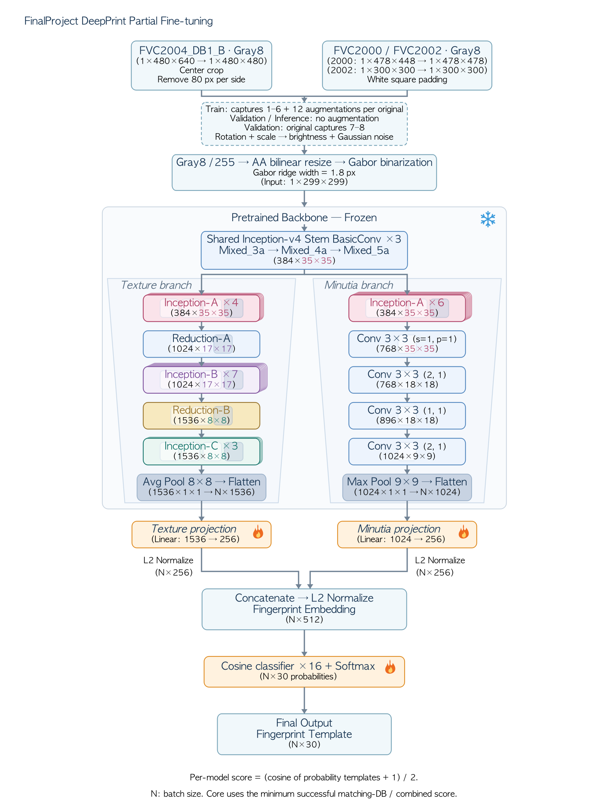

# Training

- `augment.cpp`: 원본에서 `data/augmented`를 생성합니다.
- `train.cpp`: 검증된 feature cache로 두 projection과 cosine classifier를 학습합니다.
- `validation.cpp`·`ValidationEngine`: 저장 모델, 고정 파라미터·버퍼, native 점수와 calibration을 검증합니다.

배포 모델은 Git LFS로 받아 재사용합니다. 설치 스크립트는 모델이 없을 때만 자동 학습합니다. 직접 재학습할 때는 새 출력 폴더를 사용합니다.

```powershell
.\build\Release\FingerprintTrain.exe data\original models\pretrained\deepprint.bin models\trained_result_new
```

기존 배포 모델만 검증하려면 다음 명령을 사용합니다.

```powershell
.\build\Release\FingerprintTrain.exe data\original models\pretrained\deepprint.bin models\trained_result --verify-only
```

기존 가중치는 덮어쓰지 않으므로 학습에는 새 출력 폴더를 사용합니다. `--augment-only`는 증강만 실행하며, cache 재사용에는 원본·전처리·가중치의 일치가 필요합니다. Python 변환 도구 `tools/prepare_deepprint.py`는 upstream 체크포인트를 처음 준비할 때 사용합니다.


<details>
<summary>DeepPrint 전처리·고정 Backbone·부분 학습 구조</summary>



[부분 학습 그림 SVG 원본](../../docs/diagrams/deepprint_finetuning.svg)

</details>

[구조도 SVG 원본](../../docs/diagrams/training.svg) · [학습 설정](../../docs/baseline/training_configuration.md) · [모델 파일](../../models/readme.md)
