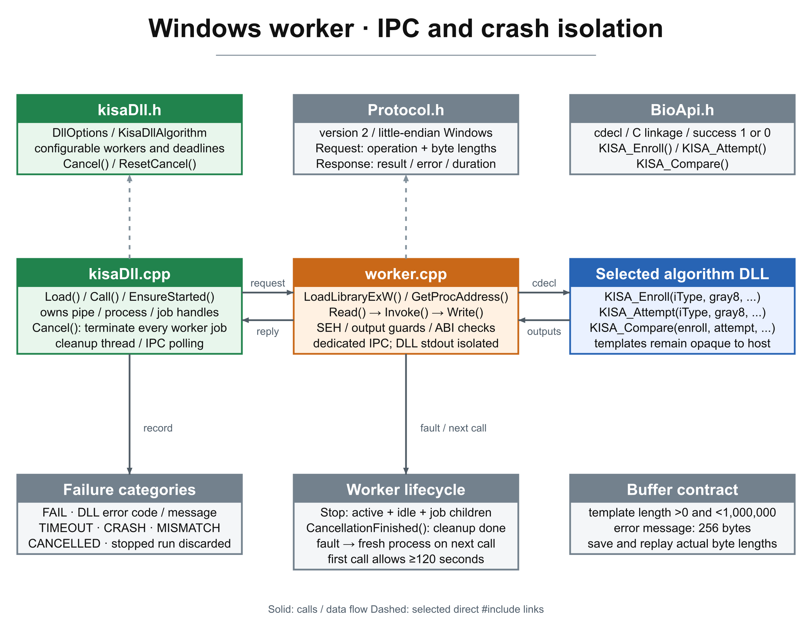

# Windows Worker

`FingerprintWorker.exe`가 선택 DLL을 로드하고 KISA 함수를 호출합니다. `Protocol.h`는 원본 픽셀·실제 길이의 템플릿과 응답을 전달하는 IPC 규약입니다. 전용 handle로 DLL의 표준 출력을 분리합니다.

GUI의 **Load selected DLL with these settings**에서 설정한 수의 Worker를 시작합니다. 각 Worker가 DLL·KISA exports를 확인한 handshake를 반환한 뒤 `Loaded`로 등록합니다. 파일명은 제한하지 않으며, DLL 내부 모델은 첫 inference에서 초기화될 수 있습니다. 한 Worker의 Load가 실패하면 이미 시작한 Worker도 모두 종료합니다.

Host는 pipe·Process·job handle을 소유합니다. 비동기 쓰기·읽기 polling으로 timeout과 Stop을 처리하고, SEH·buffer guard·반환값 검사를 수행합니다. 비정상 Worker는 종료하고 다음 호출에서 새로 시작합니다.

성공한 Compare 점수는 유한한 `0~1` 값이며 소수 셋째 자리 규칙을 만족해야 합니다. `0.1234`처럼 자릿수가 초과된 값은 `MISMATCH`로 처리합니다. float32·double 표현 오차는 점수 기준 `1e-7`까지 허용하며, Evaluator가 외부 DLL 점수를 반올림하거나 보정하지는 않습니다. 규칙은 `Public/Score.h`에 정의되어 있습니다.

Stop은 실행 중·대기 중인 모든 Worker와 각 Windows job에 속한 자식 프로세스를 종료합니다. 별도 cleanup thread가 진행 중인 호출의 반환, job 내 프로세스 종료, pipe·Process·job handle 해제를 기다립니다. `CancellationFinished()`가 완료를 알리며, `ResetCancel()`도 정리가 끝난 뒤에만 새 실행을 허용합니다. 다른 프로그램의 프로세스는 종료 대상에 포함하지 않습니다.

기본값은 worker 1개(최대 16개), 호출 30초, 새 worker의 첫 호출 최소 120초, 시작 30초입니다. 실패는 `FAIL`(DLL 코드·메시지), `TIMEOUT`, `CRASH`, `MISMATCH`, `CANCELLED`로 구분합니다.

[구조도 SVG 원본](../../docs/diagrams/worker.svg) · [검증 상태](../../docs/verification.md)
