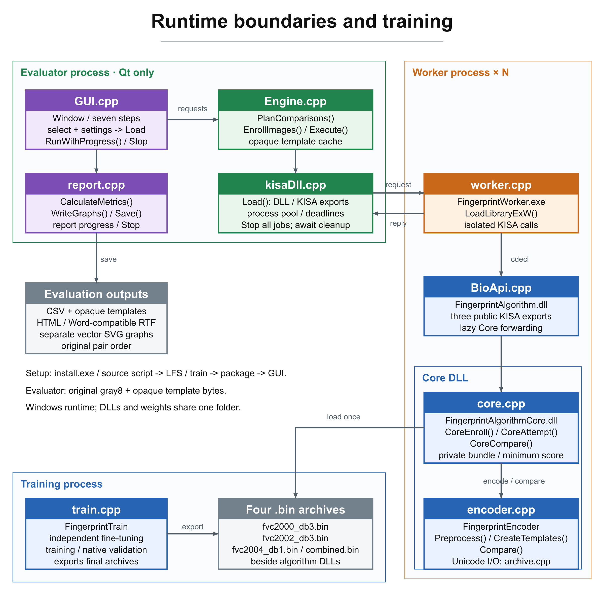

# 소스 구성

Windows·MSVC 전용 소스입니다. `main.cpp`는 GUI 실행 진입점이며 나머지 코드는 역할별 모듈로 나뉩니다.

| 파일·폴더 | 역할 |
|---|---|
| [main.cpp](main.cpp) | Windows 배포 준비 확인 후 Qt GUI 창 생성 |
| [Public](Public/readme.md) | 공개 KISA 함수 선언, FVC 매핑, gray8 이미지 자료형 |
| [Algorithm](Algorithm/readme.md) | 모델 로딩·전처리·템플릿 생성·유사도 계산 |
| [Training](Training/readme.md) | 데이터 증강·모델 4개 학습·학습 결과 검증 |
| [Kisa](Kisa/readme.md) | 공개 DLL wrapper와 알고리즘 Core DLL |
| [Engine](Engine/readme.md) | 비교 계획·템플릿 캐시·병렬 평가·원시 결과 저장 |
| [Worker](Worker/readme.md) | 별도 Windows 프로세스에서 DLL 호출·오류 격리 |
| [GUI](GUI/readme.md) | 7단계 평가 화면·결과 표시·지표·보고서 |

Windows에서는 `GUI/startup.cpp`가 배포 파일을 확인하고, 필요하면 설치 스크립트로 다운로드·학습·패키징한 뒤 GUI를 다시 실행합니다. 평가 흐름은 `main.cpp → GUI → Engine → Worker → 선택한 DLL`입니다. 이 프로젝트의 DLL은 `Kisa → Algorithm`을 호출합니다. 학습은 `FingerprintTrain → Training → Algorithm` 흐름으로 실행됩니다.

외부 DLL 교체는 GUI Step 3에서 경로를 선택합니다. 이 프로젝트의 DLL을 배포할 때는 패키징으로 생성한 `dist/FingerprintAlgorithm/`을 사용합니다.

[설치·학습·실행·배포](../readme.md) · [전체 구조도](../docs/diagrams/overview.svg)

[Installer](Installer/readme.md)는 Qt·LibTorch 없이 시작하는 Windows `install.exe`를 빌드하며, 기존 설치 스크립트와 패키징을 연결합니다.
